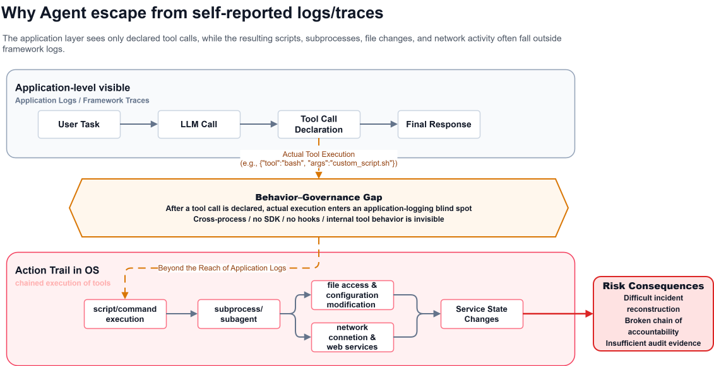
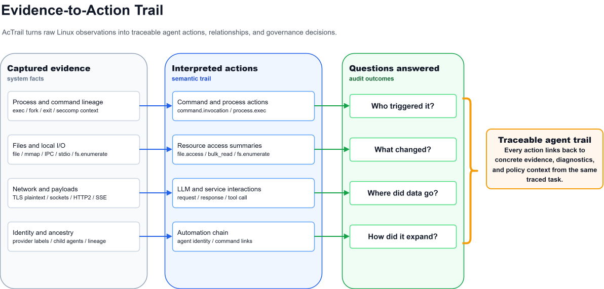
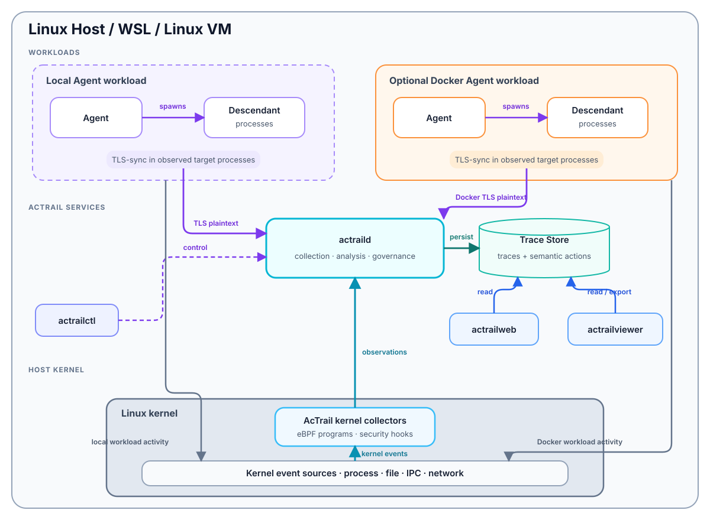
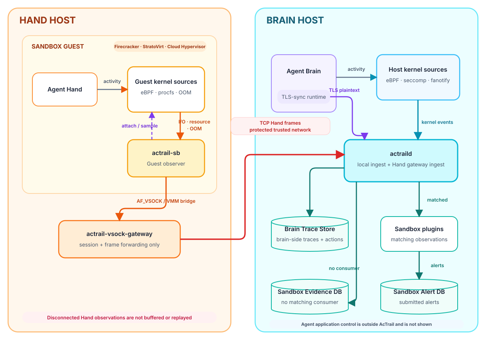

<div align="center">

# AcTrail: Agent Credible Trail

A general-purpose foundation for AI agent governance, scheduling, and management control

[](#4-installation)
[](LICENSE)
[](https://www.rust-lang.org/)
[](https://gitcode.com/openEuler/AcTrail/tree/dev)
[](https://gitcode.com/openEuler/AcTrail/tree/dev)

[English](README.md) | [中文](README.zh-CN.md)

</div>

---

## 1 Highlights

| Highlight | Benefit |
| --- | --- |
| **Independent observation** | Reliable visibility into commands, files, and network activity beyond agent logs |
| **Detailed model insights** | Prompts, responses, reasoning, tool calls, and token usage in one trace |
| **Traceable actions** | Faster investigation from actions to their supporting evidence |
| **Active governance** | Enforceable file and command policies with traceable decisions |
| **Controlled execution** | Managed agent launch and live process tracking |
| **Flexible customization** | Policy and analysis plugins loaded or unloaded at runtime |
| **Visual investigation** | Easier diagnosis through Web UI, CLI, and trace exports |
| **Supported agents** | xiaoO, Pi, Claude Code, Codex CLI, OpenCode, Grok, deepagents-code, Qoder CLI, zcode, and openclaw |

## 2 Why you will need AcTrail

An agent can report success while changing the wrong file or running an unexpected command. AcTrail gives you independent evidence to diagnose mistakes and enforce policies during execution.

<p align="center">
  
  
</p>

## 3 Prerequisites

Checked = required, unchecked = optional

### 3.1 Host

- [x] Linux / WSL (x86_64 / ARM64)
- [x] Root or equivalent kernel capabilities
- [x] Kernel BTF, writable tracefs, perf tracepoints, uprobes

### 3.2 Components

- [x] `actraild`: collection and storage
- [x] `actrailctl`: configuration and trace control
- [ ] `actrailweb`: Web UI (used in Quick Run)
- [ ] `actrailviewer`: CLI queries and exports
- [ ] Policy and analysis plugins
- [ ] `actrail-sb`, `actrail-vsock-gateway`: isolated execution

[Platform and build requirements](docs/reference/platform-support.md)

## 4 Installation

### 4.1 For an AI Agent

Agent prompt (repository root):

```text
Read README.md and scripts/install-release.sh. Install the build dependencies
with scripts/install-build-deps.sh --install, then run
scripts/install-release.sh /usr/local/bin. Verify actraild, actrailctl,
actrailviewer, and actrailweb are on PATH.
```

### 4.2 From Source

From the repository root:

```bash
./scripts/install-build-deps.sh --install  # Install build dependencies (dnf / apt-get)
./scripts/install-release.sh /usr/local/bin  # Build and install release artifacts
```

### 4.3 From Prebuilt RPM

<details>
<summary>📥 Official build packages</summary>

| package | version | openEuler version |
| --- | --- | --- |
| [AcTrail (Releases)](https://gitcode.com/openeuler/AcTrail/releases) | Latest | — |
| [AcTrail (EulerMaker)](https://eulermaker.openeuler.openatom.cn/package/download?osProject=openEuler-26.09-DevStation:epol&packageName=AcTrail) | 0.7.2-2.oe2609 | 26.09-DevStation |

</details>

Download the package for your architecture, then install:

```bash
sudo rpm -Uvh ./AcTrail-*.rpm  # Install the downloaded package
```

## 5 Quick Run

### 5.1 Initialize

Generate the complete collection configuration

```bash
sudo actrailctl init --mode complete
```

### 5.2 Start the Daemon

```bash
sudo actraild start
```

### 5.3 Launch an Agent

Example: [xiaoO](https://atomgit.com/openEuler/xiaoO) (installed and configured)

For other [supported agents](#1-highlights), replace `xiaoo` below with the agent's launch command.

```bash
sudo --preserve-env=HOME,PATH actrailctl launch -- xiaoo
```

### 5.4 Run a Task

In the agent session:

```text
Read /etc/os-release and summarize the operating system in three points. Do not modify any files.
```

After the summary, exit the agent session.

### 5.5 Start the Web UI

```bash
sudo actrailweb
```

Use `--addr` and `--port` to change the listening address and port.

Open [Web UI](http://127.0.0.1:18080) to inspect:

- Agent process tree
- `/etc/os-release` file activity
- Model request and summary response

<!-- TODO: Add a Web UI screenshot of the agent trace and linked evidence. -->

### 5.6 Stop

Press `Ctrl-C` to stop the Web UI, then stop the daemon:

```bash
sudo actraild stop
```

[CLI and troubleshooting](docs/getting-started/quickstart.md)

## 6 Deployment View

| Local execution | Remote isolated execution |
| --- | --- |
| Local development and host, VM, or container workloads | Remote workloads requiring an isolated sandbox |
|  |  |

[Deployment guide](docs/operations/deployment/choose-a-mode.md)

## 7 Documentation

| Topic | Links |
| --- | --- |
| Capabilities | [Overview](docs/concepts/capabilities.md), [Coverage](docs/concepts/collection-observation-checklist.md) |
| Configuration | [Collection](docs/reference/configuration/collection.md) |
| Operations | [Guide](docs/operations/README.md) |
| Development | [Architecture](docs/architecture/README.md) |

[All documentation](docs/README.md)

## 8 Contributing

- [Issues](https://gitcode.com/openeuler/AcTrail/issues): bug reproduction steps or feature use cases
- [Pull requests](https://gitcode.com/openeuler/AcTrail/pulls): focused changes, validation results
- Validation: `cargo fmt`, release build, [real-agent end-to-end tests](tests/README.md)

## 9 License

[Mulan Permissive Software License, Version 2](LICENSE)
