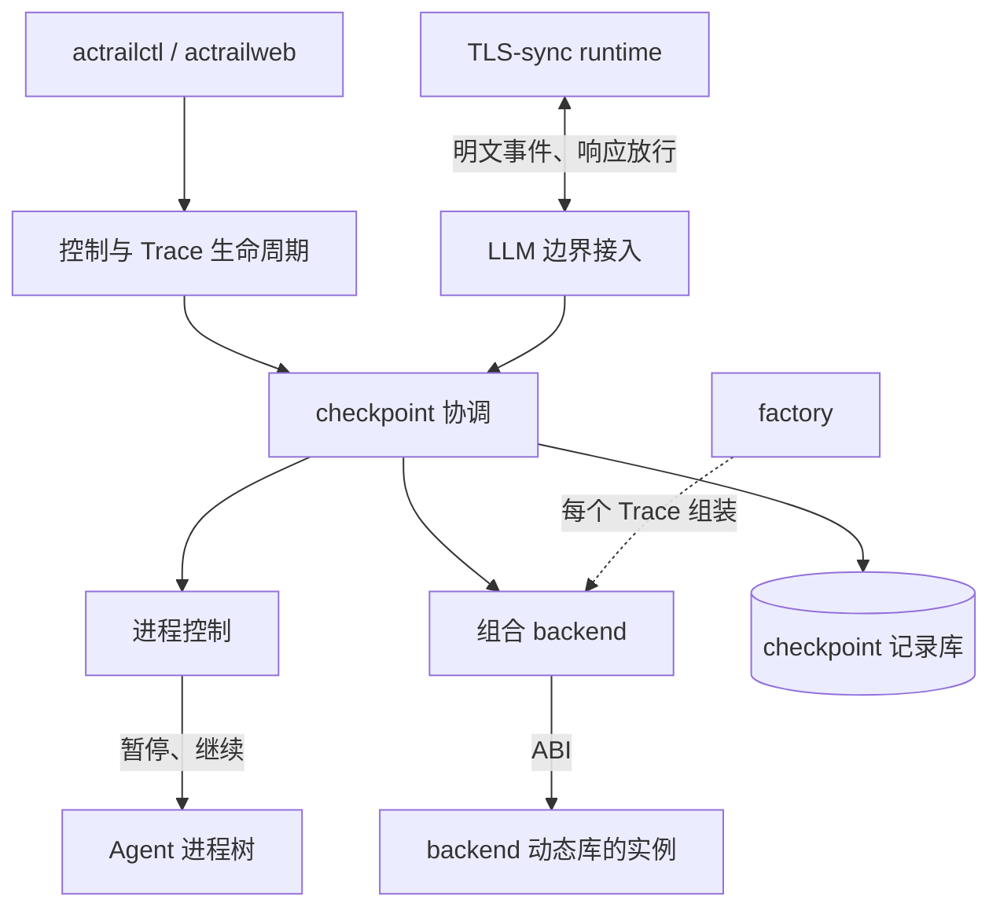
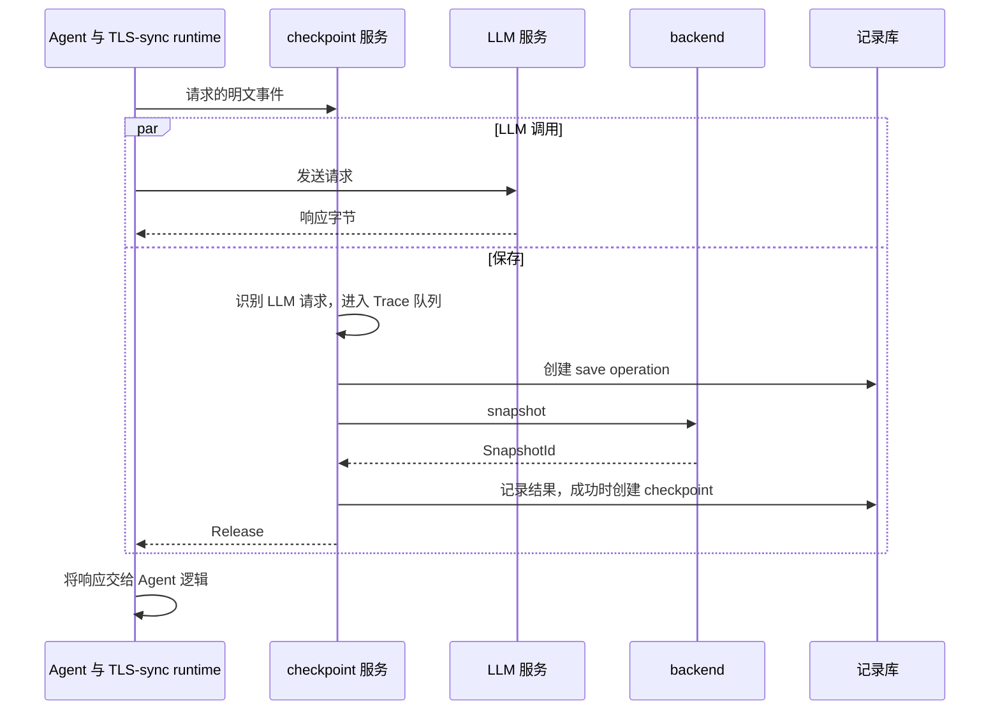
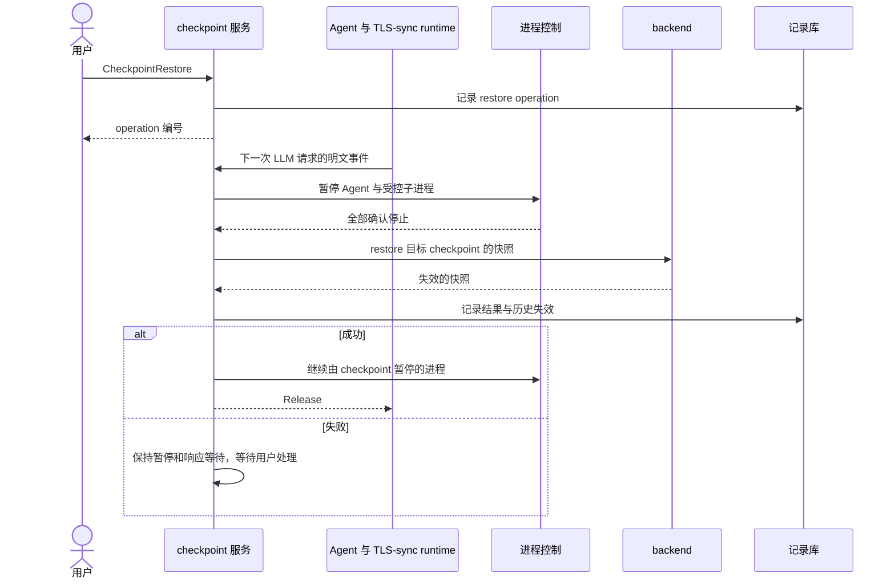

# Checkpoint

checkpoint 服务为运行中的 Trace 保存和恢复受保护目录的文件状态。daemon 负责保存时机、LLM 响应等待、进程暂停、按 Trace 调度和历史记录；checkpoint backend 动态库负责实际的文件保存与恢复，并管理由此产生的快照或日志。快照只活到 Trace 结束。文件恢复不回退 Agent 的对话和进程内存。

## 对象与术语

| 对象 | 含义与用途 |
| --- | --- |
| 保护范围（scope） | 一个受保护目录、其排除路径和负责它的 backend。一个 Trace 可以配置多个 scope |
| backend | 按一份配置加载的动态库，例如使用指定快照目录的 Btrfs backend；scope 用 `backend_instance` 指向它的名字 |
| backend 实例 | 一个 backend 的一个对象，由 `connect` 绑定到一个 Trace，直到 `disconnect`。每个 Trace 有自己的实例 |
| 组合 backend | 一个 Trace 的全部 backend 实例组成的一个 backend，协调组件只调用它 |
| 快照（snapshot） | backend 为一次完整保存返回的 `SnapshotId`，例如 Btrfs 只读快照或 AgentNS 日志位置。AcTrail 只保存这个 ID，它只在这次连接内有意义 |
| checkpoint（恢复点） | 一次保存成功后得到的记录，引用组合 backend 的快照 |
| operation | 一次实际执行的保存（save）或恢复（restore），记录进展、结果和对 Agent 进程的影响 |

## 组件与状态



| 组件 | 职责 | 持有的状态 |
| --- | --- | --- |
| checkpoint 协调 | 计算有效 scope 并连接 backend，按 Trace 调度 save、restore、删除与 disconnect，处理历史失效、恢复失败，以及决定 LLM 边界处的 Agent 何时继续；经只读连接回答历史查询 | 每个 Trace 的执行队列、待执行的恢复、当前 operation、组合 backend，恢复失败后保持的暂停进程和等待放行的边界 |
| LLM 边界接入 | 扩展 TLS-sync 服务：按 TLS 连接放行 runtime 已上报并处理完的出站事件；LLM 投影识别出的被关注 Trace 的 LLM 请求交给 checkpoint 协调，协调结束后继续放行 | 每条 TLS 连接已处理与已放行的序号，等待 checkpoint 处理的 LLM 请求 |
| 进程控制 | 恢复前暂停 Trace 的 Agent 及受控子进程，之后只继续由 checkpoint 暂停的进程 | 由 checkpoint 暂停的进程和执行结果 |
| factory | 启动时按配置加载动态库并校验 ABI；launch 时为每个 Trace 创建各 backend 的新实例并组合起来 | 已加载的动态库和各自的配置内容 |
| 组合 backend | 实现与单个 backend 相同的接口：把 scope 分给各实例，依次调用，把各实例的快照合成一个快照；保存失败时删除已得到的部分 | 各实例和每个快照对应的子快照 |
| 记录库 | 独立的 SQLite 文件，保存每个 Trace 的 scope 配置、所有者、根进程、是否已结束和 disconnect 结果，以及 checkpoint（在 Trace 内从 0 编号，0 是 launch 时的初始保存；含快照 ID 和删除状态）和 operation | 持久化历史 |

backend 在 daemon 进程内运行，位于 Agent 暂停范围之外，权限与 daemon 相同。接口见 [Checkpoint Backend 接口](../../reference/checkpoint-backend.md)。

## 配置与 scope

operator 配置启用 checkpoint，定义记录库路径和可用的 backend。launch 时通过 `--checkpoint <配置文件>` 指定本次启动的 scope。

operator 配置示例：

```toml
[checkpoint]
enabled = true
catalog_path = "/var/lib/actrail/checkpoint.db"

[[checkpoint.backends]]
name = "project-btrfs"
library = "/usr/lib/actrail/checkpoint/libactrail_ckpt_fs_btrfs.so"
config = "/etc/actrail/checkpoint/btrfs.json"
```

launch 配置文件示例：

```toml
[[scopes]]
id = "project"
root = "/data/workspaces/project"
backend_instance = "project-btrfs"

[[scopes]]
id = "other-files"
root = "/"
exclude = ["/tmp"]
backend_instance = "agentns"
```

launch 命令示例：

```bash
actrailctl launch --checkpoint /path/to/checkpoint-config.toml -- python agent.py
```

每条路径由覆盖它的最内层 scope 负责。子 scope 的整个根目录加入父 scope 的排除集合，子 scope 内的排除路径也由子 scope 保持。上例中 Btrfs 保存整个项目目录；AgentNS 负责项目之外 Agent 进程树的修改，排除 `/tmp` 和整个 `/data/workspaces/project`。Btrfs 快照不包含嵌套子卷，所以 Btrfs scope 不支持排除路径，也不能嵌套其他 scope，`connect` 时拒绝。协调组件按 `backend_instance` 把 scope 分组，组合 backend 把每组交给对应的实例，实例在 `connect` 时检查自身环境能否落实这些路径。backend 以 root 身份读写，所以 daemon 在 launch 时先检查每个 scope 的根目录属于发起 launch 的用户，宿主机 root 不受限，避免普通用户借恢复改回其他用户的文件。

组合结构由配置决定：`[[checkpoint.backends]]` 列出组成 Trace 的 backend 和调用顺序。参与方式由 backend 声明的类型决定：`Filesystem` 只在 launch 的 scope 点名时参与；`Context` 没有 scope，每个 Trace 都参与，例如 Agent 上下文快照。

## LLM 边界

自动保存和运行中 Trace 的恢复都发生在 LLM 请求边界，依赖 TLS-sync runtime 的响应等待。启用 checkpoint 的 Trace 需要设置 `payload.tls.capture_backend = "tls-sync"`；daemon 需要开启 LLM 投影（`semantic_retention.projection_enabled` 与 `semantic_retention.l0_llm_call.enabled`，默认开启）。静态可执行文件使用直接探针计划，不注入 runtime，因此没有响应等待。

边界就是观测识别出的 LLM 请求：daemon 处理 TLS-sync 上报的明文时，LLM 投影在请求结束时识别它，与动作视图中的 LLM 调用是同一个结果。边界不区分发出请求的进程：Trace 中任一进程发出的 LLM 请求都是边界，包括 Agent 运行的工具和以独立进程运行的子 Agent。在工具发出的请求处保存，得到的仍是完整的目录快照；在这里恢复，会在工具执行中途改动文件，效果与 `force` 立即恢复相同。

checkpoint launch 的 runtime 不解析请求，只在明文上报连接上等待放行：

- 上报事件带有进程内递增的序号。runtime 记下每条 TLS 连接上最后一个入队的出站事件的序号。
- daemon 识别完一批事件后，不等写入存储，就按 TLS 连接放行到已处理的最大序号；遇到被关注 Trace 的 LLM 请求时，只放行到它最后一个出站片段之前，checkpoint 处理结束后再继续。处理失败的一批同样放行。
- runtime 把一次 TLS 读取的响应字节交给 Agent 之前，记下这条连接上最后一个入队的出站事件的序号，等待放行序号达到它。此后才写出的请求不影响这次读取。

| 消息 | 方向 | 作用 |
| --- | --- | --- |
| `Release` | daemon → runtime | 一条 TLS 连接上不超过给定序号的出站事件已放行 |
| `HoldEnd` | daemon → runtime | 该进程此后不再等待。Trace 结束或断开后，daemon 向仍在上报的进程发送；登记了等待、但所属 Trace 未被关注的连接，上报出站事件时同样收到 |

非 LLM 流量同样等待放行，daemon 处理完即放行；放行与网络响应并行，通常先到，Agent 读取响应时不必等待。入队失败的事件不等待，其中的 LLM 请求不会成为边界，观测中也看不到它。上报通道失败或断开时，runtime 结束全部等待，此后该进程不再等待；已发生的进程暂停仍由 daemon 管理。保存或恢复时间过长时，LLM 流可能超时，Agent 按自身的网络错误处理继续。

## 保存

| 时机 | 行为 |
| --- | --- |
| launch | 在 launch 启动屏障内连接 backend 并完成初始保存，之后才放行 Agent。失败时 launch 失败 |
| LLM 请求 | runtime 正常发送请求并上报明文，交付响应前等待放行。daemon 识别出 LLM 请求后执行 save，与 LLM 调用并行。保存完成或失败后放行响应。失败记录在 operation 中，Agent 继续运行 |
| 用户手动 | 直接执行 save，创建新的 checkpoint |

每个 LLM 请求边界都执行 save，不判断两次保存之间有没有修改；保存哪些内容由 backend 决定，例如 Btrfs 保存子卷的文件状态，AgentNS 记录 Agent 进程树产生的修改。代价是没有修改的边界同样产生 checkpoint，一轮对话中的多次 LLM 请求（例如子 Agent、标题生成）各得一个快照。

部分 backend 保存成功时，组合 backend 删除已得到的快照，返回失败，不创建 checkpoint，失败原因留在 operation 中。AcTrail 不协调后台工具和并行子 Agent 在保存期间的写入。



保存失败同样发送 `Release`。响应等待只阻塞对应的 TLS 读取，后台工具继续运行。

## 恢复

用户选择运行中 Trace 历史里的一个 checkpoint，整体恢复。恢复前不自动保存当前状态；需要保留当前修改时，用户先手动保存。已结束的 Trace 不能恢复。

Trace 状态取自上游 Trace 生命周期（`TraceLifecycleState`）。`Draining` 表示根进程已退出、后代进程仍在运行，与 `Active` 一样按运行中处理。

| Trace 状态 | 进入恢复 |
| --- | --- |
| `Active`、`Draining` | 等待下一次 LLM 请求边界，再暂停 Agent 及受控子进程 |
| `Active`、`Draining`，等待中执行 `CheckpointForce` | 跳过剩余的边界等待，立即暂停进程，沿用同一 operation 和目标 |
| `Active`、`Draining`，上次恢复失败、尚未 resume | 不等边界，直接恢复；成功后一并解除之前保留的暂停和响应等待 |
| 已结束（`Exited`、`Completed`、`Failed`） | 拒绝，返回 `trace_ended` |

等待边界期间 Trace 结束时，直接执行这次恢复，之后才 disconnect。恢复前暂停仍存活的进程，例如 `TrackRemove` 之后仍在运行的进程，通常一个都没有。



图中是等到 LLM 边界的恢复。daemon 发送继续信号和 `Release` 时，不需要已暂停 runtime 的确认。

进程控制从 Trace 根进程和已知成员出发反复发现后代并暂停，直到没有新增的存活后代；全部确认停止后才调用 backend。主线程为僵尸但线程组仍有其他线程时，仍需暂停并确认整个线程组，不能确认时恢复失败。恢复成功后，daemon 继续由 checkpoint 暂停的进程并解除响应等待，不是由 checkpoint 暂停的进程保持停止。恢复失败时，保持暂停，用户执行 `CheckpointResume` 或再次恢复成功后解除；这期间到达的 LLM 请求同样等待，解除时一并放行。

恢复与 disconnect 的结果写库失败时，协调器保留尚未写入的结果；后续命令先补记，再检查状态和受理新操作，避免未完成的历史永久阻止恢复或清理。补记只更新记录，不重做 backend 调用；`CheckpointResume` 在补记失败时仍可继续由 checkpoint 暂停的进程。

协调器保留暂停状态直到继续进程成功。Web 用只读 `CheckpointStatus` 查询当前暂停和工作线程状态，不从历史失败记录或命令已受理推断是否已解除；查询失败时显示状态未知，历史照常可查。

同一 Trace 同时只有一个未结束的 restore。多个 backend 之间不保证原子性：某个 backend 失败后，后面的不再调用，错误中带上它的名字。

backend 在恢复结果中返回本次导致失效的快照，恢复失败时也返回已经造成的失效。对应的 checkpoint 保留在历史中，标为不可恢复并注明原因。以单向回退的 AgentNS 为例，恢复 C1 会使 C2 的日志位置失效；组合快照中任一子快照失效，整个 checkpoint 都不可恢复。全部 backend 都保留历史时，恢复后仍可回到已有的任意 checkpoint。

## 删除

用户可以删除不再需要的 checkpoint，释放 backend 占用的空间。AcTrail 先在记录库中把它标为已删除、不可恢复，再回复用户，然后在该 Trace 的执行队列中调用 backend 的 `delete`。顺序反过来时，如果 backend 删除后 daemon 退出，记录库中会留下看起来可以恢复、实际已不存在的 checkpoint。

删除不影响其他 checkpoint 的恢复。`delete` 的结果记在该 checkpoint 上；没有释放时，用户再次删除即重试。等待中或执行中的恢复以它为目标时，拒绝删除。只有运行中的 Trace 可以删除 checkpoint，Trace 结束时 disconnect 已经全部删除；记录保留在历史中，标为已删除。

## Disconnect

disconnect 结束 backend 连接，释放全部快照。Trace 结束时 daemon 自动 disconnect；用户也可以在 Trace 运行中执行 `CheckpointDisconnect` 提前放弃，有未结束的恢复时拒绝。

受理后，Trace 不再接受 save 和 restore，到达的 LLM 请求直接放行。该 Trace 执行队列中排在前面的工作完成后，AcTrail 把剩下的 checkpoint 标为已删除，调用 backend 的 `disconnect` 并记录结果；没能释放时，失败原因记在这些 checkpoint 上，实例保留，用户再次 disconnect 或 Trace 结束时重试，成功后这些 checkpoint 改记为已释放。恢复失败后保持的暂停和响应等待随之解除。运行中的 Trace disconnect 后，daemon 不再扣住它的 LLM 请求。

launch 没有完成时同样释放：`connect` 失败时组合 backend 断开已连接的实例，初始保存失败时 disconnect 并记录结果。

## 调度与故障边界

每个 Trace 有一个执行队列，串行处理 save、restore、删除和 disconnect，保证历史按执行顺序更新，同一实例上的调用因此不会重叠。不同 Trace 用各自的实例并发执行，互不等待，daemon 不为 backend 加锁；访问同一底层状态时由 backend 自行协调。

backend 调用在 worker 线程中执行，daemon 的控制入口和采集循环继续运行。调用没有统一的超时。backend 在 daemon 进程内运行，它崩溃时 daemon 随之退出。

实例和对运行中 Trace 的观测都只存在于 daemon 内存中，之后启动的 daemon 不重建。daemon 正常停止时，运行中的 Trace 在已排队的工作完成后 disconnect，等待预算由 `checkpoint.runtime.shutdown_drain_timeout_ms` 配置，默认 10 秒。daemon 启动时收尾：执行中的 operation 记为 `unknown`，排队和等待边界的记为失败；上一个 daemon 没有 disconnect 的 Trace 记为已 disconnect，它们的 checkpoint 标为已删除，释放状态为失败。这些 Trace 只能查询历史。异常退出时 backend 留下的快照由运维手动清理；runtime 的响应等待随边界连接断开解除，因恢复失败而保持暂停的进程由用户自行处理。

初始保存失败、Trace 结束和 daemon 正常停止时记录 `ended_at`，启动收尾也补上旧记录缺失的结束时间，已有时间不覆盖。无法还原实际结束时刻的旧记录使用收尾时间。运行中的 Trace 手动 disconnect 仍保持未结束，直到生命周期结束或 daemon 停止。

## 记录与查询

记录库路径由 daemon 配置的 `checkpoint.catalog_path` 指定。checkpoint 历史独立于 daemon，也独立于主存储的观测数据和留存清理：Trace 结束后、daemon 重启后都可以查询，但不能再恢复。operation 结果和 checkpoint 记录在短事务中更新，backend 调用和进程控制在事务之外执行。

历史查询只读取记录库，不经过 backend。查询经独立的只读连接在受理线程上执行，不排进 Trace 的执行队列，也不等正在写入的 checkpoint 工作。

| 命令 | 作用 |
| --- | --- |
| `CheckpointSave` | 手动保存，返回 operation 编号 |
| `CheckpointRestore` | 把运行中的 Trace 恢复到指定 checkpoint，返回 operation 编号，等到下一次 LLM 请求边界执行 |
| `CheckpointForce` | 让等待边界的恢复立即执行 |
| `CheckpointResume` | 解除恢复失败后保留的暂停，继续这些进程并放行响应等待 |
| `CheckpointStatus` | 查询当前 daemon 的协调状态：`held` 表示仍保持恢复后的进程暂停或响应等待，`busy` 表示工作线程正在处理或有排队工作；不反映其他来源及旧 daemon 遗留的进程暂停 |
| `CheckpointDelete` | 删除指定 checkpoint，标为已删除后返回，之后由 backend 释放空间 |
| `CheckpointDisconnect` | 提前放弃 Trace 的全部 checkpoint，受理后返回；之后删除剩下的 checkpoint，由 backend 释放快照 |
| `CheckpointList` | 按创建顺序查询 checkpoint 历史，filter mode 选择全部、最新若干个或某个创建时间范围内的 |
| `CheckpointOperations`、`CheckpointOperation` | 查询 operation 列表与单个 operation 的进展和结果 |

save 和 restore 命令在 operation 写入记录库后返回编号，客户端断开不取消已受理的操作。启用 checkpoint 的 launch 注册（`TrackAdd`）在初始保存完成后才回复，这需要控制服务支持延迟回复。

在 LLM 边界执行的 operation 记录边界的观察时间和这次等待的 `llm.request` 动作，也就是 daemon 扣住其响应时识别出的那个请求。Web 取 ActionTree 中这个请求所在的 LLM 调用，两个方向共用这个结果，提供双向导航：从 checkpoint 或 operation 跳到这次 LLM 调用；ActionTree 在这个 LLM 调用节点上标出这里的保存或恢复，保存显示对应的 checkpoint，恢复显示 restore operation 及其目标，点击后打开详情。观测数据被留存清理后不再有对应的调用，历史照常可查。

## 设计选择

**backend 作为进程内动态库。** 新 backend 只需提供一个 `.so` 和配置，不用重新发布 daemon。调用是普通的函数调用，没有进程和协议要维护。代价是没有崩溃隔离，backend 崩溃时 daemon 随之退出，权限也与 daemon 相同。文件状态由 backend 的快照或日志保存，AcTrail 不拦截逐次文件修改，文件写入不进入同步控制路径。

**实例就是连接。** 每个 Trace 一个实例，`connect` 之后实例只服务这个 Trace，接口不需要传连接句柄，也不需要声明并发能力：同一实例的调用由 Trace 的执行队列串行，不同实例互不相干。

**组合放在 backend 这一层。** 组合 backend 实现与单个 backend 相同的接口，协调组件只面对一个 backend，不知道有几个子实例、哪个失败。多个 backend 的顺序、子快照的对应关系和部分失败的清理都归它。代价是 operation 只有一个结果，不再按 scope 展示。

**接口以 SnapshotContext 指明对象。** 协调组件的命令、查询和事件不直接收 TraceId，而是收一个 SnapshotContext，现在它只有 Trace 一个字段。以后一个 Trace 里同时跑多个 session、每个 session 有各自的 checkpoint 时，在 SnapshotContext 里加字段，调用方的接口签名不变。传给 backend 的 `connect` 的是契约里的同名类型，另外带上根进程和 scope。

**checkpoint 的生命周期是 AcTrail 的子集。** 快照活在 backend 连接内，连接活在 daemon 内存里，Trace 结束时自动释放。这样 backend 不需要持久化状态，也不需要跨重启接回连接。代价是 Trace 结束后不能回滚；daemon 异常退出时留下的快照没有 daemon 负责清理，由运维处理。

## 代码布局

| 组件 | 模块与布局 |
| --- | --- |
| checkpoint 协调 | [`crates/core/checkpoint`](../code-layouts/crates/core/checkpoint/code-layout.md) |
| factory、组合 backend | [`crates/core/checkpoint`](../code-layouts/crates/core/checkpoint/code-layout.md) 的 `factory.rs`、`backends/` |
| backend ABI 契约 | [`crates/contracts/checkpoint`](../code-layouts/crates/contracts/code-layout.md) |
| 记录库 | [`crates/adapters/storage/checkpoint`](../code-layouts/crates/adapters/code-layout.md) |
| Btrfs、AgentNS backend | [`integrations/checkpoint/filesystem`](../code-layouts/integrations/code-layout.md) |
| daemon 接入、进程控制 | [`crates/apps/daemon/src/services/checkpoint`](../code-layouts/crates/apps/daemon/src/services/code-layout.md) |
| LLM 边界接入 | [`crates/apps/daemon/src/services/tls_sync`、`services/live`](../code-layouts/crates/apps/daemon/src/services/code-layout.md) |
| LLM 请求识别 | [`crates/core/semantic_action_runtime/src/llm_pipeline/provider`](../code-layouts/crates/core/semantic_action_runtime/src/llm_pipeline/code-layout.md) |

现有模块中的改动见各自的代码布局：控制命令与延迟回复、接入服务关注 Trace、TLS-sync 边界消息与 runtime 响应等待、记录库配置、CLI 和 Web。

必需行为见 [Checkpoint 规范](../../specifications/checkpoint/save-and-restore.md)。
