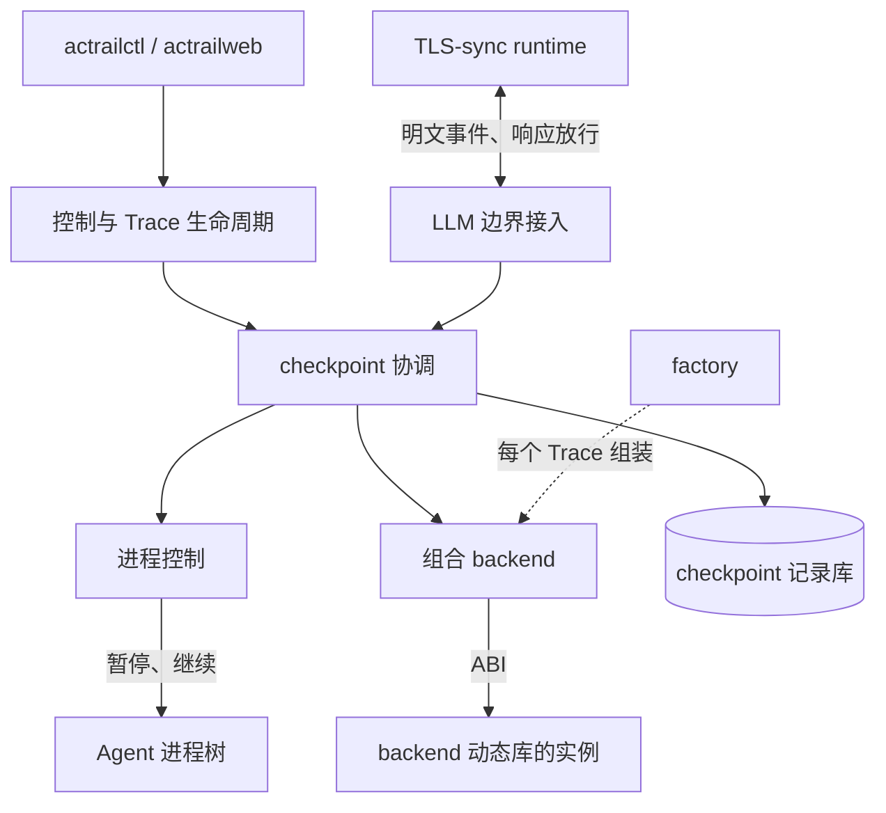
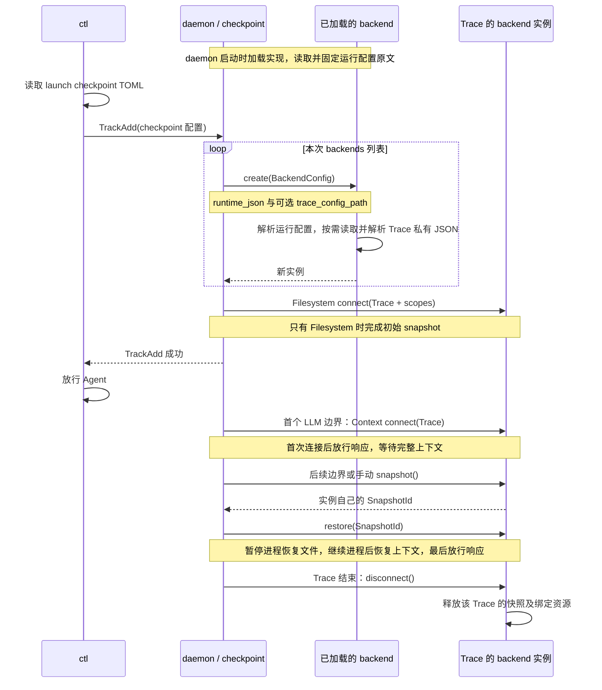
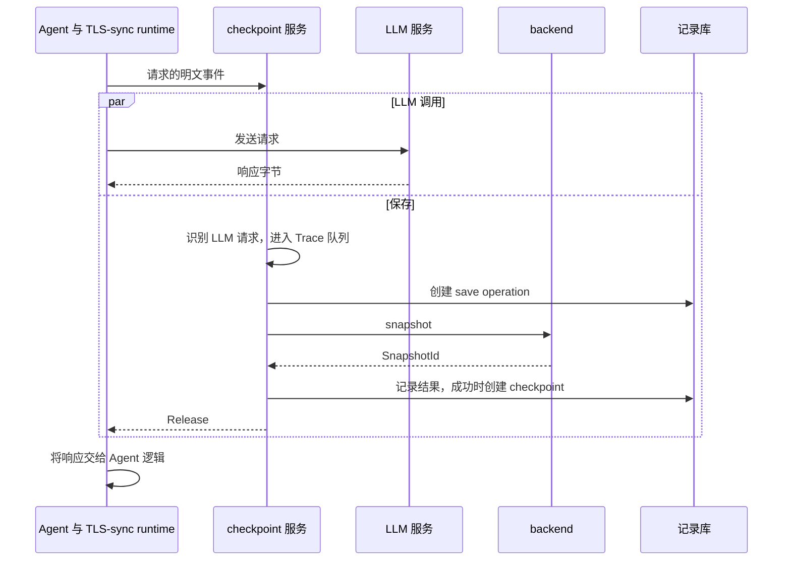
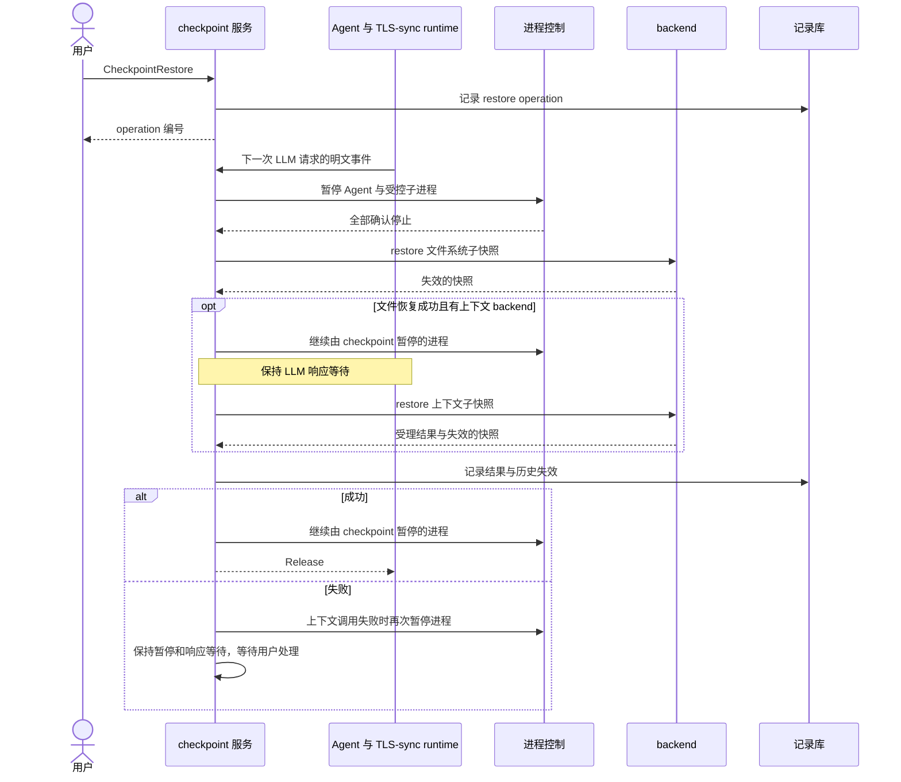

# Checkpoint

checkpoint 服务为运行中的 Trace 组合文件系统和 Agent 上下文快照。文件系统 backend 恢复目录，上下文 backend 请求 Agent 恢复对话状态。

daemon 负责保存时机、LLM 响应等待、进程暂停、按 Trace 调度和历史记录。backend 动态库负责资源的保存与恢复，并管理快照或日志。Trace 结束时，daemon 通知 backend 断开连接。

## 对象与术语

| 对象 | 含义与用途 |
| --- | --- |
| 保护范围（scope） | 一个受保护目录、其排除路径和负责它的 backend。一个 Trace 可以配置多个 scope |
| backend | daemon 按名称加载的动态库实现，例如 Btrfs 或 Xiaoo。launch 配置通过这个名称选择实现 |
| backend 实例 | backend 按运行配置和本次 Trace 配置创建的对象，由 `connect` 绑定到一个 Trace，直到 `disconnect`。每个 Trace 有自己的实例 |
| 组合 backend | 一个 Trace 的全部 backend 实例组成的一个 backend，协调组件只调用它 |
| 快照（snapshot） | backend 为一次完整保存返回的 `SnapshotId`，例如 Btrfs 只读快照或 AgentNS 日志位置。AcTrail 只保存这个 ID，它只在这次连接内有意义 |
| checkpoint（恢复点） | 一次保存成功后得到的记录，引用组合 backend 的快照 |
| operation | 一次实际执行的保存（save）或恢复（restore），记录进展、结果和对 Agent 进程的影响 |

## 组件与状态



| 组件 | 职责 | 持有的状态 |
| --- | --- | --- |
| checkpoint 协调 | 计算有效 scope，连接 backend，并按 Trace 调度保存、恢复和释放。根据操作结果更新历史、处理失败并决定边界放行。历史查询使用只读连接 | 每个 Trace 的执行队列、待执行的恢复、当前 operation、组合 backend，恢复失败后保持的暂停进程和等待放行的边界 |
| LLM 边界接入 | 按 TLS 连接放行已处理的出站事件。被关注 Trace 的 LLM 请求交给 checkpoint 协调，完成后继续放行 | 每条 TLS 连接已处理与已放行的序号，等待 checkpoint 处理的 LLM 请求 |
| 进程控制 | 恢复前暂停 Trace 的 Agent 及受控子进程，之后只继续由 checkpoint 暂停的进程 | 由 checkpoint 暂停的进程和执行结果 |
| factory | 启动时加载动态库、校验 ABI 并读取运行配置原文。launch 时将运行配置原文和 Trace 配置路径交给创建入口，组合返回的实例 | 已加载的动态库、注册名称及固定的运行配置原文 |
| 组合 backend | 把 scope 分给各实例，按文件系统和上下文的调用时机执行，把各实例的快照合成一个快照。保存失败时删除已得到的部分 | 各实例和每个快照对应的子快照 |
| 记录库 | 独立的 SQLite 文件，保存每个 Trace 的 scope 配置、所有者、根进程、是否已结束和 disconnect 结果，以及 checkpoint（在 Trace 内从 0 编号，0 是首次成功保存，含快照 ID 和删除状态）和 operation | 持久化历史 |

backend 在 daemon 进程内运行，位于 Agent 暂停范围之外，权限与 daemon 相同。接口见 [Checkpoint Backend 接口](../../reference/checkpoint-backend.md)。

## 配置与 scope

operator 配置启用 checkpoint，定义记录库路径、可用的 backend 及其运行配置路径。daemon 启动时读取运行配置原文并保持到进程结束。

launch 通过 `--checkpoint <配置文件>` 指定本次使用的 backend、可选的 Trace 私有配置路径和 scope。ctl 读取这份配置，daemon 按名称调用已加载的实现。backend 创建实例时解析运行配置，并按自身需要读取、解析 Trace 私有 JSON，连接时绑定资源。

| backend | 运行配置，由 daemon 提供 | Trace 输入 |
| --- | --- | --- |
| Btrfs | 工具路径、复制参数预算、`snapshot_root`、`allowed_workspace_roots` | `scopes[].root` 指定本次保护的子卷，省略 Trace 私有配置 |
| AgentNS | `library_path`、`area_root`、统一附加排除 `extra_excluded_paths` | 根进程身份和 scope 排除路径，省略 Trace 私有配置 |
| Xiaoo | RPC 超时、响应大小限制、恢复模式 | Trace 私有 JSON 的 `endpoint` 指定本次绑定的 socket |

`TraceProcess.cwd` 来自启动屏障内根进程的实际工作目录。`scope.root` 表示用户选择的保护目录，两者各有用途。

operator 配置示例：

```toml
[checkpoint]
enabled = true
catalog_path = "/var/lib/actrail/checkpoint.db"

[[checkpoint.backends]]
name = "project-btrfs"
library = "/usr/lib/actrail/checkpoint/libactrail_ckpt_fs_btrfs.so"
config = "/etc/actrail/checkpoint/btrfs.json"

[[checkpoint.backends]]
name = "agentns"
library = "/usr/lib/actrail/checkpoint/libactrail_ckpt_fs_agentns.so"
config = "/etc/actrail/checkpoint/agentns.json"
```

launch 配置文件示例：

```toml
[[backends]]
name = "project-btrfs"

[[backends]]
name = "agentns"

[[scopes]]
id = "project"
root = "/data/workspaces/project"
backend_instance = "project-btrfs"

[[scopes]]
id = "other-files"
root = "/"
exclude = ["/tmp"]
backend_instance = "agentns"
```

launch 命令示例：

```bash
actrailctl launch --checkpoint /path/to/checkpoint-config.toml -- python agent.py
```

每条路径由覆盖它的最内层 scope 负责。子 scope 的整个根目录加入父 scope 的排除集合，子 scope 内的排除路径也由子 scope 保持。上例中 Btrfs 保存整个项目目录，AgentNS 负责项目之外 Agent 进程树的修改。AgentNS 的排除范围包含 `/tmp` 和整个 `/data/workspaces/project`。

AgentNS 在运行配置的统一排除之外，再合并本次 scope 的排除路径。

协调组件按 `backend_instance` 把 scope 分组，组合 backend 把每组交给对应的实例。实例在 `connect` 时检查自身环境能否落实这些路径。Btrfs 快照不包含嵌套子卷，因此拒绝包含排除路径或嵌套 scope 的配置。

backend 以 root 身份读写。daemon 在 launch 时检查每个 scope 的根目录是否属于发起 launch 的用户，防止普通用户通过恢复覆盖其他用户的文件。宿主机 root 不受此所有权限制。

组合结构由 launch 的 `[[backends]]` 决定。scope 的 `backend_instance` 引用本次选中的 Filesystem backend 名称，Context backend 由同一列表选择并自行绑定上下文资源。

保存按 launch 后端列表的顺序调用。恢复先调用 `Filesystem`，再调用 `Context`，同类内保持该顺序。接入步骤与配置见[快照与回滚接入](../../operations/checkpoint.md)。

## 实例生命周期



daemon 启动时检查库能否加载、运行配置文件能否读取。运行配置格式和 Trace 配置由 backend 在 `create` 时校验，失败使该次 launch 失败。

实例保存在该 Trace 的组合 backend 中。同一 Trace 的操作按队列执行，结束时沿该队列释放实例。

新增使用已加载 backend 的任务只需准备本次 launch 配置，以及该 backend 需要的 Trace 私有配置，daemon 持续运行。

## LLM 边界

自动保存和等待边界的恢复依赖 TLS-sync runtime 的响应等待，需要以下配置：

- `payload.tls.capture_backend = "tls-sync"`。
- `semantic_retention.projection_enabled` 与 `semantic_retention.l0_llm_call.enabled` 开启，两者默认开启。

静态可执行文件使用直接探针计划，不注入 runtime，因此没有响应等待。

边界是观测识别出的 LLM 请求。daemon 处理 TLS-sync 上报的明文时，LLM 投影在请求结束时识别它，与动作视图中的 LLM 调用共用识别结果。

Trace 中任一进程发出的 LLM 请求都可以形成边界，包括 Agent 运行的工具和独立进程中的子 Agent。在工具请求处保存，得到完整的目录快照。在此恢复会改动工具执行中的文件，与 `force` 立即恢复一样需要考虑工具尚未完成的操作。

checkpoint launch 的 runtime 不解析请求，只在明文上报连接上等待放行：

- 上报事件带有进程内递增的序号。runtime 记下每条 TLS 连接上最后一个入队的出站事件的序号。
- daemon 识别完一批事件后，按 TLS 连接放行到已处理的最大序号，放行不等待存储写入。
- 遇到被关注 Trace 的 LLM 请求时，放行停在该请求最后一个出站片段之前，checkpoint 处理结束后继续。处理失败的一批同样放行。
- runtime 把一次 TLS 读取的响应字节交给 Agent 之前，记下这条连接上最后一个入队的出站事件的序号，等待放行序号达到它。此后才写出的请求不影响这次读取。

| 消息 | 方向 | 作用 |
| --- | --- | --- |
| `Release` | daemon → runtime | 一条 TLS 连接上不超过给定序号的出站事件已放行 |
| `HoldEnd` | daemon → runtime | 结束该进程的响应等待。发送时机为 Trace 结束、checkpoint 断开，或已登记等待的连接上报事件时发现其 Trace 未被关注 |

非 LLM 流量在 daemon 处理完成后放行。放行与网络响应并行，通常先到，Agent 读取响应时无需额外等待。

响应等待只阻塞对应的 TLS 读取，后台工具继续运行。

| 异常情况 | 行为 |
| --- | --- |
| 事件入队失败 | runtime 不等待该事件。事件不会进入观测，其中的 LLM 请求也不会形成边界 |
| 上报通道失败或断开 | runtime 结束全部等待，此后该进程不再等待。已发生的进程暂停仍由 daemon 管理 |
| 保存或恢复耗时过长 | LLM 流可能超时，Agent 按自身的网络错误处理继续 |

## 保存

| 时机 | 行为 |
| --- | --- |
| launch | 在启动屏障内连接文件系统 backend 并记录 Trace。只有文件系统 backend 时完成初始保存后放行 Agent。含上下文 backend 时直接放行 Agent，等待其启动后再连接上下文。启动阶段失败时 launch 失败 |
| LLM 请求 | runtime 正常发送请求并上报明文，交付响应前等待放行。尚未连接上下文 backend 时，daemon 连接它并跳过本次保存。后续边界执行 save，与 LLM 调用并行。保存完成或失败后放行响应，失败记录在 operation 中 |
| 用户手动 | 尚未连接上下文 backend 时先连接，再执行 save。backend 尚无可保存上下文时返回失败。成功保存创建新的 checkpoint |

Xiaoo 在 `connect` 时通过 `init(current)` 激活上下文捕获。首个边界连接后放行响应，让 Agent 在完整循环边界发布上下文。后续边界执行 save。

边界保存不检查两次保存之间是否有修改。没有修改的边界也可能产生 checkpoint，一轮对话中的多次 LLM 请求分别保存。

| backend | 保存内容 |
| --- | --- |
| Btrfs | 子卷的文件状态 |
| AgentNS | Agent 进程树产生的文件修改 |
| Xiaoo | 最近的完整上下文 |

部分 backend 保存成功时，组合 backend 删除已得到的快照，返回失败，不创建 checkpoint，失败原因留在 operation 中。

保存期间，checkpoint 服务不协调后台工具和并行子 Agent 的写入。



保存失败同样发送 `Release`。

## 恢复

用户选择运行中 Trace 历史里的一个 checkpoint，整体恢复。需要保留当前修改时，先手动保存，因为恢复流程不会自动保存当前状态。已结束的 Trace 拒绝恢复。

Trace 状态取自上游 Trace 生命周期（`TraceLifecycleState`）。`Draining` 表示根进程已退出、后代进程仍在运行，与 `Active` 一样按运行中处理。

| Trace 状态 | 进入恢复 |
| --- | --- |
| `Active`、`Draining` | 等待下一次 LLM 请求边界，再暂停 Agent 及受控子进程 |
| `Active`、`Draining`，等待中执行 `CheckpointForce` | 跳过剩余的边界等待，立即暂停进程，沿用同一 operation 和目标 |
| `Active`、`Draining`，上次恢复失败、尚未 resume | 直接执行恢复，成功后解除保留的暂停和响应等待 |
| 已结束（`Exited`、`Completed`、`Failed`） | 拒绝，返回 `trace_ended` |

等待边界期间 Trace 结束时，直接执行这次恢复，之后才 disconnect。恢复前暂停仍存活的进程，例如 `TrackRemove` 之后仍在运行的进程，通常一个都没有。



图中是等到 LLM 边界的恢复。daemon 发送继续信号和 `Release` 时，不需要已暂停 runtime 的确认。

进程控制从 Trace 根进程和已知成员出发反复发现后代并暂停，直到没有新增的存活后代。全部确认停止后调用文件系统 backend。主线程为僵尸但线程组仍有其他线程时，仍需暂停并确认整个线程组，不能确认时恢复失败。

文件恢复成功后，daemon 继续由 checkpoint 暂停的进程，保留 LLM 响应等待，再调用上下文 backend。这样 Agent 内的 socket 服务可以处理上下文请求。全部调用成功后解除响应等待。

Xiaoo 返回成功表示接受请求，排队的恢复在完整循环边界应用。

上下文调用失败时，daemon 再次暂停进程。用户执行 `CheckpointResume` 或再次恢复成功后，解除失败保留的暂停和响应等待。

恢复与 disconnect 的结果写库失败时，协调器保留尚未写入的结果。后续命令先补记，再检查状态和受理新操作，避免缺失的历史结果持续阻止恢复或清理。补记更新记录，不重做 backend 调用。

`CheckpointResume` 在补记失败时仍可继续由 checkpoint 暂停的进程。

协调器保留暂停状态直到继续进程成功。

多个 backend 之间不保证原子性：某个 backend 失败后，后面的不再调用，错误中带上它的名字。

backend 在恢复结果中返回本次导致失效的快照，恢复失败时也返回已经造成的失效。对应的 checkpoint 保留在历史中，标为不可恢复并注明原因。

组合快照中任一子快照失效，整个 checkpoint 都不可恢复。例如 AgentNS 单向回退到 C1 后，C2 的日志位置失效。全部 backend 都保留历史时，恢复后仍可回到已有的任意 checkpoint。

## 删除

用户可以删除不再需要的 checkpoint，释放 backend 占用的空间。AcTrail 先在记录库中把它标为已删除、不可恢复，再回复用户，然后在该 Trace 的执行队列中调用 backend 的 `delete`。顺序反过来时，如果 backend 删除后 daemon 退出，记录库中会留下看起来可以恢复、实际已不存在的 checkpoint。

删除只针对选中的 checkpoint，其他 checkpoint 保持可恢复。`delete` 的结果记在该 checkpoint 上，释放失败时再次删除即可重试。

| 删除条件 | 行为 |
| --- | --- |
| 等待中或执行中的恢复以该 checkpoint 为目标 | 拒绝删除 |
| Trace 已结束 | 拒绝删除。结束时 disconnect 已将全部 checkpoint 标为已删除，历史记录保留 |

## Disconnect

disconnect 结束 backend 连接并释放全部快照。Trace 结束时 daemon 自动 disconnect，用户也可以在 Trace 运行中执行 `CheckpointDisconnect` 提前放弃。有未结束的恢复时，手动 disconnect 请求被拒绝。

disconnect 受理后，Trace 停止接受 save 和 restore，到达的 LLM 请求直接放行。队列中排在前面的工作完成后，AcTrail 将剩余 checkpoint 标为已删除，调用 backend 的 `disconnect` 并记录结果。释放流程同时解除恢复失败后保留的暂停和响应等待。

释放失败时，AcTrail 在相关 checkpoint 上记录原因并保留实例。用户再次 disconnect 或 Trace 结束时重试，成功后将这些 checkpoint 改记为已释放。

launch 没有完成时同样释放：`connect` 失败时组合 backend 断开已连接的实例，初始保存失败时 disconnect 并记录结果。

## 调度与故障边界

每个 Trace 有一个执行队列，串行处理 save、restore、删除和 disconnect。历史按执行顺序更新，同一实例上的调用不会重叠。同一 Trace 同时只有一个未结束的 restore。

不同 Trace 的实例并发执行，daemon 不为 backend 加锁。多个实例访问同一底层状态时，由 backend 自行协调。

backend 调用在 worker 线程中执行，daemon 的控制入口和采集循环继续运行。调用没有统一的超时。

backend 在 daemon 进程内运行，它崩溃时 daemon 随之退出。

实例和对运行中 Trace 的观测保存在 daemon 内存中。之后启动的 daemon 不重建这些状态，上次运行的 Trace 只能查询历史。

| 阶段 | 处理 |
| --- | --- |
| daemon 正常停止 | 等待已排队工作完成，为运行中的 Trace 执行 disconnect。等待预算为 `checkpoint.runtime.shutdown_drain_timeout_ms`，默认 10 秒 |
| daemon 启动时收尾 operation | 执行中的 operation 记为 `unknown`，排队和等待边界的记为失败 |
| daemon 启动时收尾 Trace | 上次没有 disconnect 的 Trace 记为已 disconnect，其 checkpoint 标为已删除、释放失败 |
| daemon 异常退出后的资源清理 | backend 留下的快照由运维手动清理。runtime 的响应等待随边界连接断开解除，恢复失败后保持暂停的进程由用户处理 |

`ended_at` 在初始保存失败、Trace 结束或 daemon 正常停止时记录。启动收尾仅补上缺失的结束时间，无法还原实际结束时刻时使用收尾时间。

运行中的 Trace 手动 disconnect 只结束 checkpoint 保护。Trace 保持未结束状态，直到自身生命周期结束或 daemon 停止。

## 记录与查询

记录库路径由 daemon 配置的 `checkpoint.catalog_path` 指定。checkpoint 历史独立于 daemon 及主存储的观测数据留存，Trace 结束或 daemon 重启后仍可查询。恢复能力只在本次运行中有效。

operation 结果和 checkpoint 记录在短事务中更新，backend 调用和进程控制在事务之外执行。

历史查询只读取记录库，不经过 backend。查询经独立的只读连接在受理线程上执行，不排进 Trace 的执行队列，也不等正在写入的 checkpoint 工作。

| 命令 | 作用 |
| --- | --- |
| `CheckpointSave` | 手动保存，返回 operation 编号 |
| `CheckpointRestore` | 把运行中的 Trace 恢复到指定 checkpoint，返回 operation 编号，等到下一次 LLM 请求边界执行 |
| `CheckpointForce` | 让等待边界的恢复立即执行 |
| `CheckpointResume` | 解除恢复失败后保留的暂停，继续这些进程并放行响应等待 |
| `CheckpointStatus` | 查询当前 daemon 的协调状态。`held` 表示其保持的进程暂停或响应等待，`busy` 表示正在执行或排队的工作。查询范围不包含其他来源及旧 daemon 遗留的暂停 |
| `CheckpointDelete` | 删除指定 checkpoint，标为已删除后返回，之后由 backend 释放空间 |
| `CheckpointDisconnect` | 受理后返回，在 Trace 队列中删除剩余 checkpoint，并由 backend 释放快照 |
| `CheckpointList` | 按创建顺序查询 checkpoint 历史，filter mode 选择全部、最新若干个或某个创建时间范围内的 |
| `CheckpointOperations`、`CheckpointOperation` | 查询 operation 列表与单个 operation 的进展和结果 |

save 和 restore 命令在 operation 写入记录库后返回编号，客户端断开不取消已受理的操作。

launch 注册（`TrackAdd`）使用延迟回复等待启动工作完成。只有文件系统 backend 时，回复条件是初始保存完成。含上下文 backend 时，回复条件是文件系统连接和 Trace 记录完成。

在 LLM 边界执行的 operation 记录边界的观察时间和这次等待的 `llm.request` 动作。Web 根据该请求定位 ActionTree 中的 LLM 调用，两个导航方向共用这一关联。

| 导航起点 | 目标 |
| --- | --- |
| checkpoint 或 operation | 对应的 LLM 调用 |
| ActionTree 的保存标记 | 对应 checkpoint 的详情 |
| ActionTree 的恢复标记 | restore operation 及其目标详情 |

观测数据被留存清理后，对应的 LLM 调用不可查询，checkpoint 历史保留。

### Web 展示

Web 的 Checkpoint 标签按恢复后的主路径排列记录。例如 `0 → 1 → 2 → 3` 恢复到 `1` 后，主路径变为 `0 → 1`，节点 1 显示“回滚至此”和恢复时间。点击标记展开收起的 `2 → 3`，查看旧记录和恢复结果。再保存 4 时，主路径变为 `0 → 1 → 4`，原展开内容仍为 `2 → 3`。

成功恢复不增加重复节点。等待中或失败的恢复保留原路径。同一目标重复恢复时，保留所有收起过记录的标记和最新一次标记，移除未收起记录的旧标记。

完整 operation 历史始终保留，ActionTree 的 `Cn` 标记也可打开旧 checkpoint 详情。

运行中的 Trace、执行中的 operation 和待释放快照自动刷新，读取失败后继续定时重试。展开状态在自动刷新时保留。

Trace 已 disconnect 时，创建 checkpoint 按钮禁用。

Web 通过只读 `CheckpointStatus` 查询当前暂停和工作线程状态。解除暂停命令受理后，提示持续到 daemon 确认解除。解除失败时仍显示提示，查询失败时显示状态未知，历史照常可查。

## 设计选择

**backend 作为进程内动态库。** 新实现通过 `.so` 和配置接入，daemon 使用函数调用访问 backend。backend 与 daemon 共享权限和进程故障边界，backend 崩溃会使 daemon 退出。

文件状态由 backend 的快照或日志保存。checkpoint 服务不逐次拦截文件修改，文件写入不进入它的同步控制路径。

**实例就是连接。** 每个选中的 backend 为 Trace 创建独立实例，`connect` 后由实例持有该 Trace 的绑定。同一实例的调用由 Trace 队列串行，不同 Trace 的实例可以并发执行。

**组合 backend 管理子快照。** core 保留组合 backend，子实例使用统一 ABI。协调组件按文件系统和上下文的调用时机调度组合 backend。多个 backend 的顺序、子快照的对应关系和部分失败的清理归组合 backend。operation 保存一个整体结果。

**SnapshotContext 指明调用对象。** 协调组件的命令、查询和事件接收包含 Trace 标识的 SnapshotContext。backend 的 `connect` 使用契约中的同名类型，携带 Trace 标识、根进程和 scope。

**连接生命周期限定快照有效期。** 连接保存在 daemon 内存中，Trace 结束时自动释放快照。backend 只维护本次连接状态，Trace 结束或 daemon 重启后不能继续恢复。

daemon 异常退出时，backend 遗留的快照由运维清理。

## 代码布局

| 组件 | 模块与布局 |
| --- | --- |
| checkpoint 协调 | [`crates/core/checkpoint`](../code-layouts/crates/core/checkpoint/code-layout.md) |
| factory、组合 backend | [`crates/core/checkpoint`](../code-layouts/crates/core/checkpoint/code-layout.md) 的 `factory.rs`、`backends/` |
| backend ABI 契约 | [`crates/contracts/checkpoint`](../code-layouts/crates/contracts/code-layout.md) |
| 记录库 | [`crates/adapters/storage/checkpoint`](../code-layouts/crates/adapters/code-layout.md) |
| Btrfs、AgentNS backend | [`integrations/checkpoint/filesystem`](../code-layouts/integrations/code-layout.md) |
| daemon 接入、进程控制 | [`crates/apps/daemon/src/services/checkpoint`](../code-layouts/crates/apps/daemon/src/services/code-layout.md) |
| LLM 边界接入 | [`crates/apps/daemon/src/services/tls_sync`、`services/live`](../code-layouts/crates/apps/daemon/src/services/code-layout.md) |
| LLM 请求识别 | [`crates/core/semantic_action_runtime/src/llm_pipeline/provider`](../code-layouts/crates/core/semantic_action_runtime/src/llm_pipeline/code-layout.md) |

必需行为见 [Checkpoint 规范](../../specifications/checkpoint/save-and-restore.md)。
