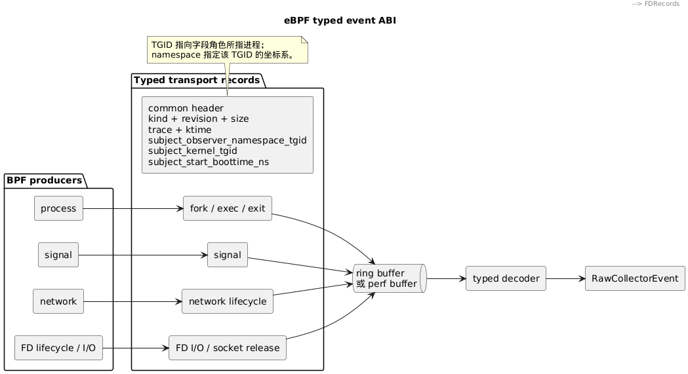

# eBPF 事件 ABI

eBPF producer 使用公共 header 加 typed record 向 daemon 传递事件。每种 record 通过专用字段表达对应事件的语义。

[](assets/ebpf-event-abi.puml)

## 公共 header

所有 typed record 以相同 header 开头：

```c
struct actrail_event_header {
    __u32 kind;
    __u16 abi_revision;
    __u16 record_size;
    __u64 trace_id;
    __u64 observed_ktime_ns;
    __u32 subject_observer_namespace_tgid;
    __u32 subject_kernel_tgid;
    __u64 subject_start_boottime_ns;
} __attribute__((packed));
```

header 固定 40 bytes，只表达传输边界和每类事件都需要的 subject 身份。TID、第二进程、FD、result、endpoint 和事件专用 flags 只属于对应 typed payload。

`record_size` 和 `abi_revision` 使 decoder 能在读取 payload 前验证完整布局。内部 ABI 不兼容时 daemon 启动失败；运行中的单条非法 record 被隔离并形成诊断，不影响 command-control。

## Typed records

| Record | Subject | Payload |
|---|---|---|
| `actrail_process_fork_event` | child | parent 的完整进程坐标 |
| `actrail_process_exec_event` | exec process | filename length、flags、filename bytes |
| `actrail_process_exit_event` | exiting process | signed exit code、validity flags |
| `actrail_process_signal_event` | signal source | target kernel TID、signal、result、group |
| `actrail_network_event` | syscall process | kind、result、FD、syscall family、flags、FD object generation、一个 endpoint及其 role |
| `actrail_fd_io_event` | syscall process | kind、syscall family、result、FD、category、requested bytes、FD object generation、可选 endpoint及其 role |
| `actrail_socket_release_event` | releasing process | FD、FD object generation |

fork 的 header 始终描述 child，parent 只出现在 fork payload。network record 每条只携带实际观测到的 endpoint，并用 `endpoint_role` 标明 local 或 remote；需要双 endpoint 的语义使用独立 record。

file、TLS、stdio 与 socket payload 保持各自的 typed layout，不套入上述 record。

## PID 坐标

PID 字段同时编码角色和坐标系：

- `*_observer_namespace_tgid`：字段角色所指进程在 daemon 所在 PID namespace 中的 TGID。
- `*_workload_namespace_tgid`：进程在 workload 所在 PID namespace 中的 TGID，并伴随 PID namespace identity。
- `*_kernel_tgid`：进程在 initial PID namespace 中的 TGID。
- TID 使用对应的 `*_observer_namespace_tid`、`*_workload_namespace_tid` 或 `*_kernel_tid`。
- 内核进程代际使用 `*_start_boottime_ns`；procfs tick 使用 `*_start_time_ticks`。

字段名描述 PID 坐标本身，不描述它被存储或索引的位置。角色前缀使用 `subject_`、`parent_`、`child_`、`target_` 或 `peer_`。

## 构造与数据流

producer 根据事件 family 构造确定大小的 typed record，填充公共 header 和本类 payload，再提交给 ring buffer 或 perf buffer。公共 header 以 raw kernel TGID 对进程身份 cache 做一次 O(1) 查询，同时取得 observer TGID 和精确 generation；不发送未使用字段，也不在高频路径扫描 BPF state或查询 `/proc`。TLS/seccomp 专用 correlation 对 trace-namespace 线程坐标使用独立 cache，每个线程只在首次触达时执行一次 namespace helper，不能把该坐标混入公共 subject 身份。

consumer 原样批量交接 raw bytes。daemon decoder 先读取公共 header，按 `kind` 选择唯一 record 类型，严格校验 `abi_revision` 与 `record_size`，然后生成 typed kernel event并投影为 `RawCollectorEvent`。transport consumer 不猜测或改写 PID 坐标。

同一 `kernel_tgid + start_boottime_ns` 只对应一个进程代际。observer-namespace 和 workload-namespace 坐标是该身份在不同 PID namespace 中的投影，不得反向作为内核 eBPF state 的主身份。身份 cache miss 不得以 `subject_observer_namespace_tgid = 0` 伪造正常 record；producer 计数并隔离该条事件，consumer 只允许已有精确 binding 的第二层恢复。

## 内核源码分层与编译边界

源码目录以状态和行为的所有权划分职责。BPF program、attach point、map ABI 和 translation unit 各有明确边界。

### 分层职责

`common/` 只包含无观测领域语义的常量、内核类型声明、寄存器访问和基础工具。它不拥有 map，不查询 trace membership，也不构造事件。

`abi/` 定义内核到用户态传输的 wire record。公共 observation header、进程、网络、FD I/O、文件路径和 payload record 按事件 family 分开。ABI 文件只描述枚举、字段和布局，不包含 map 操作或事件构造逻辑。record 语义及 PID 坐标由[eBPF 事件 ABI](ebpf-event-abi.md)定义。

`runtime/` 提供多个观测领域共同依赖的运行时机制：事件 transport、PID 身份投影、trace membership、进程代际和 endpoint 读取。共享 runtime 不依赖 FD、network、file、payload 或 TLS 等领域模块。

`launch_binding/` 拥有启动绑定协议及按内核能力选择的 task-storage 和 PID-generation 实现。两种实现向 process 领域提供相同的绑定行为，不把实现差异传播到其他领域。

每个观测领域拥有自己的 map、pending state、事件构造与 BPF program 入口。`state.h` 或 `maps.h` 保存该领域状态；`observe.h` 和 `capture.h` 负责从内核上下文构造 typed record；`programs.h` 只保留 `SEC(...)` 入口和薄参数适配。FD 领域同时作为 file、network 和 payload 使用的受控基础服务，负责 descriptor 读取、FD slot、kernel file object、引用计数和生命周期。socket 创建暂态保存在 network state 中，由 FD lifecycle 在创建与线程退出路径消费。

### 依赖方向

依赖只沿以下方向下降：

```text
live_observation.bpf.c
          ↓
domain/programs.h
          ↓
domain state and behavior ──→ fd service
          ↓
runtime
          ↓
abi and common
```

底层模块不 include 领域 program 或上层聚合文件。共享状态由明确的领域拥有；FD lifecycle 对 network socket 创建暂态的访问是 socket 注册与现有退出清理路径的集成边界。通用 runtime 不通过 include 把某个领域实现重新引入依赖图。

### 编译边界

`live_observation.bpf.c` 是主 collector 的组合入口，只 include 各领域的 `programs.h` 并声明制品级信息。所有模块编译为同一个 BPF translation unit。

verifier 复杂度取决于具体 program 的控制流、内联边界和状态访问。性能优化须遵循上述所有权和依赖边界。
