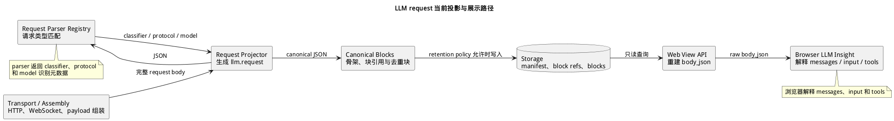

# LLM Request 当前投影路径

> 本文展示 LLM request 从完整 JSON 到持久化内容和 Web 展示的当前职责边界。

当前路径包含两种投影：daemon 识别 LLM 请求类型并生成 `llm.request` action；浏览器从重建的原始 JSON 中提取消息和工具。



## 从字节到完整请求

HTTP、WebSocket 和 payload transport 组件负责帧、分片与消息边界。它们把完整 request body 交给 LLM request projector；request parser 每次只识别一份完整 JSON，不维护网络帧状态。

HTTP/1 在消息头确认时分配稳定来源身份，随后把带该身份的解码正文交给 request projector。正文完成和 LLM 分类只决定何时生成语义投影，不改变消息归属。HTTP 观测与 LLM 请求投影消费同一次消息解析结果，HTTP application event 后续补充正文与证据。Call 的请求—响应关系由 HTTP exchange 决定。

Request Parser Registry 目前注册结构化 JSON/SSE parser 和通用 JSON parser。每个 parser 对当前 JSON 返回 `NoMatch`、`Plausible` 或 `Strong`。Registry 选择唯一的最高强度候选；最高强度并列时不选择 parser。

被选中的 parser 当前只返回：

- `classifier_id`：识别器身份；
- `protocol_id`：可选的协议身份；
- `model`：可选的模型名称。

这些字段描述识别结果，不包含 messages、tools 或有序 item。

## Action 与内容保留

Request projector 使用识别结果生成 `llm.request` action，并按 semantic retention 配置处理 request body。当前有三种内容状态：

| 状态 | 保存内容 |
|---|---|
| `none` | 不保存 request content |
| `shape` | 保存 canonical hash、大小和有限的形状元数据，不写入可重建正文 |
| `canonical_blocks` | 写入 manifest、按原顺序排列的 block reference，以及按内容哈希去重的 block |

**Canonical JSON** 是键顺序和编码方式确定的 JSON 表示。`canonical_blocks` 将 `messages`、`tools`、`prompt` 和 `input` 中的内容替换为有序占位符，形成 skeleton。Storage 通过 skeleton 和 block reference 的 ordinal 解释正文；前缀读取按预算顺序读取必要的 block 字节，节点读取只解析目标路径及当前子项页所需的 block。完整 canonical 长度通过 skeleton 与 block 的持久化字节长度计算。item 类型由浏览器在展示时解释。

## Web 当前如何展示

请求详情先显示动作属性中的摘要。用户打开正文时，Web View API 从当前请求的 manifest 读取一页字段描述，展示消息、系统指令、工具定义及其他请求字段。展开字段后再读取其中的子项，展开具体正文块后才解码该块。长字符串按页显示。

每个请求的 manifest 和块引用决定其完整内容。相同 trace 中的相同正文块共享存储，trajectory 记录调用关系。请求详情按当前 manifest 导航，切换请求后重新按需读取。

## 故障边界

无法匹配或存在同等级歧义时，Registry 返回无结果。Canonical content 是否写入由 retention policy 独立决定；下游展示失败不会改变已经持久化的原始内容。

超出读取上限的 request content 由 API 拒绝或截断在明确边界内，Web 查询使用只读 storage handle，不参与 daemon 的写事务。

`GET /api/traces/{id}/actions/{action_id}/content/llm-request` 接受 `max_bytes`，返回 UTF-8 边界内的 canonical 前缀与完整 `canonical_body_bytes`。`/content/llm-request/node` 接受 JSON Pointer `pointer`、`offset` 和 `limit`。对象和数组按子项索引分页，保留精确子项计数。

字符串按解码后的 UTF-8 字节分页。`offset` 为本页起点，`next_offset` 为下一页起点，末页返回 `null`；起点必须位于字符边界。`value_bytes` 是完整字符串字节数，`returned_bytes` 是本页字节数，`truncated` 表示本页只包含字符串的一部分。浏览器翻页替换当前内容，并保存页起点供返回上一页使用。其他 scalar 的字节数按 canonical JSON token 计算。

节点目录通过 canonical block 的首字节识别类型，块内的子项数量在展开后提供。读取前检查请求内累计字节预算，同一 block 的相同字节在请求内只计一次。超预算返回明确的局部请求错误；未找到正文才返回 `content: null`。Skeleton 和引用元数据仍按请求读取，正文 block 不跨请求缓存。进入正文 block 后的对象均为用户数据，不再解释为存储占位符。Local 与 cluster 采用相同预算，配置入口见 [Web Runtime](web-runtime.md#正文查询预算)。

## 源码位置

```text
crates/core/semantic_action_runtime/src/llm_pipeline/
├── transport/                              # HTTP/1、HTTP/2、WebSocket 消息边界
├── assembly/                               # payload 流组装
├── provider/registry/request.rs            # request parser contract 与选择
├── projection/projector/request.rs         # llm.request action 与 retention 接线
└── projection/retention/request_blocks.rs  # canonical skeleton、块引用与元数据

crates/apps/web/
├── src/view/actions.rs                     # request content 读取与 body_json 输出
└── frontend/src/components/llm/           # 消息和工具字段的按需浏览
```
