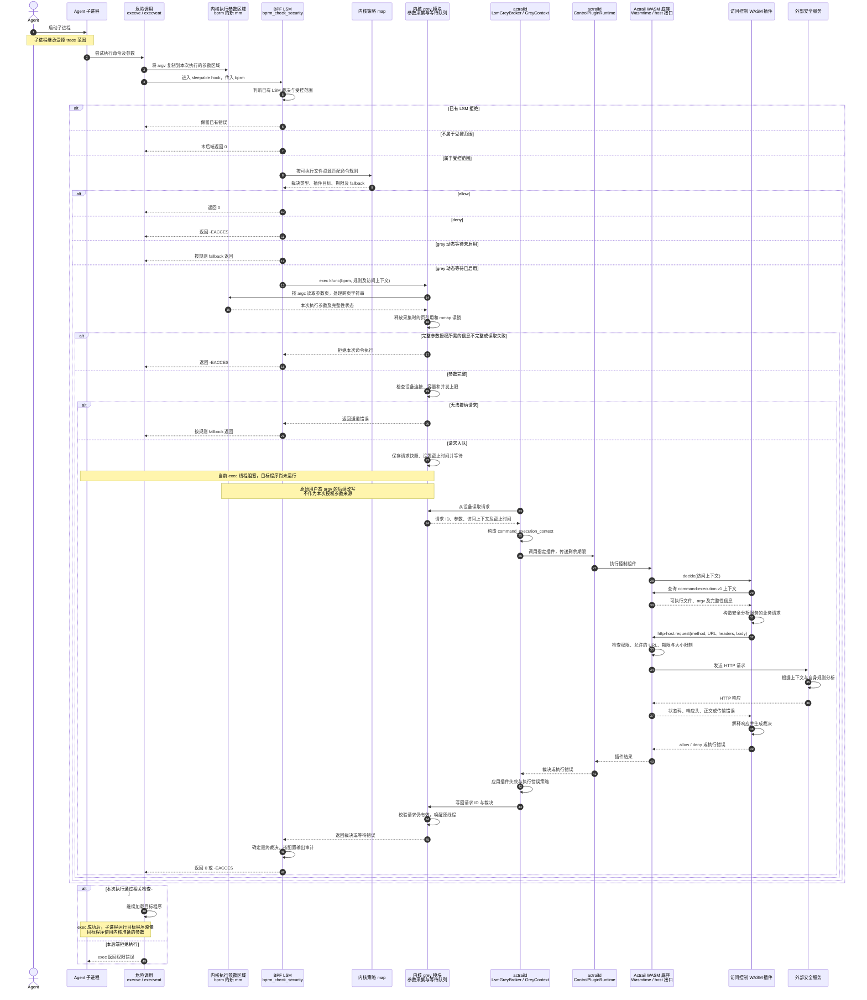

# LSM Grey 命令执行授权

本文说明基于内核执行参数副本的 grey 授权设计。Agent 启动的子进程尝试执行命令时，LSM 先查询内核策略。静态规则直接返回 allow 或 deny。grey 规则通过 daemon 调用访问控制 WASM 插件，由插件请求外部安全服务并解释响应。

设计的关键是读取 `linux_binprm` 对应的执行参数区域。内核已经为本次 exec 复制参数，模块从这份副本构造授权请求，避免重新读取原始用户态 argv 导致参数不一致。

## 参与者与职责

| 参与者 | 职责 |
| --- | --- |
| Agent | 启动执行工具或命令的子进程 |
| 子进程 | 发起 `execve` 或 `execveat`，例如执行带 GET 或 POST 参数的 curl |
| exec 内核路径 | 复制执行参数，调用 LSM，决定是否继续执行目标程序 |
| 内核参数区域 | 保存本次执行使用的参数，由 `bprm->mm`、`bprm->p` 和 `bprm->argc` 定位 |
| BPF LSM | 检查已有 LSM 裁决、受控范围和策略，选择直接裁决或 grey 分支 |
| 内核 grey 模块 | 读取执行参数副本，维护有界等待队列，接收裁决并唤醒原线程 |
| `LsmGreyBroker` / `GreyContext` | 读取设备请求，构造命令上下文，携带剩余期限分发并写回裁决 |
| `ControlPluginRuntime` | 定位规则指定的插件实例并调用控制插件 |
| Actrail WASM 底座 | 执行组件，提供上下文查询和受限的通用 HTTP 接口 |
| 访问控制 WASM 插件 | 构造业务请求，解释服务响应，生成 allow 或 deny |
| 外部安全服务 | 根据参数、上下文及自身规则计算分析结果 |

## 完整时序

下图以原生 ELF 程序的执行为范围。所有参数读取都发生在 grey 分支中。`exec kfunc` 表示接收当前 `bprm` 的模块入口。

LSM 返回 0 表示本后端允许继续执行。exec 后续仍可能因其他检查或程序加载错误而失败。

## 参数一致性与异常处理

内核执行参数副本是本次 argv 授权的数据来源。模块读取 `bprm->mm` 中从 `bprm->p` 开始的参数字符串，并按 `bprm->argc` 确定结束位置。授权请求只保存采集结果，等待期间不保留参数页映射和采集用的内存映射读锁。exec 路径自身仍可能持有其他内核锁。

WIT 的 argv 使用 UTF-8 字符串。当前 daemon 对非 UTF-8 字节使用替换字符解码，因此插件侧的逐字节一致性范围是有效 UTF-8 参数。内核参数来源的一致性不改变这项文本接口限制。

完整参数授权要求采集结果覆盖全部 argv。若达到采集上限或读取失败，拒绝这类命令授权，避免将未知参数视为已授权。参数完整性错误与普通通道错误分别处理，完整性错误不能转成允许型 fallback。

| 条件 | 处理 |
| --- | --- |
| 静态 allow / deny | 内核直接裁决，不采集 argv，不请求安全服务 |
| 动态 grey 未启用 | 使用规则配置的 fallback |
| 参数读取失败或超限 | 对依赖完整 argv 的授权拒绝执行 |
| 设备未连接、队列满或达到并发上限 | 使用规则配置的 fallback |
| 指定插件不存在或执行期间被卸载 | 拒绝访问 |
| 插件执行失败，包括未处理的 HTTP 错误 | 使用规则配置的 fallback |
| 内核等待超时、被中断或 daemon 断开 | 结束等待，使用规则配置的 fallback |
| 裁决到达时请求已结束 | 拒绝迟到的回复 |

主图展示请求正常返回的路径。内核等待期限独立于外部服务运行，用户态处理停滞时仍会结束等待。需要确保外部授权成功才允许执行的规则，应选择 deny fallback，并启用动态 grey。

## WASM 与安全服务边界

`http-host.request` 提供通用 HTTP 传输。插件选择已授权 URL、方法、请求头和正文，宿主执行权限、地址、时限及正文大小限制。安全服务的 JSON 字段及响应到 allow/deny 的映射属于插件逻辑。接口定义见[控制插件 API](../../reference/plugin-api/control-decider.md#http-请求)。

例如，插件可以将 curl 的参数交给服务分析，允许 `-X GET`，拒绝 `-X POST`。拒绝发生在 curl 的 exec 阶段，目标 curl 程序尚未开始发送 HTTP 请求。daemon 和安全服务独立运行在受控 Agent 的进程树之外，服务使用自己的规则库和模板文件。

