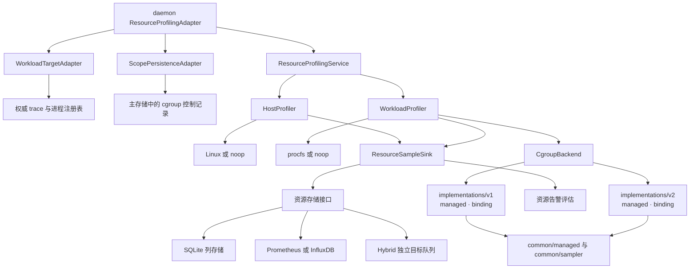

# 资源观测设计

`resource_profiling` 统一拥有 Host 与 Workload 的资源采集、指标模型、存储、告警和配置。daemon 提供权威目标、进程身份、trace 生命周期与控制持久化端口；Guest 资源观测沿独立的 hand-side 链路处理。

## 组件与状态

Host 样本使用宿主 boot identity。Workload 样本关联稳定进程与 trace 身份；采样目标来自 daemon 注册表，后端持有绑定、采样基线与自身生命周期状态。组件的配置、模型、Factory 和接口归属见[代码布局](../../code-layouts/crates/core/resource_profiling/code-layout.md)。

## 采集选择与指标语义

Host 与 Workload 可同时采集，各自拥有开关、周期和 backend。Host CPU 的 100% 对应整机总容量，Workload CPU 的 100% 对应一个逻辑 CPU；缺少初始差分基线时 CPU rate 为空。

Workload `auto` 根据目标绑定能力选择 cgroup，并在允许时选择 procfs。显式 `cgroup` 要求绑定成功。cgroup Factory 按配置和能力选择 v2 或 v1，绑定后的目标保留所选版本与来源。配置错误阻止启用相应配置。

每个样本携带计量方法、覆盖范围与周期或最终样本种类。cgroup charged memory 记录内核记账的内存，进程 RSS 单独采样。不可用的计数保留缺失状态。外部容器和共享 v1 边界包含 trace 外进程，覆盖标记为 `broader_than_trace`。

## 资源范围生命周期

| 来源 | 身份与接入 | 完成与故障处理 |
| --- | --- | --- |
| v2 managed | 在 delegated 根下创建范围，将暂停的 launch 子进程移入 workload 叶子，后代继承 | 等待范围为空或有限超时，提交最终样本并持久化控制完成，再清理空目录；超时标记 partial，存活后代继续运行 |
| v2 binding（容器） | 校验容器完整 ID、PID 开始时间、祖先关系、boot ID 与目录身份；以只读方式绑定已有范围 | 身份失效或持续读取失败使绑定失效并记录诊断；关闭记录独立持久化；`require` 控制准入 |
| v1 managed | 在 cpu/cpuacct 和 memory 层级下创建 trace 范围，将暂停的 launch 子进程移入 workload 叶子 | 复用 managed 最终采样、超时与清理流程；恢复时核对记录所属版本及各层级目录身份 |
| v1 binding（已有 cgroup） | 分别验证并只读绑定已有 cpuacct 和 memory controller 目录 | 恢复保留边界与版本，重建 CPU 基线；边界变化停止周期采样，最终样本标记不可得计数 |
| procfs | 从已确认身份读取进程数据，按配置包含后代 | 采样前后核验进程开始时间，避免复用 PID 混入原 trace |

持久化的 cgroup 控制记录用于启动恢复、失效、完成与清理。managed 进程移动提交之后的错误按准入失败处理。准入和运行期诊断见 [Host 操作指南](../../../operations/resource-metrics-host.md)与[容器操作指南](../../../operations/resource-metrics-containers.md)。

cgroup 门面通过共同的 `CgroupBackend` 接口调度 `implementations/v1` 与 `implementations/v2`，两个版本复用 `common/managed` 的生命周期和 `common/sampler` 的采样逻辑。一次启动最多选择一个 managed 版本；存在 live managed 记录时，必须按记录所属版本恢复，无法安全恢复则启动报错并保留记录。已有 v1、v2 绑定分别持久化到 `trace_external_cgroup_v1_bindings` 与 `trace_external_cgroup_v2_bindings`。

## 存储与故障边界

资源样本通过 `ResourceStorageBackend` 写入 database、remote 或 hybrid。默认 SQLite 路径是相对 operator 配置目录的 `./actrail-resources.sqlite`。资源样本使用专属表和 retention；trace 事件及 cgroup 控制记录由主存储负责。两者可配置到同一个 SQLite 文件，各自维护其数据职责。

单目标存储和 hybrid 子目标使用有界后台队列与写入超时。Hybrid 分发共享只读样本，各目标独立处理失败。队列满、超时或写入失败可能丢失周期或最终样本；控制完成独立推进。

SQLite 后端将 Host 与 Workload 样本分表按列存储，每个 trace 保存一份 metadata profile，样本只编码与之不同的部分；表结构、编码、还原与保留清理见[资源样本存储设计](storage.md)。

资源数据库在 fanotify 启动前打开，数据库、WAL 与 SHM 文件纳入自拦截排除。

## 查询与配置

Viewer 和 Web 通过资源数据库接口只读查询 Host 或 Workload 样本。Hybrid 查询要求恰好一个 database 子后端；remote-only 数据通过接收端查询。

Web 火焰图的资源轨道由 `timeline` 模块按时间窗口读取、降采样并组装 Host 与 Workload 样本，保留采样空洞、来源和不可用原因。

[配置布局](../../config-layout.md)列出完整字段、默认值与必填条件，[配置说明](configuration.md)说明子模块所有权和多目标存储用法。collection、storage、alerts 分别解析自身子配置；root Factory 负责组合。实际运行与验证命令见 [Host 与 Workload](../../../operations/resource-metrics-host.md)、[容器](../../../operations/resource-metrics-containers.md)和[Guest](../../../operations/resource-metrics-sandboxes.md)。
