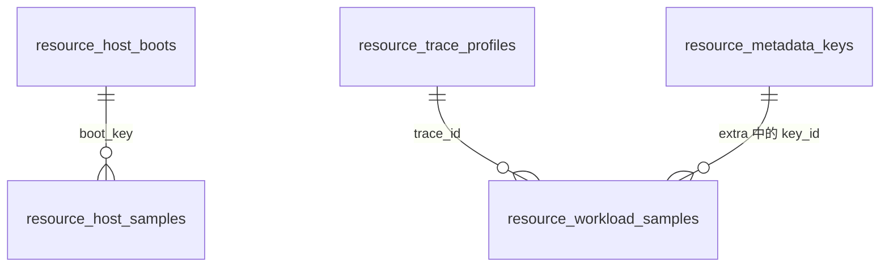

# 资源样本存储设计

本文说明 `ResourceStorageBackend` 的 SQLite 实现如何按列存储 Host 与 Workload 样本，以及 metadata 去重、读写还原和保留清理的规则。存储接口、remote 与 hybrid 目标见[资源观测设计](design.md)。

## 表结构

资源数据库只保存样本，cgroup 控制记录由主存储负责。表名和索引名统一使用 `resource_` 前缀；`database.sqlite.path` 可以与主存储指向同一个文件，不得使用 `PRAGMA user_version`。



| 表 | 一行对应 | 主要列 |
| --- | --- | --- |
| `resource_host_boots` | 一次宿主启动 | `boot_key`，16 字节 `boot_id` |
| `resource_host_samples` | 一条 Host 样本 | `boot_key`、`observed_at_ns`、CPU、内存、`load_1/5/15`（REAL） |
| `resource_trace_profiles` | 一个 trace | `trace_id` 主键、`scope`、`subject`、首条样本的 metadata（有序 JSON） |
| `resource_metadata_keys` | 一个 metadata 键名 | `key_id`、`key` |
| `resource_workload_samples` | 一条 Workload 样本 | `trace_id`、`observed_at_ns`、`process_id`、`flags`、`alert`、`cpu_rate_interval_usec`、18 个指标列、12 个 memory events 列、`extra` |

| 索引 | 用途 |
| --- | --- |
| `resource_workload_samples_trace (trace_id, observed_at_ns)` | 按 trace 和时间窗口读取，判断 profile 是否仍被引用 |
| `resource_host_samples_boot (boot_key, observed_at_ns)` | 按启动读取，判断 boot 是否仍被引用 |
| `resource_*_samples_age (observed_at_ns)` | 时间窗口查询与保留清理 |

Host 与 Workload 字段不同，分表存放。cgroup v1、v2 与 procfs 的 Workload 样本共用一张表，来源由 `flags` 区分。完整 DDL 见 `schema.sql`。打开数据库时删除旧的 `resource_samples` 表，旧样本不迁移。

## 固定字段编码

| `ResourceSample` 字段 | 存储位置 | 规则 |
| --- | --- | --- |
| `observed_at` | `observed_at_ns` | Unix 纳秒 |
| `host_boot_id` | `boot_key` | UUID 字节存入 `resource_host_boots`，样本只保存键 |
| `Option<u64>` 指标 | 同名 INTEGER 列 | `None` 存 NULL；按位转为 `i64`，读出时转回 `u64` |
| `memory_events`、`memory_events_local` | 各 6 列加 `flags` 位 | 标志位区分 `None` 与全部计数缺失的 `Some` |
| `scope`、`subject` | profile | 与 profile 不同时写入本行 `extra` 开头 |

`flags` 是磁盘格式的一部分，已发布的编码不得复用：

| 位 | 含义 | 编码 |
| --- | --- | --- |
| 0–1 | `accounting_method` | 1 `cgroup_v1`，2 `cgroup_v2`，3 `procfs_rss_sum` |
| 2–3 | `accounting_coverage` | 1 `exact`，2 `broader_than_trace`，3 `partial` |
| 4–5 | `sample_kind` | 1 `periodic`，2 `final` |
| 6 | `memory_events` 存在 | |
| 7 | `memory_events_local` 存在 | |
| 8 | 本行 scope/subject 与 profile 不同 | `extra` 开头存本行来源 |

大于 `i64::MAX` 的计数在 SQL 中显示为负数，SQL 聚合需要将其视为异常值。

## Metadata

`metadata` 是开放映射，各采集后端写入的键不同，内核新增的 `cpu.stat.*`、`io.stat.*` 字段也会原样转存。存储层不维护键名单，按以下规则拆分：

| 位置 | 内容 |
| --- | --- |
| `alert` 列 | 值为 `false`、`true`、`unknown` 时存 0、1、2，否则保留在 metadata |
| `cpu_rate_interval_usec` 列 | 值是规范十进制整数时存整数，否则保留在 metadata |
| profile | 该 trace 首条样本的其余 metadata 及 scope、subject |
| `extra` | 与 profile 相比值不同或新增的键、缺失的键，以及来源覆盖 |

profile 创建后不再修改，`extra` 始终相对它编码。首条样本缺少后续常见的键时，后续每条样本都在 `extra` 中携带这些键。

`extra` 在没有任何差异时为 NULL，否则编码为：

```text
[flags 第 8 位] varint(len) scope, varint(len) subject
varint(键值对数 << 1 | 有删除列表)
每对：varint(key_id << 1 | 值为整数)，随后 varint(整数) 或 varint(len) UTF-8
[有删除列表] varint(个数)，每个 varint(key_id)
```

只有转回字符串后与原值完全相同的无符号十进制整数使用 varint，其余值保留 UTF-8。

## 写入与读取

写入沿用批处理、事务和超时检查。写入线程缓存 `trace_id → profile` 与 `key → key_id`：

1. Host 样本取得或创建 `boot_key` 后插入 `resource_host_samples`。
2. Workload 样本先拆出 `alert` 与 `cpu_rate_interval_usec`。
3. 缓存缺少 profile 时，按 `trace_id` 读取已有 profile；不存在时用当前样本创建。daemon 重启后继续使用已持久化的 profile。
4. 与 profile 比较生成 `extra`，组合 `flags`，插入 `resource_workload_samples`。
5. 写入 final 样本后移除该 trace 的 profile 缓存。

`query` 与 `scan_ascending` 根据 `ResourceQuery.kind` 选择表，WHERE 子句只包含已设置的过滤条件，使查询能使用 trace 与 boot 索引。读取方缓存 profile 和键名，按 profile、来源覆盖、`extra` 键值、删除列表、专用列的顺序还原完整 `ResourceSample`。Web 以只读方式打开数据库；新表尚未创建时返回空结果。

## 保留清理

两张样本表共享每轮 50 ms 的清理预算，先清理 Workload 表，再清理 Host 表。每批删除 `max_samples_per_sweep` 行，直到没有过期行或预算用完；预算用完时，下一次写入继续清理，不等待 `sweep_interval_seconds`。

样本清理完成后，每小时最多回收一次没有样本引用的 profile 与 boot，并清空对应缓存。键字典不回收：键的引用位于 `extra` BLOB 中，且键总数很小。清理与回收在写入线程的同一连接上执行。

## 演进规则

- 新指标通过 `ALTER TABLE ... ADD COLUMN` 增加，旧行读为 `None`。
- 新枚举值追加编码，不复用已发布的值。
- 删除的指标保留列，不再写入。
- 新 metadata 键无需修改存储层。
- 格式无法兼容时删除并重建资源表，不保留格式版本号。

## 不变量

- 读取得到的 `ResourceSample` 与写入时逐字段相同，metadata 不丢键、不改值。
- 一个 trace 最多一行 profile；profile 创建后不修改，在仍有样本引用时不删除。
- `extra` 中的 `key_id` 在键字典中始终存在。
- 查询 SQL 不使用 `?x IS NULL OR column = ?x` 形式的可选过滤。
- 资源表与索引的名称不与主存储冲突。

## 容量

在 oe 上使用 601 条真实 cgroup v1 Workload 样本，VACUUM 后按 dbstat `sum(pgsize - unused)` 计算，完整资源 schema 从每条 1547 B 降到 145 B。其中 Workload 表与两个索引为 138 B，`extra` 平均 16 B。cgroup v2 会转存更多内核字段，`extra` 预计更大，尚未在 v2 主机上实测。

## 相关实现边界

```text
crates/core/resource_profiling/src/storage/database/sqlite/
├── schema.sql                              # 资源表与索引
├── resource_storage_sqlite_backend.rs      # 连接、事务、查询与 DatabaseStorageBackend
├── retention.rs                            # 样本清理与 profile、boot 回收
└── columns/
    ├── encode.rs                           # 专用列、flags、profile 比较与写入缓存
    ├── decode.rs                           # 样本还原与读取缓存
    └── extra_codec.rs                      # extra 编码
```
