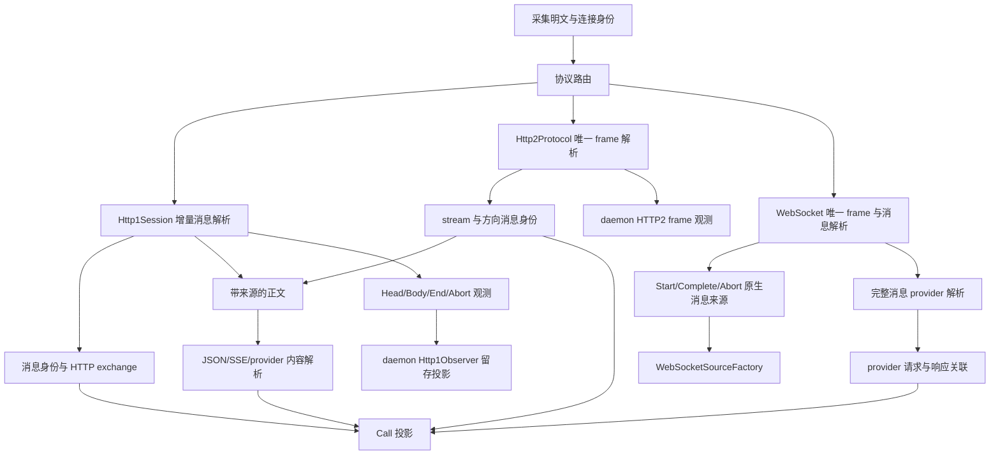

# 流式解析器

> 本文展示当前运行时如何把增量 HTTP payload 解析为 LLM request、response、call、link 与 evidence。

流式解析从符合 `plaintext_http_candidate` 的 payload segment 开始。HTTP 消息解析独立于 LLM 内容留存开关，入口负责协议路由和生命周期编排；协议状态按连接、方向以及 HTTP/2 stream 隔离。

## 连接与 HTTP 边界

HTTP/1 由 `Http1Session` 唯一消费消息 framing，处理 header、fixed body、chunked body 和 trailer。消息头确认后先分配稳定身份并建立 HTTP 事实，再消费正文。响应正文边界结合配对请求的方法判断。消息身份在连接状态重置后也不复用，来源不依赖正文分类或持久化事件 ID。

daemon 的 `Http1Observer` 消费共享消息事件，按配置生成 headers、body 与 SSE 观测。HTTP application event 携带 `http.message_id`，用于补充已有 HTTP action 的正文和 event evidence；该事件不启动另一轮 HTTP 配对。一次 payload transaction 完成观测补充后释放本批已结束的临时消息事实。

HTTP/2 的 `Http2Protocol` 唯一拥有 frame 解析。decoder 只交付完整 frame，daemon 消费同一结果生成 preface、frame 与 DATA 观测。每个连接方向维护一个 HPACK 解码上下文；HEADERS/CONTINUATION 完成后建立消息头和稳定来源，method、path、status 与内容编码来自真实头字段。trailer 继续更新压缩上下文并结束原消息。connection assembly 按 `stream_id` 解复用 DATA，每个 stream 方向独立持有内容解码器、evidence、SSE cache 和进行中的 response。同一连接的 stream ID 决定请求—响应关系。partial frame 不会退化成普通 payload，也不会与其他 stream 合并。

gap、truncation、decoder failure 或容量越界按实际协议影响范围隔离。HTTP/2 framing 损坏后停止该连接解析至关闭；一个连接或 stream 的问题不会清空同一 trace 的其他连接。

## WebSocket 消息与来源

WebSocket owner 消费共享 HTTP 升级头，按已确认的连接身份维护 frame 与消息状态。文本或二进制消息开始时分配稳定消息 ID；continuation 和压缩数据只由该 owner 组装。完整消息交给中立内容投影器，provider 的请求顺序及 response ID 负责逻辑 Call 关联，消息来源通过独立链接保留。

`WebSocketSourceFactory` 借阅 Start、Complete、Abort 事件并投影 `websocket.message`，无驻留消息缓存和正文副本。Start 写入初始来源，Complete/Abort 更新同一 action 的完整性、真实末次采集时间及 evidence。连接身份、原始 stream key 和 opcode 同时保留。LLM 内容完成与 WebSocket 消息传输结束各自收口；内容预算耗尽不会伪造协议中断。

原始连接身份包含 trace、process、source boundary 和 stream key。采集对象在升级前后更换 key 时，需要 producer 的明确连接身份映射；解析器不按进程或首个可解码 frame 合并连接。

Rustls 明文采集使用 `CommonState` 地址生成 `tls:<pid>:<pointer>`。该对象可能随 Rust 值移动而改变地址，因此这个坐标不能证明跨移动的连接连续性。现有 TLS 事件没有 socket fd/generation 或权威别名；无法证明升级请求、响应与后续 frame 属于同一连接时，保留未关联观测。跨移动关联要求 producer 在同一次 TLS/IO 调用上下文中取得 socket fd 及其 generation，并传递明确连接身份。禁止按指针接近程度、时间、线程或相邻 fd 猜测别名。

## 响应 body 与 provider

SSE（Server-Sent Events）framer 只消费已经去除 HTTP framing 的 response body，并且只交付以空行完整终止的事件。非 SSE JSON 响应在 body 完整时解析。

stream classifier 只有两个状态：`Undetermined` 与 `ConfirmedLlm`。初始 soft sniff budget 只限制识别成本；超出预算不会把它判定为“普通 SSE”，后续决定性事件仍可确认 LLM provider。late match 时，SSE cache 会重放为确认所保留的 body。

response parser 的当前选择顺序是 OpenAI Responses、Structured JSON SSE、Anthropic、OpenAI-compatible。同等级证据有歧义时保持未确认，不猜测 provider。插件 codec 可以先把 request 或 SSE event 归一化，再进入相同的 provider-neutral 投影链。

## Evidence 与语义投影

HTTP/2 evidence tracker 维护原始 DATA 字节坐标到 payload segment 的紧凑映射，并检查 syscall operation 是否连续、内容是否完整。内容解码器唯一持有解压正文，快照供 JSON/SSE 解析；解压尚未产出内容的片段也保留 wire evidence。投影分别记录原始字节数和解码正文长度，不复制压缩输入到 parser state。

provider parser 输出与厂商无关的增量状态。HTTP 的 LLM request/response 直接保留解析输入的消息身份，Call 沿唯一 HTTP exchange 关系生成。已解析的失败 HTTP 状态先是协议事实，待对应请求确认为 LLM 后产生失败语义结果。WebSocket 使用应用协议关联状态。保留策略分别约束 assembly、stream classifier 和 projection state；这些上限来自 `semantic_retention` 子配置。

## 正常完成与有限采集收口

进行中的 LLM response 和 WebSocket message 可以先持久化轻量 action。共同投影协调器在这些 action 正常结束或异常收口时发送 `ActionSnapshot`，以权威标题和完整属性替换存储内容；空属性集合删除已有属性。`Lifecycle` 独立更新结束时间、状态和完整性。HTTP/1、HTTP/2 与 WebSocket 的 LLM response 使用相同路径；WebSocket delta 只更新有界 provider aggregate 和来源链接，不逐条重写聚合正文。`updated_actions` 提供在线视图，持久化必须消费显式 update。

provider 的明确终态决定 LLM 内容语义的结束，HTTP boundary 独立决定来源消息的传输完整性。provider 提前完成后，协议状态仍保留至 END/Abort。未完整物化的 action 进入 `ResponseFinalizer`：性能模式实际触发前缀限采时收口为 `success/capture_limited`；peer close、trace close、confirmed gap、operation incomplete、protocol decode failure、HTTP/2 reset、buffer bytes exceeded 和 segment ranges exceeded 等异常收口为 `error/partial`。

已确认且包含有效语义的异常 response 会生成 error/partial action；未确认或没有有效内容的 stream 只产生紧凑诊断。trace close 会为 partial action 附加对应属性。finalizer 释放当前 stream 状态，不反向终止 payload ingress。

必须保持的分层与容量约束见[流式解析器规范](../../specifications/observation/streaming-parser.md)。

[组件图](assets/streaming-parser.png) · [图源](assets/streaming-parser.puml)

## HTTP 内容解码

### 数据与生命周期

HTTP framing 处理后的输入切片交给一个内容解码实现，再将解压后的正文交给
SSE/JSON 投影。消息持有一个句柄；gzip、Brotli、zstd 的库状态随消息创建和释放。
identity 单例执行透传，正文由消息句柄持有。

库的历史窗口、上下文和临时输出缓冲区由库管理，累计解码正文由一个
`BoundedBody` 持有。输入直接借用。正文容量上限约束累计输出，库内部工作缓冲另有内存开销。
快照共享 `Arc`，调用链同步消费后释放。
清理 identity 正文时，独占缓冲区直接清空；仍被快照持有时替换为空缓冲区。

### 库调用与失败

gzip 委托 `flate2::write::MultiGzDecoder`；Brotli 委托
`brotli::DecompressorWriter`；zstd 委托
`zstd::stream::zio::Writer<BoundedBody, zstd::stream::raw::Decoder>`。
追加和结束均使用库原生接口；gzip、zstd 每次追加后调用 flush，
将库已产生的输出交给正文存储。zstd 结束时调用 Writer::finish 校验帧完整性。
解压校验由库负责，库原生错误沿消息失败通道返回。
正文容量限制由 `BoundedBody` 承担。

各压缩实现使用库原生窗口设置。
`semantic_retention.l0_llm_call.assembly.max_buffer_bytes` 约束累计解码正文，
库的历史窗口、上下文和临时输出缓冲区另有内存开销。

共享内容解码器处理 HTTP/1.x 及 HTTP/2 消息的单个 Content-Encoding。HTTP/2 在完整头部确定编码后创建句柄，DATA 增量追加，END_STREAM 完成库校验；内容消费失败仅终止对应 stream，继续维护连接方向的 HPACK 上下文。

### 常量

| 所属模块 | 常量 | 值 | 含义 |
| --- | --- | --- | --- |
| content_decoder | `DEFAULT_ENCODING_IF_CONTENT_ENCODING_MISSING` | `"identity"` | 缺少 Content-Encoding 时使用透传 |
| implementations/brotli | `BUFFER_SIZE` | `0` | 委托 Brotli 库选择标准工作缓冲区 |

identity 编码常量与 Brotli 缓冲区参数定义在各自模块的 `constant.rs`。
gzip、zstd 使用库原生构造接口。
