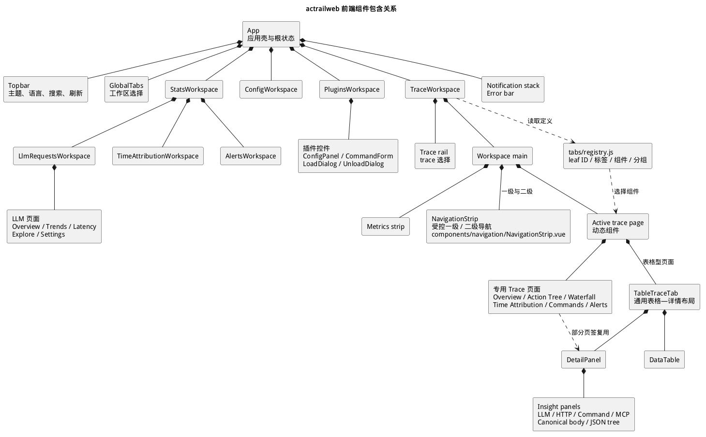
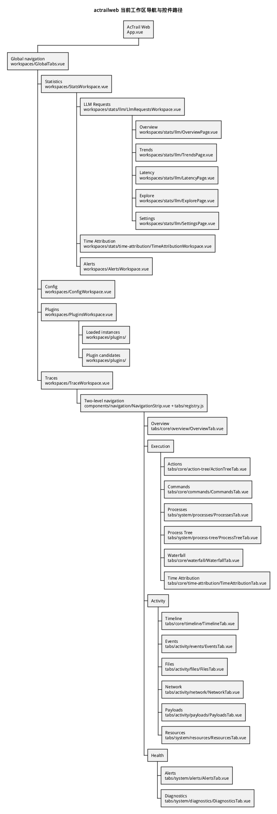
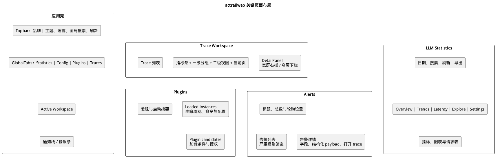
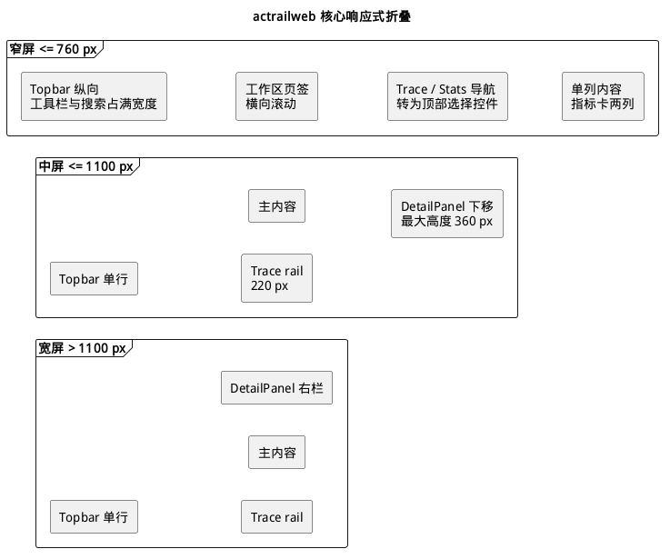

# Web 前端控件与页面布局

本文记录 `actrailweb` 当前控件层级、组合边界、关键页面布局和响应式规则。具体组件路径见 [代码布局](../../code-layouts/crates/apps/web/code-layout.md)，Navigator 与 Workspace 的交互契约见 [Navigator 与 Workspace](controls/navigation-workspace.md)。

## 控件层级

[](assets/web-frontend-components.puml)

- `App`
  - `Sidebar`：品牌、分组 Workspace 导航、仓库入口和收起/展开拨片。
  - `Header`：右对齐的悬浮操作簇，承载全局搜索、主题、语言和刷新。
  - Active Workspace：Statistics、Config、Plugins 或 Traces。
  - Notification stack 与 Error bar：跨 Workspace 反馈。
- `TraceWorkspace`
  - Trace rail：Trace 选择。
  - Metrics strip：当前 Trace 的摘要指标。
  - Primary `NavigationStrip`：Overview、Execution、Activity 和 Health 分组选择。
  - Secondary `NavigationStrip`：当前分组内的 leaf view 选择；Overview 不显示第二级。
  - Active trace page：由 registry 选择的动态组件。
- 表格型 Trace page
  - `TableTraceTab`：共享的表格—详情组合。
  - `DataTable`：行、选择和滚动边界。
  - `DetailPanel`：证据详情与 insight panels。
- 专用 Trace page
  - Action Tree、Waterfall、Time Attribution、Commands 和 Alerts 等保留自己的交互布局。

页面负责数据加载与用例编排；领域控件负责完整交互；共享控件只持有可复用的显示和输入语义。不得为了复用外观而把 Workspace 的业务状态、请求生命周期或跨页面跳转放进基础控件。

## 当前工作区导航

[](assets/web-frontend-navigation.puml)

当前 `Sidebar` 提供 Statistics、Config、Plugins 和 Traces 四个顶层 Workspace，按 Observe（Statistics、Traces）和 Control（Config、Plugins）两组展示。Statistics 的子页面使用内容区顶部的下划线标签。导航状态不写入 URL：顶层选择保存在 `App`，Statistics 与 Traces 的子选择由所属 Workspace 持有。

Trace 使用四组两级导航。一级为 Overview、Execution、Activity 和 Health，每组最多包含 6 个 leaf view。各 leaf view 通过稳定 ID 关联数据端点和详情组件；状态归属和分组见 [Navigator 与 Workspace](controls/navigation-workspace.md)。

## 关键页面布局

[](assets/web-frontend-layouts.puml)

### 应用壳

应用壳为两列网格：左侧 `Sidebar` 承载品牌、分组导航和仓库入口，右侧主列铺满视口。`Header` 绝对定位在主列顶部且背景透明，只渲染右对齐的悬浮操作簇。内容列顶部的渐变模糊带使滚动内容在悬浮控件下方渐隐。通知栈与错误条覆盖当前页面，不占用 Workspace 网格。

`Sidebar` 在 `216px` 与 `60px` 之间收起展开：拨片贴在侧栏右缘，宽度过渡完成切换，收起后只保留图标并隐藏分组标题与文字，状态记录在浏览器本地。主题、语言与刷新位于悬浮操作簇内。

### Trace Workspace

Trace 页面由左侧 Trace rail 和右侧主内容组成。主内容依次包含 Metrics strip、一级导航、当前组的可选二级导航和 Active trace page。使用表格—详情页面时，活动页再组合主视图与 `DetailPanel`。

### LLM Statistics

LLM Statistics 顶部统一提供日期范围、搜索、刷新和 CSV 导出。内部视图承载指标卡、趋势图、分布图、探索查询和显示设置。

### Plugins

Plugins 主体由 discovery/startup 摘要和插件主区组成；主区按 loaded instances 与 plugin candidates 分段。实例条目组合运行状态、host grants、command form、配置面板和 unload 控件。

### Alerts

Alerts 使用主从布局。列表负责严重级别筛选与告警选择，详情展示字段、结构化 payload 和打开对应 Trace 的入口。

## 响应式折叠

[](assets/web-frontend-responsive.puml)

- `1100px` 及以下：`Sidebar` 固定为图标宽度，隐藏导航文字、品牌副标题和收起拨片；Trace rail 收窄至 `220px`；表格—详情布局由左右两栏变成上下排列，详情最大高度为 `360px`。
- `760px` 及以下：`Sidebar` 变为内容上方的横向条，只保留品牌标记和导航图标；悬浮操作簇改为整行宽度；Trace 页面改为单列，Trace rail 移到内容上方，四项指标改为两列；Trace 组导航折叠为下拉选择。

Stats、Plugins、Alerts 与图表组件可以设置局部断点，但局部断点只能改变所属组件，不能改变顶层 Workspace 结构。稳定尺寸必须通过 CSS 变量或主题 token 管理，文档只记录布局语义和核心断点。

## 主题与源码拆分

本节源码路径相对于 `crates/apps/web/frontend/src/`。PlantUML 图中的源码路径作为普通文本标注。

### 主题组织


- `theme/contract.css` 声明主题无关的几何、排版、动效 token，并派生 `--trace-*` 组件 token。
- `theme/index.js` 暴露 `system`、`light`、`white`、`dark` 四个模式。`system` 跟随平台配色并在其变化时重新解析为 `white` 或 `dark`，其余三个模式固定色板；解析结果写入根元素的 `data-palette`，模式写入 `data-theme-mode`。
- `theme/light/`、`theme/white/` 与 `theme/dark/` 各提供一份角色色板。暖纸色板随应用 bundle 加载，另外两份由加载器按需注入，因此首屏不会因为等待样式而闪烁。
- 角色色板定义在 `:root` 与 `:root[data-palette='white'|'dark']`，body 与浮层同样继承当前色板。
- 玻璃与动效令牌由契约提供，并在窄视口、`prefers-reduced-motion` 或 `prefers-reduced-transparency` 下降级为实色与零时长。
- 角色 token 命名统一为 `--ui-*`；色板只覆盖颜色角色，几何与派生 token 由契约提供。


### 控件路径表达


架构图只标注对布局、状态或依赖边界有意义的控件。节点使用下列格式：

```text
控件名称
职责
相对于 crates/apps/web/frontend/src/ 的路径
```

全局组件图展示影响布局、状态或依赖关系的控件。复杂领域控件可以拥有单独文档；其入口组件记录精确路径，内部实现记录目录边界。

### 拆分规则

- 只有稳定的交互语义或被两个明确调用方复用时，才抽取共享控件。
- Workspace 负责导航选择、业务状态、数据加载和动态页面渲染。
- Workspace 保持自身状态高内聚；共享控件通过 props、events、`v-model` 和 slots 组合。
- 新目录应声明唯一公共入口，其余实现保持目录私有；导出范围遵循最小化原则。
- CSS 变量和主题 token 是稳定视觉值的代码真相，Markdown 不复制完整数值表。
