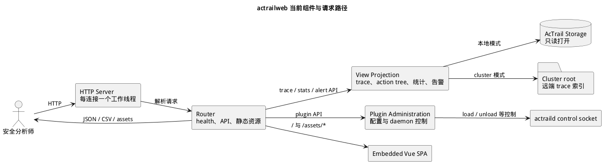

# Web Runtime

> 本文展示 `actrailweb` Rust 服务如何提供嵌入式前端、只读安全分析 API 和本地插件管理边界。

`actrailweb` 是独立的本地 HTTP 服务。它提供嵌入式单页应用（SPA）、trace 与统计 API、告警视图和插件管理入口；它不参与采集，也不写入 trace 主存储。Trace 是一次受观测进程树的证据集合。浏览器内部结构见 [actrailweb 前端架构](web-frontend/README.md)。



## 请求入口

HTTP server 绑定配置的监听地址，每个已接受连接由独立工作线程处理。请求读取受可选 timeout 约束，响应可以根据 `Accept-Encoding` 使用 gzip。`/health` 只证明 Web 进程能够处理请求，不代表 daemon、插件或所有 trace 数据均健康。

Router 将请求分为三组：

- `/` 与 `/assets/*`：返回编译时嵌入 binary 的 Vue SPA 资源；
- `/api/traces/*`、统计、告警和配置查询：调用 storage-backed view projection；
- 插件管理 API：读取 catalog 和配置，并通过 daemon control socket 执行需要授权的运行时操作。

## View Projection

本地模式在启动时验证 storage 路径，并始终以 `StorageOpenMode::ReadOnly` 打开后端。View 层把存储 contract 投影成面向界面的 JSON 或 CSV，包括：

- trace 摘要、事件、进程树、payload 和诊断；
- 渐进 action tree、语义时间线、命令、LLM request content 与 lineage；
- token、LLM activity 和 time attribution 统计；
- 告警与审计视图。

Time attribution 使用进程内缓存；清除缓存只影响派生统计，不修改主存储。

Cluster 模式不打开单一 storage，而是从配置的 cluster root 定位远端 trace 索引和对应数据。两种模式复用相同的 HTTP 表示，但数据入口不同。

### 渐进时间线查询

`GET /api/traces?page=1&limit=50` 返回 `traces`、`page`、`total`、`total_pages`，支持直接跳转任意正整数页号。支持 `trace_id`、名称完全匹配 `name`、创建时间纳秒闭区间 `from`/`to`，筛选在 SQL 中执行。本地按创建时间和 trace ID 倒序排列，排除已清理记录；过滤后的准确总数与当前页在同一读取事务中查询，仅加载当前页元数据与根进程。空结果总页数为 0，超过末页返回空列表与实际总数。浏览器用每页数量下拉和页码导航替换列表，当前选中的 trace 不因离开列表页而改变。精确计数与深页 offset 需要扫描相应元数据，不读取正文或构造动作树。列表是实时查询，数据变化后应刷新。

列表启动配置为 `ACTRAIL_WEB_TRACES_DEFAULT_LIMIT=50`、`ACTRAIL_WEB_TRACES_MAX_LIMIT=250`，须为小于 `i64::MAX` 的正整数并满足 `default <= max`。无效配置使 Web 启动失败。页号默认为 1；非法页号、单页数量或 offset 溢出返回请求错误。

Cluster 列表沿 `trace_uid` 主键升序排列，使用相同页号、单页数量和准确总数语义。名称与创建时间筛选在索引数据库查询中执行；创建时间筛选遇到非法的持久化时间字符串时返回请求错误。列表、metadata 和路由统一使用持久化 `trace_uid`；snapshot 内的数字身份以 `local_id` 单独展示，查询 snapshot 时才转换为本地 ID。UID 含 `/`，浏览器把整个 UID 编码为单个 URL 路径段，服务端切分路径后解码。导入顺序和重复导入不会改变已有 trace 的寻址身份。

`GET /api/traces/{id}/metadata` 返回 trace 元数据、根进程展示信息和 `timeline_bounds`。其中 `start_time_unix_nanos` 与 `end_time_unix_nanos` 是该 trace 动作开始时间的最小值和最大值，以纳秒字符串表示；没有动作时均为 `null`。`end_time_unix_nanos` 表示最晚开始时间，绘图轴终点可结合 trace 生命周期时间确定。存储通过开始时间索引的两个端点读取范围。Cluster snapshot 使用相同查询；没有 snapshot 时范围为 `null`。统计通过 `/summary` 显式读取。Flamegraph 与 waterfall 使用 `GET /api/traces/{id}/actions/timeline`，action tree 页面通过 `/action-tree/root` 和 `/action-tree/children/{parent_id}` 逐层读取节点。

时间线参数为 `kinds`（逗号分隔的 action kind）、`process_id`（内部进程身份）、`from`/`to`（Unix 纳秒）、`cursor` 和 `limit`。时间窗口按动作开始时间的闭区间筛选，两端条件在索引查询中执行。已加载动作超出当前视窗的部分由绘图裁剪。游标表示最后扫描的存储时间和内部 action key；页面关联使用原始 action ID。筛选条件变化后重新开始查询。

响应包含 `actions`、直接关联 `links`、辅助关联端点 `context_actions`、`next_cursor`、`has_more`、`scanned`、`links_truncated` 和 `partial`。辅助端点可能位于筛选范围外。候选预算用尽时允许空页带游标，由窗口加载器在预算内继续查询；分页不执行精确总数统计。关联达到预算时明确标记截断。运行中的 trace 可能继续变化，刷新更新范围和数据。

Flamegraph 与 waterfall 共用连续视口和固定时间原点。前端先加载当前可见范围，再预取两侧各半屏，保留选中详情。完整缓存范围直接复用；部分加载的窗口保留已读动作，不覆盖已有窄窗口，也不作为完整覆盖。失败保留已有数据，切换 trace、筛选条件或显式刷新使缓存失效。默认初始范围为 30 秒，导航请求延迟 120 毫秒合并，单次窗口查询最多读取 4 批、1000 个动作、1000 个关联端点和 4000 条关联。缓存另设 `maxCachedWindows=4`、`maxCachedActions=4000`、`maxCachedContexts=4000`、`maxCachedLinks=16000`，按各窗口保存的条目累计计算，重复条目也占预算；超过任一限制时淘汰较久未使用的窗口。展示数据从缓存按身份去重生成。默认值集中在 `workspaces/timeline/constants.js`，可通过 `TimelineWindow` 的 options 覆盖；缓存预算须容纳一次窗口查询。条目预算不代表固定字节上限，读取和绘图期间还有查询结果及派生模型的临时开销。

时间线读取热字段，不读取正文、冷属性或 evidence。LLM 正文在详情中按需请求；idle 和 time attribution 不进入时间线首屏依赖。

时间线默认种类包含命令、Agent、LLM 调用及 HTTP 消息。HTTP 消息使用已存储的请求方法与路径或响应状态作为标题；用户可通过种类和时间窗口筛选请求。

`GET /api/traces/{id}/idle-intervals` 显式分页查询已持久化的 hang episode。参数为 Unix 纳秒闭区间 `from`/`to`、`cursor` 和 `limit`；省略时间条件时从历史 episode 开始有限扫描。响应包含 `idle_intervals`、`next_cursor`、`has_more`、`scanned` 和 `axis_end_unix_nanos`。区间包含 `id`、`session_id`、`task_id`、`kind`、`start_time_unix_nanos` 和可空的 `end_time_unix_nanos`。游标沿首次检测告警 ID 升序推进；窗口筛选后的空页仍可带继续游标。开放区间的显示终点使用 `axis_end_unix_nanos`，终态 trace 取最早终态时间，运行中的 trace 取当前时间。前端显式加载当前范围并逐页替换，筛选变化后重置游标。Local 与 cluster 使用相同查询语义。

Web 启动时读取以下环境配置，非正整数或不满足 `default <= max <= candidates` 的预算关系会导致启动失败：

| 环境变量 | 默认值 | 用途 |
|---|---:|---|
| `ACTRAIL_WEB_TIMELINE_DEFAULT_LIMIT` | 250 | 未提供 limit 时的页大小 |
| `ACTRAIL_WEB_TIMELINE_MAX_LIMIT` | 1000 | 客户端可请求的最大页大小 |
| `ACTRAIL_WEB_TIMELINE_CANDIDATES` | 2000 | 单页候选扫描预算 |
| `ACTRAIL_WEB_TIMELINE_LINKS` | 2000 | 单页直接关联读取预算 |
| `ACTRAIL_WEB_IDLE_DEFAULT_LIMIT` | 100 | idle 默认页大小 |
| `ACTRAIL_WEB_IDLE_MAX_LIMIT` | 500 | idle 最大页大小 |
| `ACTRAIL_WEB_IDLE_CANDIDATES` | 1000 | idle 单页候选扫描预算 |

候选预算至少覆盖去重后的类型数量。`scanned` 包含索引取回的全部候选；多类型合并按各索引共同可确定的排序前缀推进游标。LLM Call 终态最多额外查询两条响应关联及一条响应热记录。Cluster 时间线从对应 `trace.sqlite` 快照查询。本地模式启动时校验数据库索引；cluster 启动验证中心索引，访问目标 snapshot 时校验其索引，故障仅影响当前请求。已有数据库由当前版本 writer 打开时准备索引，已有导出快照需重新生成。

### 正文查询预算

Web 启动读取下列环境变量，值必须为小于 `i64::MAX` 的正整数；非法值使启动失败。LLM request 前缀和节点查询使用只读 storage，预算错误只影响当前请求。

| 环境变量 | 默认值 | 用途 |
|---|---:|---|
| `ACTRAIL_WEB_CONTENT_MAX_BYTES` | 16777216 | LLM request、MCP content 与普通 HTTP 正文的 `max_bytes` 上限 |
| `ACTRAIL_WEB_CONTENT_NODE_MAX_ITEMS` | 250 | 节点查询 `limit` 上限 |
| `ACTRAIL_WEB_CONTENT_NODE_PREVIEW_BYTES` | 65536 | 字符串叶子与普通 HTTP 正文默认单页 UTF-8 字节预算 |
| `ACTRAIL_WEB_CONTENT_NODE_BLOCK_BYTES` | 8388608 | 节点查询累计读取的唯一 block 字节预算；普通 HTTP 正文的单次读取与解码预算 |

节点查询沿 skeleton 和必要 block 导航，返回当前子项页或字符串页。单个 block 超过剩余预算时明确报错。字符串页通过 `offset` 和 `next_offset` 定位，通过 `value_bytes` 和 `returned_bytes` 显示完整长度和本页长度。单页预算不足以容纳下一个 UTF-8 字符时返回局部请求错误；至少 4 字节可容纳任意单个字符。页预算与 block 预算由服务端环境设置，客户端通过 `pointer`、`offset`、`limit` 选择节点与分页。具体表示见 [LLM Request 当前投影路径](llm-request-projection.md)。

## 前端交付边界

Vue 构建产物在编译期嵌入 `actrailweb` binary。Router 只向 `/` 和 `/assets/*` 返回已登记的静态资源；页面导航、组件状态和响应式布局位于浏览器。完整构建链路、组件树与页面布局见 [actrailweb 前端架构](web-frontend/README.md)。

服务端返回持久化事实和派生 JSON，浏览器不会直接访问 SQLite 或 daemon 内部模块。大语言模型（LLM）请求详情按节点读取消息与工具字段，用户展开具体块后才读取正文。请求内容前缀接口仍按显式字节预算返回 `body_json`。该投影边界见 [LLM Request 当前投影路径](llm-request-projection.md)。

## 插件管理边界

插件 catalog、package 展示和配置校验位于 Web 的 `plugins/` 模块。需要改变 daemon 运行状态的 load、unload 或 command 请求通过本地控制 socket 发送给 `actraild`；Web 不直接操作 daemon 的插件宿主。

插件管理失败只影响当前 HTTP 请求。Trace 查询和静态资源仍可继续提供；单个连接中的解析或渲染错误由该连接返回，不终止监听循环。

## 源码导航

```text
crates/apps/web/
├── build.rs                    # 前端构建与嵌入式 asset table
└── src/
    ├── http.rs                 # HTTP server、router 与 API 路径
    ├── http/                   # 告警、插件和查询参数边界
    ├── view.rs                 # storage-backed view façade
    ├── view/                   # trace、action、stats、alert 等投影
    ├── plugins/                # catalog、package 与插件管理表示
    └── render.rs               # 嵌入式 SPA assets
```
