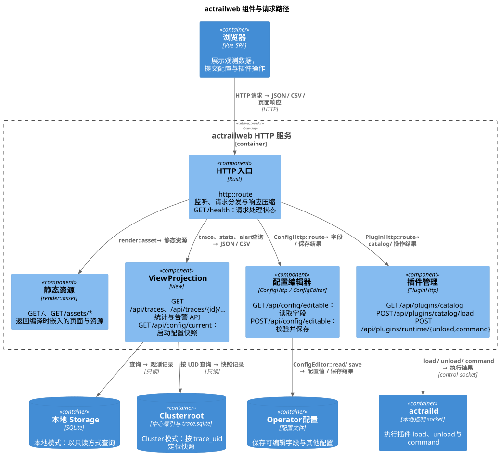

# Web Runtime

`actrailweb` 是独立 HTTP 服务，为浏览器提供安全分析页面、观测数据查询、配置编辑和插件管理。Trace 是一次受观测进程树的证据集合。

## 阅读索引

| 主题 | 本页 | 详细参考 |
|---|---|---|
| 请求如何处理 | [组件与入口](#组件与入口) | [源码导航](#源码导航) |
| 观测数据如何读取 | [数据查询](#数据查询) | [查询接口](../../reference/protocols/web-api.md#数据查询) |
| 时间线如何展示 | [按需加载](#按需加载) | [前端时间线](web-frontend/timeline.md) |
| 配置如何保存和生效 | [配置编辑](#配置编辑) | [配置接口](../../reference/protocols/web-api.md#配置编辑) |
| 插件如何管理 | [插件管理](#插件管理) | [插件操作指南](../../operations/plugins/manage.md) |
| 启动与请求失败如何处理 | [运行约束](#运行约束) | [Web 配置](../../reference/configuration/daemon.md#web-与-exportsnapshot) |

## 组件与入口

| 请求 | 处理组件 | 结果 |
|---|---|---|
| `/`、`/assets/*` | 静态资源处理器 | 编译时嵌入的 Vue 单页应用 |
| `/api/traces/*`、统计与告警 API | View Projection（存储到界面数据的投影层） | JSON 或 CSV |
| `GET /api/config/current` | View Projection | 启动配置摘要与文件原文快照 |
| `GET /api/config/editable`、`POST /api/config/editable` | 配置编辑器 | 可编辑字段或保存结果 |
| 插件管理 API | 插件管理模块 | 包目录、运行实例和操作结果 |
| `/health` | HTTP 服务 | Web 进程的请求处理状态 |

## 数据查询

### 数据来源

| 模式 | 数据入口 | Trace 身份 | 存储访问 |
|---|---|---|---|
| 本地 | 配置的 storage 路径 | 本地 trace ID | 启动时验证路径与索引，以只读模式打开 |
| Cluster | cluster root 下的中心索引与 `trace.sqlite` 快照 | 持久化 `trace_uid` | 启动时验证中心索引，查询时验证目标快照 |

两种模式使用相同的 HTTP 表示。Cluster 路由使用 `trace_uid`，进入快照查询时转换为快照内的本地 ID。

### 按需加载

| 用户操作 | 读取内容 | 接口或详细说明 |
|---|---|---|
| 浏览 Trace 列表 | 当前页元数据、根进程与准确总数 | [列表分页](../../reference/protocols/web-api.md#trace-列表) |
| 选择 Trace | 元数据、根进程与动作时间范围 | [Metadata](../../reference/protocols/web-api.md#metadata) |
| 平移或缩放时间线 | 时间窗口内的动作热字段、直接关联及辅助端点 | [时间线查询](../../reference/protocols/web-api.md#时间线) |
| 展开动作树 | 根节点或指定父节点的子节点 | `/action-tree/root`、`/action-tree/children/{parent_id}`，路径位于 `/api/traces/{id}` 下 |
| 打开正文详情 | 当前节点、子项页或字符串页 | [正文分页](../../reference/protocols/web-api.md#正文分页) |
| 查看 idle 区间 | 已持久化的停滞区间 | [Idle 查询](../../reference/protocols/web-api.md#idle-区间) |
| 查看统计 | summary、token、LLM activity 或 time attribution | 按所选统计显式查询 |

时间线查询读取热字段。正文在详情中单独加载。Time attribution 使用进程内派生缓存，清除缓存后由存储数据重新计算。

浏览器的窗口预取、缓存淘汰、总览索引与 LLM 编号见[前端时间线](web-frontend/timeline.md)。正文存储与投影见 [LLM Request 投影](llm-request-projection.md)。

## 配置编辑

| 阶段 | 行为 |
|---|---|
| 启动 | 解析编译内嵌的字段选择策略，校验字段路径，保存启动配置原文快照 |
| 读取 | 返回可编辑字段及控件类型，前端据此生成表单 |
| 保存 | 将提交字段合并到最新文件原文，经所属模块校验后原子落盘 |
| 生效 | 相关进程按启动机制加载新配置，Web 重启后更新启动快照 |

编辑入口要求 loopback 连接、匹配本机监听地址的 Host 和同源请求。POST 使用 `Content-Type: application/json`。字段选择、值的表示和错误码见[配置接口](../../reference/protocols/web-api.md#配置编辑)。

## 插件管理

| 职责 | 所属组件 | 行为 |
|---|---|---|
| 发现和展示 | Web 插件管理模块 | 按目录优先级扫描包，返回 catalog、配置与诊断 |
| 请求加载 | Web 插件管理模块 | 根据包选择键重新扫描并解析当前选中的包 |
| 执行 load、unload、command | `actraild` 插件运行时 | 通过本地控制 socket 接收请求并执行运行时操作 |

目录顺序、重复 ID、加载授权与操作步骤见[插件管理](../../operations/plugins/manage.md#四种状态)。Catalog 字段见[接口参考](../../reference/protocols/web-api.md#插件-catalog)。

## 运行约束

| 范围 | 行为 |
|---|---|
| HTTP 连接 | 每个已接受连接由独立工作线程处理，请求读取受可选超时限制 |
| 响应压缩 | 根据 `Accept-Encoding` 使用 gzip |
| 启动校验 | 无效查询限制、配置字段策略或本地存储索引导致启动失败 |
| 请求失败 | 查询、正文读取、配置保存和插件管理错误由当前请求返回，监听循环继续运行 |
| 索引准备 | 当前版本 writer 打开数据库时准备索引，已有导出快照需重新生成以补齐索引 |

服务端查询上限见 [Web 配置](../../reference/configuration/daemon.md#web-与-exportsnapshot)。前端构建与资源嵌入见[运行时与交付](web-frontend/runtime-and-delivery.md#构建与嵌入)。

## 源码导航

| 目录或文件 | 职责 |
|---|---|
| [`src/http.rs`](../../../crates/apps/web/src/http.rs)、[`src/http/`](../../../crates/apps/web/src/http/) | 监听、路由及 HTTP 参数处理 |
| [`src/view.rs`](../../../crates/apps/web/src/view.rs)、[`src/view/`](../../../crates/apps/web/src/view/) | Trace、动作、统计与告警投影 |
| [`src/configuration.rs`](../../../crates/apps/web/src/configuration.rs)、[`src/configuration/`](../../../crates/apps/web/src/configuration/) | 字段选择、配置校验与文件保存 |
| [`src/plugins/`](../../../crates/apps/web/src/plugins/) | 包发现、catalog 与插件管理 |
| [`build.rs`](../../../crates/apps/web/build.rs)、[`src/render.rs`](../../../crates/apps/web/src/render.rs) | 前端构建、嵌入与静态资源响应 |
| [`frontend/`](../../../crates/apps/web/frontend/) | 页面、交互与浏览器状态 |
