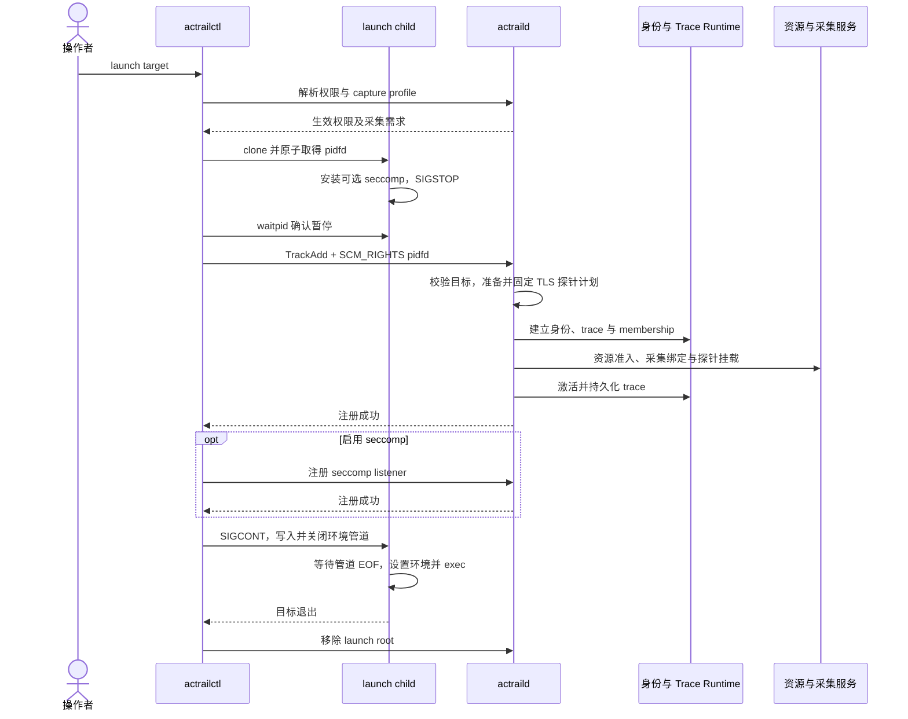
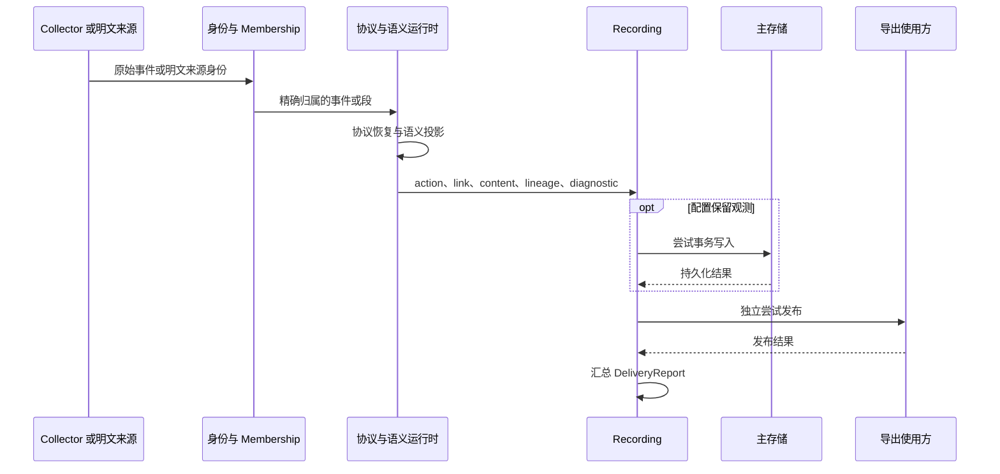
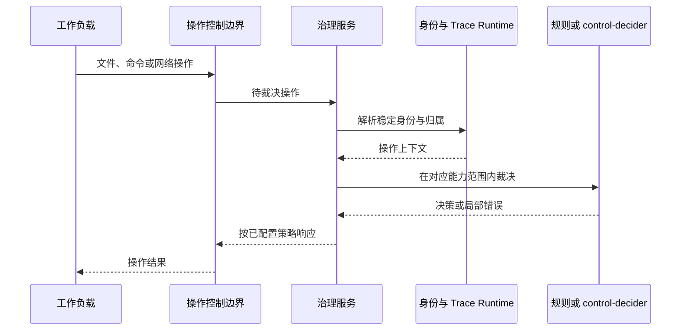
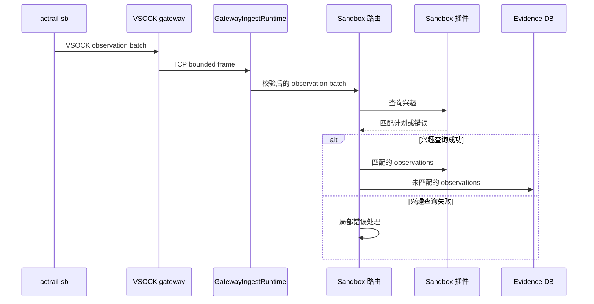
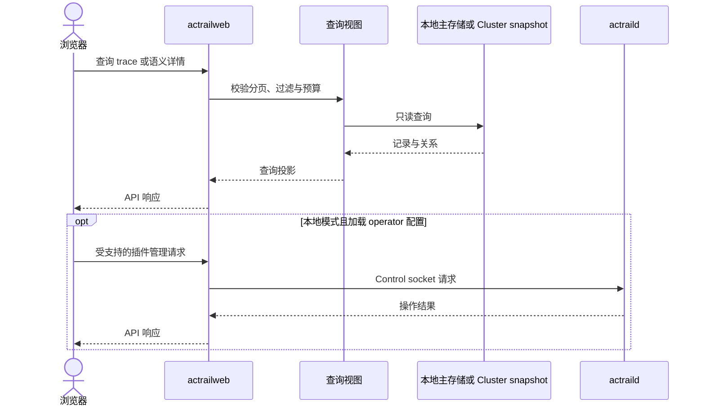

# 运行时序

本页说明跨组件的关键交互和状态交接。每条流程对应当前实现中的职责边界；静态关系见[架构图](c4-graphs.md)。

## 受控 Launch

ctl 准备启动目标和可选 TLS-sync 注入。默认 `bpf-copy` 由 daemon 在暂停屏障内生成并固定探针计划；TLS-sync 模式也向 daemon 请求计划解析。

pidfd 是 launch 目标注册的身份依据。暂停及环境管道屏障使目标执行发生在准入和注册之后；准备或注册失败时 ctl 清理子进程与已建立状态。进程 fork/exec 的双坐标与身份时序见[进程身份运行时](components/process-identity-runtime.md)。相关决策见[pidfd 注册](../decisions/0002-use-pidfd-for-launch-registration.md)。

## 观测与交付

主存储和导出的结果分别记录；资源样本使用[资源组件](components/resource-profiling/design.md)的独立存储路径。消息解码或内容预算失败限制在相应消费者内，底层观测按自己的条件继续处理。

## 操作治理

下图表示需要用户态响应的控制通知。LSM 规则预先编译并发布到内核，操作在内核裁决，用户态异步接收审计；要求同步用户态决定的规则无法编译为该 LSM 路径。

不同控制后端各自实现拦截和响应机制。seccomp、fanotify、LSM 与网络控制的职责见[Core Runtime](components/core-runtime.md)；插件控制能力见[control-decider API](../reference/plugin-api/control-decider.md)。

## Hand-side 路由

同一批可以包含匹配项与未匹配项，互斥边界是单条 observation。插件产生的告警另行进入 Sandbox Alert DB。数据与身份定义见[隔离运行时](components/execution-isolation.md)。

## 查询与管理

资源查询通过资源数据库接口读取样本；远端独占存储由接收端提供查询。Web 缓存、渐进时间线和正文预算见[Web Runtime](components/web-runtime.md)，前端状态与交付时序见[前端运行与交付](components/web-frontend/runtime-and-delivery.md)。
