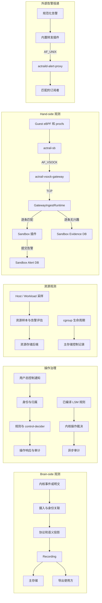

# 关键数据流

AcTrail 的观测、治理、资源采样、隔离观测和告警投递各自具有明确入口与故障边界。图中箭头表示数据或决策传递；交互顺序见[运行时序](../sequence-graphs.md)。

## 观测与治理

采集和下游解析各自处理失败。解析器、导出器或插件的故障限制在对应使用方或逻辑流。主存储与导出分别报告交付结果，存储失败后仍可尝试发布。

用户态通知治理在待裁决操作边界取得上下文并返回决策。LSM 使用预先发布到内核的规则完成操作裁决，用户态异步读取审计。审计进入对应观测路径，控制响应按所选 backend 和策略执行。

## 资源观测

资源样本使用组件拥有的 database、remote 或 hybrid 后端。cgroup 绑定及控制完成记录通过主存储持久化，样本投递为 best-effort。指标语义与生命周期见[资源设计](../components/resource-profiling/design.md)。

## 手侧观测

路由互斥粒度是单条 observation。同一批中，兴趣查询成功且有匹配插件的项投递插件，无匹配使用方的项写入 Sandbox Evidence DB。兴趣查询失败作为局部错误处理，不等同于无兴趣。

## 告警投递

告警持久化和外部转发分别报告结果。队列压力或代理断开可以丢弃转发副本；故障限制在转发使用方内。
