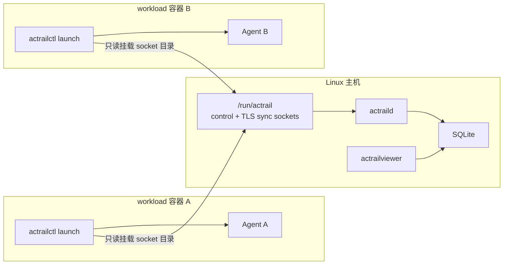

# 观测 Docker 容器中的工作负载

> 本文说明如何使用 Linux 主机上的 AcTrail daemon 安全观测一个或多个 Docker workload 容器。

`actraild`、SQLite 和 viewer 留在主机。容器只运行 `actrailctl launch` 与目标 Agent，并通过只读挂载的 `/run/actrail` 访问主机 control/TLS-sync socket。



## 前置条件

- **主机服务**：主机已经按 [主机部署](host.md) 启动 daemon。
- **容器镜像**：workload 镜像包含 `actrailctl`。显式选择 `tls-sync` 时还需包含 TLS sync runtime library。
- **模型与认证**：Agent、模型配置与密钥由镜像分层、只读挂载或 secrets 注入。
- **构建与配置**：主机和容器使用兼容的 release 产物与 operator config。

## 1. 选择 Docker seccomp 模式

| 模式 | seccomp-notify 行为 | 用途 |
| --- | --- | --- |
| Docker 默认 profile | 默认 eBPF 观测不安装 AcTrail seccomp-notify listener | 默认观测 |
| `deploy/container-auto/seccomp/actrail-notify.json` | 启用 notify，同时保留 Docker 外层 syscall 过滤 | 需要完整 launch-time seccomp 的推荐模式 |
| `seccomp=unconfined` | notify 可用，但关闭 Docker 外层过滤 | 仅限可信排障环境 |

默认启动等价于 `--seccomp-notify disabled`。启用 notify 需要 operator 配置和 CLI 同时显式 opt-in：

```toml
[seccomp_notify]
enabled = true
```

通过 `--seccomp-notify` 选择启动行为：

- **`auto`**：seccomp-notify 不可用时允许继续启动，此时依赖 notify 的采集和治理能力不可用。
- **`required`**：seccomp-notify 不可用时启动失败。需要确保安装 notify listener 时使用此值。
- **`disabled`**：关闭 seccomp-notify。

## 2. 创建 workload 容器

示例镜像必须已经包含工作负载与 AcTrail runtime：

```bash
export ACTRAIL_WORKLOAD_IMAGE=registry.example.com/agent-runtime:current
export ACTRAIL_SECCOMP_PROFILE=/absolute/path/to/AcTrail/deploy/container-auto/seccomp/actrail-notify.json

docker run -d --name actrail-agent \
  --user 0:0 \
  --security-opt "seccomp=$ACTRAIL_SECCOMP_PROFILE" \
  -v /run/actrail:/run/actrail:ro \
  -v /etc/actrail:/etc/actrail:ro \
  "$ACTRAIL_WORKLOAD_IMAGE" sleep infinity
```

模型密钥通过 Docker secrets 或受控环境变量文件提供。

## 3. 探测实际权限

```bash
docker exec actrail-agent actrailctl probe \
  --config /etc/actrail/actraild.conf \
  --host-ebpf auto \
  --seccomp-notify disabled \
  --json
```

- **完整探测**：该命令同时检查本地启动条件和 daemon 就绪状态。
- **本地探测**：`--skip-daemon` 仅检查本地条件。实际启动所用能力还需由 daemon 确认。

## 4. 启动受观测工作负载

```bash
docker exec actrail-agent actrailctl \
  --config /etc/actrail/actraild.conf \
  launch \
  --name container-agent \
  --host-ebpf auto \
  --seccomp-notify disabled \
  -- \
  /usr/local/bin/agent-runtime
```

- **启动单位**：每个容器中的每次 Agent 运行都应单独调用 `launch`。
- **共享连接**：多个容器可以挂载同一 `/run/actrail`，连接负责该 socket 的主机 daemon。

- **查看结果**：Trace 由主机上的 `actrailviewer` 查看。
- **故障排查**：容器看不到 socket 或出现 `pidfd_getfd ... Operation not permitted` 时，按 [部署故障排查](../troubleshooting/deployment.md) 处理。
