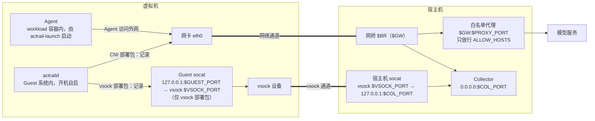
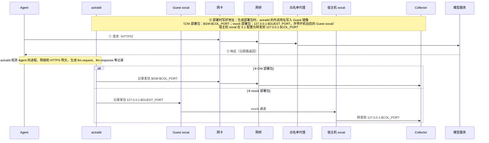
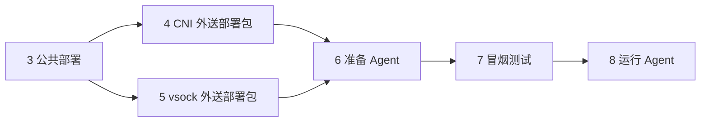

# 虚机容器部署

> 本文说明如何在一台 openEuler 24.03 主机（x86_64 或 aarch64）上从源码部署 AcTrail 虚机容器（Kata）测试环境，并在虚拟机中运行 Agent、采集其行为。两种架构的步骤相同，个别命令按部署参数 `ARCH` 选择文件。

Agent 运行在 Kata 虚拟机内的 workload 容器中。AcTrail 采集守护进程 `actraild` 运行在虚拟机的 Guest 系统中，观测 Agent 的进程、网络和模型调用，并把采集记录外送到宿主机的 OpenTelemetry Collector。宿主机、Guest 系统和 workload 容器均为 openEuler 24.03。

---

## 1 部署形态

| 维度 | 选项 | 说明 |
| --- | --- | --- |
| **虚拟机后端** | StratoVirt（默认）、Cloud Hypervisor | 由 Kata 调用的 VMM。只影响部署包的生成参数和 vsock 宿主机转发服务 |
| **外送方式** | CNI、vsock | CNI：记录经虚拟机网卡发往 Collector；vsock：记录经 vsock 通道发往 Collector，不依赖虚拟机网络 |
| **Agent** | 任意，示例为 Claude Code | Agent 程序和凭据（Agent 调用模型服务用的密钥，如 API key）在启动虚拟机时提供，不打包进镜像 |

**部署包**是 prepare 脚本生成的目录，代码中称为 artifact，包含 Guest 镜像、Kata 配置和 AcTrail 客户端。Collector 地址在生成时写入 Guest 镜像，因此每种「后端 × 外送方式」组合各需一个部署包，多个部署包可以在同一主机上并存。

prepare 先校验已有部署包：有效就复用，不存在或校验失败就重建并覆盖同一哈希目录。部署包目录名是内容哈希，输入一变目录名就变，因此部署时加 `--activate`：成功后把固定链接 `$REPO/local/kata/current/<后端>-<network|vsock>` 指向本次部署包，后续启动命令始终通过这个固定路径使用最新的部署包，同时清理未使用的旧部署包。仍被引用或使用的部署包会保留，无法确认使用状态时也保留并记录原因。

### 1.1 通道



- **网络通道**：每台虚拟机都有。Agent 访问外网经网桥和白名单代理；使用 CNI 部署包时，采集记录也经网桥发往 Collector。
- **vsock 通道**：使用 vsock 部署包时，采集记录经 Guest socat、vsock 和宿主机 socat 发往 Collector，不经过网卡。StratoVirt 使用所有虚拟机共用的宿主机 socat；Cloud Hypervisor 为每台虚拟机单独启动一个。
- 图中 `$` 开头的名称是部署参数，见 3.1 部署参数。

### 1.2 一次请求的数据流



⓪ 的地址在第 4、5 节生成部署包时写入，虚拟机开机后 `actraild` 按该地址外送，运行时不能修改。Agent 的请求和响应（①②）不经过 AcTrail。外送的只有 AcTrail 生成的记录（④）。本文生成的部署包使用默认的 `metadata-only` 模式，记录只含动作类型、状态和时间等元数据；需要命令行、消息预览等内容时见 4.2。完整请求正文和工具结果正文在两种模式下都不外送。

## 2 前置依赖

### 2.1 主机

| 项目 | 要求 | 必需 |
| --- | --- | --- |
| 操作系统 | openEuler 24.03 x86_64 或 aarch64，root 权限（全程在 `sudo -i` 的 root shell 中执行） | 是 |
| 硬件虚拟化 | `/dev/kvm` 可用：物理机开启 BIOS 虚拟化，云主机开启嵌套虚拟化。aarch64 还需 GICv3（内核日志含 `GICv3`） | 是 |
| 资源 | 内存 16 GB 以上，根分区可用空间 40 GB 以上 | 是 |
| 网络 | 可访问 openEuler 软件源、`atomgit.com`、GitHub、Rust 官网与 crates.io、npm 源、Docker Hub、`models.opencode.ai`（3.7 构建 workload 镜像时下载 OpenCode 模型目录） | 是 |

### 2.2 下载文件

| 文件 | 来源 | 必需 |
| --- | --- | --- |
| Kata 3.32.0 静态包 `kata-static-3.32.0-amd64.tar.zst`（x86_64）或 `kata-static-3.32.0-arm64.tar.zst`（aarch64） | GitHub `kata-containers/kata-containers` Releases | 是 |
| Kata 4.3.1 静态包 `kata-static-4.3.1-amd64.tar.zst`（x86_64）或 `kata-static-4.3.1-arm64.tar.zst`（aarch64），只取其中的 Guest 内核 6.18.56（3.5） | GitHub `kata-containers/kata-containers` Releases | 是 |
| Docker Compose 插件 `docker-compose-linux-x86_64` 或 `docker-compose-linux-aarch64` | GitHub `docker/compose` Releases | 用 Docker 运行 Collector 时 |
| OpenTelemetry Collector `otelcol-contrib_0.157.0_linux_amd64.tar.gz` 或 `…_linux_arm64.tar.gz` | GitHub `open-telemetry/opentelemetry-collector-releases` Releases | 不用 Docker 运行 Collector 时（3.9） |
| Agent 凭据，示例为 Anthropic API key（`sk-ant-api03-…`） | Agent 服务商控制台 | 是 |

### 2.3 部署流程



第 4、5 节可只做其中一节，也可两节都做；两种后端各做一遍时，修改 `BACKEND` 后重复第 4、5、7 节。代码块中 `# →` 表示预期输出。每次只粘贴一个代码块；任何一步返回非零或输出与预期不符时，保存输出并停止。

## 3 公共部署

### 3.1 部署参数

生成部署参数文件。后续代码块均以 `source` 该文件开头：

```bash
cat > /etc/actrail-test.env <<'EOF'
export REPO=/opt/AcTrail          # 源码目录，部署后不可移动
export BACKEND=stratovirt         # 虚拟机后端：stratovirt 或 cloud-hypervisor
export BR=actrail-cni0            # 网桥名
export SUBNET=10.89.77.0/24       # 虚拟机网卡网段
export GW=10.89.77.1              # 网桥地址
export COL_PORT=4318              # Collector 端口
export PROXY_PORT=18443           # 白名单代理端口
export GUEST_PORT=14318           # vsock 部署包中 Guest socat 的监听端口
export VSOCK_PORT=43180           # vsock 端口，Guest 与宿主机转发服务共用，取 1027–65535
export ARCH=$(uname -m | sed 's/x86_64/amd64/;s/aarch64/arm64/')  # 架构：amd64 或 arm64，选择下载文件和 Guest 内核
EOF
source /etc/actrail-test.env; echo $ARCH  # → amd64 或 arm64
```

部署完成后修改参数，需重新执行受影响的步骤：

| 参数 | 受影响步骤 |
| --- | --- |
| `BACKEND` | 4.1、5.2（原后端的部署包保留） |
| `BR`、`SUBNET`、`GW` | 3.8、4.1 |
| `COL_PORT` | 3.9、4.1、5.1 |
| `GUEST_PORT` | 5.2 |
| `VSOCK_PORT` | 5.1、5.2 |
| `PROXY_PORT` | 无，下次运行 Agent 时生效 |
| `ARCH` | 由 `uname -m` 得出，无需修改 |

Guest socat 地址 `127.0.0.1` 固定，不可修改。

### 3.2 安装系统包

```bash
dnf install -y containerd stratovirt containernetworking-plugins socat podman moby \
  git python3 nodejs npm firewalld parted e2fsprogs util-linux curl binutils zstd file cpio
systemctl enable --now containerd docker firewalld  # 启动容器运行时、Docker 和防火墙
```

- **`stratovirt`**：StratoVirt 后端的 VMM。Cloud Hypervisor 由 Kata 静态包提供，只用 Cloud Hypervisor 时可不装。
- **`socat`**：vsock 外送的宿主机转发使用。**`zstd`**：解压 Kata 静态包。**`cpio`**：3.5 构建 Guest 镜像时从 Kata initrd 中提取 Kata agent。
- **`podman`**：构建 workload 镜像。**`moby`**：运行 Collector；按 3.9 用二进制方式运行 Collector 时可不装，也不需要下面的 Compose 插件。

安装 Docker Compose 插件（文件位于当前目录）：

```bash
install -d -m 0755 /usr/local/lib/docker/cli-plugins
install -m 0755 ./docker-compose-linux-$(uname -m) /usr/local/lib/docker/cli-plugins/docker-compose
docker compose version  # → Docker Compose version v2.x
```

### 3.3 系统设置

```bash
ls -l /dev/kvm  # 确认硬件虚拟化可用
printf 'vhost_vsock\nvsock_loopback\n' > /etc/modules-load.d/actrail-vsock.conf  # 开机加载 vsock 模块
modprobe vhost_vsock; modprobe vsock_loopback  # 立即加载
lsmod | grep -cE '^vhost_vsock|^vsock_loopback'  # → 2
```

StratoVirt 的 vsock 外送依赖 `vhost_vsock`；Cloud Hypervisor 经宿主机上的 Unix socket 转发，不依赖该模块，加载也无影响。

### 3.4 获取源码

```bash
source /etc/actrail-test.env
git clone -b dev https://atomgit.com/openeuler/AcTrail.git $REPO  # 克隆 dev 分支
git -C $REPO log -1 --oneline  # 记录当前版本
test -f $REPO/deploy/virtual-container/host/prepare-artifacts.py && echo ok  # → ok；无输出说明版本过旧，不适用本文
```

### 3.5 安装 Kata 3.32 并构建 Guest 镜像

将 Kata 静态包安装到 `/opt/kata-3.32.0`，并注册 containerd runtime `io.containerd.kata332.v2`：

```bash
source /etc/actrail-test.env
bash $REPO/deploy/virtual-container/host/install-kata-3.32.sh --archive /path/to/kata-static-3.32.0-$ARCH.tar.zst
cat /opt/kata/VERSION  # → 3.32.0
```

静态包提供含 Kata agent 的 initrd、Cloud Hypervisor 和 virtiofsd；不提供 StratoVirt，StratoVirt 使用 3.2 安装的 `/usr/bin/stratovirt`。

Guest 内核使用 6.18.56，不使用 Kata 3.32.0 静态包自带的 6.18.35。从 Kata 4.3.1 静态包中只取出带 BTF 的调试版内核及其配置清单，放到独立目录，Kata 运行时仍为 3.32.0：

```bash
source /etc/actrail-test.env
install -d /opt/actrail-guest-kernel
tar --zstd -xf /path/to/kata-static-4.3.1-$ARCH.tar.zst -C /opt/actrail-guest-kernel --strip-components=5 --wildcards \
  './opt/kata/share/kata-containers/vmlinu*-6.18.56-208-debug' \
  './opt/kata/share/kata-containers/config-6.18.56-208-debug'
ls /opt/actrail-guest-kernel  # → config-6.18.56-208-debug、vmlinux-6.18.56-208-debug、vmlinuz-6.18.56-208-debug
```

6.18.35 存在 virtiofs 缺陷（上游 kata-containers issue 12589，CVE-2026-53381，6.18.37 修复）：容器主进程退出时 Guest 内核出错，kata-agent 不再响应，沙箱约 30 秒后被强制停止，容器退出码变为 255，aarch64 上几乎必现。

构建 openEuler 24.03 Guest 镜像：从宿主机的 openEuler 软件源安装 systemd、socat 等基础软件包，并从静态包的 initrd 中提取匹配的 Kata agent。镜像不含 AcTrail，第 4、5 节生成部署包时注入；CNI 和 vsock 两种部署包使用同一个镜像：

```bash
source /etc/actrail-test.env
install -d /opt/actrail-images
# --rootfs：中间目录，必须不存在或为空；--output-image：输出镜像，必须不存在
bash $REPO/deploy/virtual-container/guest/build-openeuler-image.sh \
  --rootfs /var/tmp/actrail-guest-rootfs \
  --output-image /opt/actrail-images/openeuler-24.03-guest.image \
  --kata-initrd /opt/kata-3.32.0/share/kata-containers/kata-containers-initrd.img \
  --expected-agent-version 3.32.0 \
  > /var/tmp/build-guest-image.log 2>&1; echo "rc=$?"  # → rc=0
grep -E '^(ACTRAIL_OPENEULER_GUEST_IMAGE_READY|agent=)' /var/tmp/build-guest-image.log  # → ACTRAIL_OPENEULER_GUEST_IMAGE_READY、agent=kata-agent version 3.32.0 …
rm -rf /var/tmp/actrail-guest-rootfs  # 删除中间目录
```

构建约 2 分钟，不需要挂载或特权容器。重新构建时先删除输出镜像；镜像变化后再执行第 4、5 节会生成新的部署包。

### 3.6 构建 AcTrail

```bash
source /etc/actrail-test.env
curl --proto '=https' -sSf https://sh.rustup.rs | sh -s -- -y --default-toolchain 1.90.0  # 安装 Rust 1.90.0
export PATH=/root/.cargo/bin:$PATH
cd $REPO
ACTRAIL_SKIP_JAVA_AGENT_BUILD=1 bash scripts/install-release.sh  # 安装构建依赖并构建 release 产物
ls target/release/actraild target/release/libactrail_tls_payload_probe_sync.so  # 确认产物存在
```

必须使用 `install-release.sh` 构建。单独执行 `cargo build` 可能生成不同的 TLS 采集模块，导致后续校验失败。中断构建后重新执行前，先确认没有残留的 `install-release.sh`、`cargo`、`npm` 进程：两个构建同时运行会使 `npm ci` 报 `ENOTEMPTY` 或 `ENOENT`。

### 3.7 构建 workload 镜像

workload 镜像是虚拟机中运行 Agent 的容器镜像，包含 openEuler 24.03、nodejs 和运行 Agent 的普通用户，不包含 AcTrail。基础镜像提供 amd64 和 arm64 两种架构：

```bash
source /etc/actrail-test.env
cd $REPO
podman pull docker.io/openeuler/openeuler:24.03-lts  # 拉取基础镜像
# 按仓库的 Containerfile 构建：BASE_IMAGE 指定基础镜像，-t 指定镜像名，最后一个参数是构建目录
podman build --network=host --format oci --build-arg BASE_IMAGE=docker.io/openeuler/openeuler:24.03-lts \
  -f deploy/virtual-container/workload/Containerfile.openEuler \
  -t docker.io/library/actrail-openeuler-workload:24.03 deploy/virtual-container/workload
```

导入 containerd（Kata 使用 containerd 中的镜像）：

```bash
install -d local/kata/workload
# 导出为 OCI 归档文件，再导入 containerd
podman save --format oci-archive -o local/kata/workload/actrail-openeuler-workload.oci.tar \
  docker.io/library/actrail-openeuler-workload:24.03
ctr -n default images import local/kata/workload/actrail-openeuler-workload.oci.tar  # 导入 default 命名空间
ctr -n default images ls -q | grep actrail-openeuler-workload  # → docker.io/library/actrail-openeuler-workload:24.03
```

### 3.8 配置 CNI 网络

为虚拟机提供网卡。网卡接入网桥 `$BR`，不做 NAT，虚拟机只能访问网桥地址上的服务：

```bash
source /etc/actrail-test.env
install -d /etc/actrail-cni-test
# bridge 插件把虚拟机网卡接入网桥 $BR；isGateway：网桥地址 $GW 作为虚拟机网关；
# ipMasq=false：不做 NAT，虚拟机不能直接访问外网；host-local：从 $SUBNET 为每台虚拟机分配地址
cat > /etc/actrail-cni-test/net.json <<EOF
{"cniVersion":"0.4.0","name":"actrail-cni-test","type":"bridge","bridge":"$BR","isGateway":true,"ipMasq":false,"hairpinMode":false,
 "ipam":{"type":"host-local","ranges":[[{"subnet":"$SUBNET","gateway":"$GW"}]],"dataDir":"/run/actrail-cni-test/ipam"}}
EOF
firewall-cmd --permanent --zone=trusted --add-interface=$BR  # 允许虚拟机访问宿主机服务（持久）
firewall-cmd --zone=trusted --add-interface=$BR  # 立即生效
firewall-cmd --get-zone-of-interface=$BR  # → trusted
```

两种外送方式都需要本步：Agent 访问外网始终经过该网卡。trusted 区域仅适合受控测试主机，不是生产访问控制方案。出现 `ZONE_CONFLICT` 表示该网桥名已绑定其他区域，先确认归属再处理，不要修改物理网卡或默认路由绕过。

### 3.9 启动 Collector

```bash
source /etc/actrail-test.env
cd $REPO/deploy/virtual-container/host-collector
printf 'OTELCOL_OTLP_HTTP_ENDPOINT=0.0.0.0:%s\nOTELCOL_DATA_DIR=/var/lib/actrail/otelcol\n' $COL_PORT > .env  # 监听地址与数据目录
install -d -o 10001 -g 10001 -m 0750 /var/lib/actrail/otelcol  # 10001 为 Collector 容器用户
docker compose --env-file .env up -d  # 启动 Collector
for i in $(seq 1 30); do  # 等待健康接口和监听端口，最多 30 秒
  curl -fsS --max-time 2 http://127.0.0.1:13133/ >/dev/null 2>&1 && ss -ltn | grep -q ":$COL_PORT " && break
  sleep 1
done; ss -ltn | grep -q ":$COL_PORT " && echo collector-ready  # → collector-ready
```

未输出 `collector-ready` 时，在本目录执行 `docker compose --env-file .env logs --tail 100` 查看原因。Collector 使用主机网络，OTLP HTTP 无认证，仅供受控测试网络使用。

**不用 Docker 时**（未安装 `moby`，或 Docker Hub 不通、拉不到 Collector 镜像）：改为直接运行同版本的 Collector 二进制，使用仓库同一份配置，数据目录与上面相同。Collector 与 compose 一样以 UID/GID 10001 运行，systemd 要求主机上存在该用户，否则启动失败（`status=217/USER`），因此先创建：

```bash
source /etc/actrail-test.env
cd /var/tmp && curl -fLO https://github.com/open-telemetry/opentelemetry-collector-releases/releases/download/v0.157.0/otelcol-contrib_0.157.0_linux_$ARCH.tar.gz
install -d /opt/otelcol-0.157.0 && tar -C /opt/otelcol-0.157.0 -xzf otelcol-contrib_0.157.0_linux_$ARCH.tar.gz
install -m 0755 /opt/otelcol-0.157.0/otelcol-contrib /usr/local/bin/otelcol-contrib
otelcol-contrib --version  # → otelcol-contrib version 0.157.0
# 创建 UID/GID 10001 的系统用户（useradd 提示 uid 大于 SYS_UID_MAX 可忽略）
getent passwd 10001 >/dev/null || { groupadd -g 10001 otelcol && useradd -r -u 10001 -g 10001 -d /var/lib/actrail/otelcol -s /sbin/nologin otelcol; }
install -d -o 10001 -g 10001 -m 0750 /var/lib/actrail/otelcol
install -d /etc/actrail-otelcol
sed 's#/var/lib/otelcol/#/var/lib/actrail/otelcol/#' $REPO/deploy/virtual-container/host-collector/otelcol-contrib.yaml \
  > /etc/actrail-otelcol/config.yaml
grep -n 'path:' /etc/actrail-otelcol/config.yaml  # → /var/lib/actrail/otelcol/actrail-traces.json
cat > /etc/systemd/system/actrail-otelcol.service <<EOF
[Unit]
Description=AcTrail host OpenTelemetry Collector (binary)
After=network-online.target
[Service]
User=10001
Group=10001
Environment=OTELCOL_OTLP_HTTP_ENDPOINT=0.0.0.0:$COL_PORT
Environment=GOMEMLIMIT=320MiB
ExecStart=/usr/local/bin/otelcol-contrib --config=/etc/actrail-otelcol/config.yaml
Restart=on-failure
MemoryMax=384M
NoNewPrivileges=yes
[Install]
WantedBy=multi-user.target
EOF
systemctl daemon-reload && systemctl enable --now actrail-otelcol
for i in $(seq 1 30); do  # 等待健康接口和监听端口，最多 30 秒
  curl -fsS --max-time 2 http://127.0.0.1:13133/ >/dev/null 2>&1 && ss -ltn | grep -q ":$COL_PORT " && break
  sleep 1
done; ss -ltn | grep -q ":$COL_PORT " && echo collector-ready  # → collector-ready
```

未输出 `collector-ready` 时用 `journalctl -u actrail-otelcol -n 100` 查看原因。

Collector 将收到的 span 写入 `/var/lib/actrail/otelcol/actrail-traces.json`（收到第一条记录后才创建）。安装查看工具 `actrail-otel-spans <起始时间> [trace 标题]`，按时间和标题列出 span：

```bash
cat > /usr/local/bin/actrail-otel-spans <<'EOF'
#!/usr/bin/env python3
# 列出 Collector 收到的 span。用法：actrail-otel-spans <起始时间，date +%s 格式> [trace 标题]
import datetime, json, os, sys
DATA = "/var/lib/actrail/otelcol/actrail-traces.json"
since = int(sys.argv[1]) * 10**9  # 起始时间换算为纳秒，早于它的 span 不列出
title = sys.argv[2] if len(sys.argv) > 2 else None  # 可选：只列出该标题的 trace
def attrs(items):  # 把 OTLP 的 key/value 属性列表转换为字典
    return {i["key"]: next(iter(i.get("value", {}).values()), "") for i in items or []}
count = 0
for line in (open(DATA, errors="replace") if os.path.exists(DATA) else []):  # 每行是一批数据（JSON）
    try:
        batch = json.loads(line)
    except ValueError:
        continue
    for rs in batch.get("resourceSpans", []):  # 每个 resourceSpans 属于一条 trace，标题在 resource 属性中
        name = attrs(rs.get("resource", {}).get("attributes")).get("actrail.trace.display_name", "")
        if title and name != title:
            continue
        for ss in rs.get("scopeSpans", []):
            for span in ss.get("spans", []):
                start = int(span.get("startTimeUnixNano", 0))
                if start < since:
                    continue
                count += 1
                # 输出：开始时间、动作名、trace 标题、动作状态
                print(datetime.datetime.fromtimestamp(start / 1e9).strftime("%H:%M:%S"),
                      f"{span.get('name', ''):<20}", name,
                      attrs(span.get("attributes")).get("actrail.action.status", "-"))
print("spans =", count)
EOF
chmod 755 /usr/local/bin/actrail-otel-spans
actrail-otel-spans $(date +%s)  # → spans = 0
```

## 4 CNI 外送部署包

### 4.1 生成部署包

使用 3.5 构建的 Guest 镜像生成部署包，Collector 地址为网桥地址：

```bash
source /etc/actrail-test.env
cd $REPO; export PATH=/root/.cargo/bin:$PATH; K=/opt/kata-3.32.0
case $BACKEND in   # 按后端选择 VMM、Kata 默认配置和 Guest 内核
  stratovirt)       HV=/usr/bin/stratovirt;     CFG=configuration-stratovirt.toml; KERN=vmlinuz-6.18.56-208-debug ;;
  cloud-hypervisor) HV=$K/bin/cloud-hypervisor; CFG=configuration-clh.toml;        KERN=vmlinux-6.18.56-208-debug ;;
esac
[ "$ARCH" = arm64 ] && KERN=vmlinux-6.18.56-208-debug  # aarch64 两种后端都用 vmlinux
# 生成部署包，参数：
#   --backend、--hypervisor、--*-config-source、--*-kernel：后端相关，取自上面的 case
#   --kata-prefix：Kata 安装目录
#   --activate：设为当前使用的部署包，更新固定链接 $REPO/local/kata/current/<后端>-<外送方式>，并清理未使用的旧部署包
#   --*-image-source：Guest 源镜像，即 3.5 构建的 openEuler 镜像
#   --workload-image：3.7 构建的镜像；--image-pull-policy never：只使用本地镜像
#   --egress-mode network、--otel-endpoint：CNI 外送，Collector 地址为网桥地址
#   输出写入日志，部署包生成在 $REPO/local/kata/artifacts/<哈希>/
python3 deploy/virtual-container/host/prepare-artifacts.py \
  --backend $BACKEND --kata-prefix $K --hypervisor $HV \
  --activate \
  --base-config-source $K/share/defaults/kata-containers/$CFG \
  --data-config-source $K/share/defaults/kata-containers/$CFG \
  --base-image-source /opt/actrail-images/openeuler-24.03-guest.image \
  --data-image-source /opt/actrail-images/openeuler-24.03-guest.image \
  --base-kernel /opt/actrail-guest-kernel/$KERN \
  --data-kernel /opt/actrail-guest-kernel/$KERN \
  --workload-image docker.io/library/actrail-openeuler-workload:24.03 --image-pull-policy never \
  --egress-mode network --otel-endpoint http://$GW:$COL_PORT/v1/traces \
  > /var/tmp/prepare-$BACKEND-network.log 2>&1; echo "rc=$?"  # → rc=0
```

返回非零时查看日志 `/var/tmp/prepare-$BACKEND-network.log` 并停止。成功后检查固定链接：

```bash
grep -E '^artifact_(cache|current)=' /var/tmp/prepare-$BACKEND-network.log  # → artifact_cache=…、artifact_current=…/current/<后端>-network
readlink -f $REPO/local/kata/current/$BACKEND-network  # → $REPO/local/kata/artifacts/<哈希>
test -f $REPO/local/kata/current/$BACKEND-network/configuration-data.toml && echo ok  # → ok
```

- **`--hypervisor`**：必须显式指定。Kata 默认配置中的 StratoVirt 路径 `/opt/kata/bin/stratovirt` 不存在。
- **内核版本**：使用 3.5 取出的 6.18.56，位于 `/opt/actrail-guest-kernel`；不要指向 `/opt/kata-3.32.0/share/kata-containers/` 下的 6.18.35。
- **内核格式**：x86_64 上 StratoVirt 使用压缩内核 `vmlinuz`，Cloud Hypervisor 使用 ELF 内核 `vmlinux`。aarch64 的 Kata 包中 `vmlinux-*` 为 ARM64 Image 格式，两种后端的默认配置都引用它，`vmlinuz-*` 只是它的 gzip 压缩版，因此两种后端都使用 `vmlinux`。均使用带 BTF 的 `-debug` 版本，数据采集需要。
- **`--base-*`、`--data-*`**：prepare 会同时生成 base 和 data 两份虚拟机配置。本部署流程使用 data（`configuration-data.toml`），base 参数填与 data 相同的值即可。两份配置的源镜像相同，部署包中只有一张 Guest 镜像 `guest.img`，两份配置共用。
- **`--activate`**：成功生成部署包后更新固定链接，并清理未使用的旧部署包。
- **外送属性**：不指定 `--otel-attribute-mode` 时为 `metadata-only`，只外送动作类型、状态和时间。需要外送命令行、消息预览等内容时见 4.2。
- 再次执行本步时，输入未变且部署包有效则直接复用（日志含 `artifact_cache=hit`）。

### 4.2 外送完整属性（可选）

默认的 `metadata-only` 模式不外送任何内容类属性。只有需要在 Collector 侧查看 Agent 实际执行的命令和对话内容时，才改用 `full` 模式：在 4.1 或 5.2 的 prepare 命令中追加 `--otel-attribute-mode full`，重新生成部署包。

- **外送的内容**：`full` 外送 `actraild` 已生成的全部属性，包括命令行、模型名、token 数、用户消息预览和回复文本。完整请求正文和工具结果正文仍不外送，另需在 Guest operator 配置中开启，见 [otel-http 插件](../plugins/otel-http.md)。
- **敏感信息**：命令行和消息中出现的密码、密钥会原样进入 Collector 的输出文件；Collector 开启 debug exporter 时还会进入它的日志。启用前确认 Collector 所在主机、输出文件和日志的访问范围。
- **生效方式**：模式写入 Guest 镜像，运行时不能修改；更改后需重新生成部署包，两种模式的部署包哈希不同。

## 5 vsock 外送部署包

### 5.1 安装宿主机转发服务

安装宿主机侧 socat 转发服务，将 vsock 端口 `$VSOCK_PORT` 的数据转发到 Collector：

```bash
source /etc/actrail-test.env
cd $REPO/deploy/virtual-container/vsock-egress
install -D -m 0755 -t /usr/local/libexec/actrail-vsock-egress host-bridge.sh ch-reconcile.sh  # 转发脚本
install -D -m 0644 -t /etc/systemd/system systemd/actrail-vsock-host-*  # systemd 单元
```

设置 vsock 端口为 `$VSOCK_PORT`、转发目标端口为 `$COL_PORT`：

```bash
D=/etc/systemd/system
install -d $D/actrail-vsock-host-stratovirt.service.d $D/actrail-vsock-host-cloud-hypervisor@.service.d
# systemd 覆盖配置：先清空原 ExecStart，再写入带 --vsock-port $VSOCK_PORT --collector-port $COL_PORT 的启动命令
# StratoVirt 转发服务
printf '[Service]\nExecStart=\nExecStart=/usr/local/libexec/actrail-vsock-egress/host-bridge.sh --backend stratovirt --vsock-port %s --collector-port %s\n' \
  $VSOCK_PORT $COL_PORT > $D/actrail-vsock-host-stratovirt.service.d/ports.conf
# Cloud Hypervisor 转发服务模板，%I 为虚拟机的 sandbox 目录名（printf 中写作 %%I）
printf '[Service]\nExecStart=\nExecStart=/usr/local/libexec/actrail-vsock-egress/host-bridge.sh --backend cloud-hypervisor --clh-vsock-socket /run/vc/vm/%%I/clh.sock --vsock-port %s --collector-port %s\n' \
  $VSOCK_PORT $COL_PORT > $D/actrail-vsock-host-cloud-hypervisor@.service.d/ports.conf
```

启用服务：

```bash
systemctl daemon-reload
systemctl enable --now actrail-vsock-host-stratovirt.service actrail-vsock-host-cloud-hypervisor-reconcile.path
systemctl is-active actrail-vsock-host-stratovirt actrail-vsock-host-cloud-hypervisor-reconcile.path  # → active active
ss -l --vsock | grep -c ":$VSOCK_PORT "  # → 1（StratoVirt 转发服务已监听）
```

| 后端 | 转发方式 |
| --- | --- |
| StratoVirt | 常驻服务 `actrail-vsock-host-stratovirt`，所有虚拟机共用，监听 vsock `$VSOCK_PORT` |
| Cloud Hypervisor | 每台虚拟机使用独立的 Unix socket `/run/vc/vm/<sandbox>/clh.sock_$VSOCK_PORT`；`…-reconcile.path` 监视 `/run/vc/vm`，虚拟机启动时创建 `actrail-vsock-host-cloud-hypervisor@<sandbox>`，删除时停止 |

两套服务同时启用，互不影响。

### 5.2 生成部署包

使用与 4.1 相同的 Guest 镜像生成部署包，Collector 地址为 Guest socat 的监听地址。与 4.1 的区别仅为 `--egress-mode` 和 `--otel-endpoint`：

```bash
source /etc/actrail-test.env
cd $REPO; export PATH=/root/.cargo/bin:$PATH; K=/opt/kata-3.32.0
case $BACKEND in   # 按后端选择 VMM、Kata 默认配置和 Guest 内核
  stratovirt)       HV=/usr/bin/stratovirt;     CFG=configuration-stratovirt.toml; KERN=vmlinuz-6.18.56-208-debug ;;
  cloud-hypervisor) HV=$K/bin/cloud-hypervisor; CFG=configuration-clh.toml;        KERN=vmlinux-6.18.56-208-debug ;;
esac
[ "$ARCH" = arm64 ] && KERN=vmlinux-6.18.56-208-debug  # aarch64 两种后端都用 vmlinux
# 生成部署包，参数含义同 4.1；区别：--egress-mode vsock-bridge 启用 Guest socat，
# --otel-endpoint 为 Guest socat 的监听地址，--vsock-port 与 5.1 宿主机转发服务一致
python3 deploy/virtual-container/host/prepare-artifacts.py \
  --backend $BACKEND --kata-prefix $K --hypervisor $HV \
  --activate \
  --base-config-source $K/share/defaults/kata-containers/$CFG \
  --data-config-source $K/share/defaults/kata-containers/$CFG \
  --base-image-source /opt/actrail-images/openeuler-24.03-guest.image \
  --data-image-source /opt/actrail-images/openeuler-24.03-guest.image \
  --base-kernel /opt/actrail-guest-kernel/$KERN \
  --data-kernel /opt/actrail-guest-kernel/$KERN \
  --workload-image docker.io/library/actrail-openeuler-workload:24.03 --image-pull-policy never \
  --egress-mode vsock-bridge --otel-endpoint http://127.0.0.1:$GUEST_PORT/v1/traces --vsock-port $VSOCK_PORT \
  > /var/tmp/prepare-$BACKEND-vsock.log 2>&1; echo "rc=$?"  # → rc=0
```

成功后检查固定链接，4.1 的 CNI 部署包保留不变：

```bash
grep -E '^artifact_(cache|current)=' /var/tmp/prepare-$BACKEND-vsock.log  # → 含 artifact_current=…/current/<后端>-vsock
readlink -f $REPO/local/kata/current/$BACKEND-vsock
test -f $REPO/local/kata/current/$BACKEND-vsock/configuration-data.toml && echo ok  # → ok
grep -cE "^  \"vsock_port\": $VSOCK_PORT,?$" $REPO/local/kata/current/$BACKEND-vsock/manifest.json  # → 1（与 5.1 一致）
```

## 6 准备 Agent

示例：[Claude Code](https://www.npmjs.com/package/@anthropic-ai/claude-code)（单文件 `claude.exe`，仅依赖 glibc）

```bash
npm install -g @anthropic-ai/claude-code@2.1.278  # 安装 Agent
$(npm root -g)/@anthropic-ai/claude-code/bin/claude.exe --version  # → 2.1.278 (Claude Code)
```

npm 按主机架构安装对应的 `claude.exe`（aarch64 上 `file` 显示 `ARM aarch64`）。npm 提示 `EBADENGINE`（要求 node 22）可忽略：`claude.exe` 是独立的原生程序，不使用系统 node。

保存 API key（8.4 方式 A 使用；采用方式 B 时跳过）：

```bash
read -rs K; printf '%s\n' "$K" > /root/.anthropic-api-key; unset K; chmod 600 /root/.anthropic-api-key  # 输入不回显
```

使用其他 Agent 时，需满足：

- **可在 workload 容器中运行**：容器为 openEuler 24.03（glibc 2.38），带 nodejs 20。依赖放在 Agent 程序目录中，或加入 workload 镜像（修改 3.7 的 Containerfile）。
- **支持 `HTTPS_PROXY`**：虚拟机仅能经白名单代理访问外网。
- **访问域名已知**：在 8.1 的 `ALLOW_HOSTS` 中列出。

## 7 冒烟测试

定义测试函数：使用 `$BACKEND` 的部署包启动虚拟机，在容器中经 `actrail-launch` 执行一条命令，检查 Collector 是否收到记录，然后清理。Cloud Hypervisor 的 vsock 部署包还会检查本机是否已为虚拟机启动转发服务：

```bash
source /etc/actrail-test.env
export PATH=/opt/kata-3.32.0/bin:/opt/kata-3.32.0/libexec:$PATH
smoke() {  # 参数：network 或 vsock；成功返回 0，任一步失败返回非零
  local MODE=${1:-} ART CID T0 OUT COUNT RC=0 NS=()
  case "$MODE" in network|vsock) ;; *) echo "用法：smoke network|vsock" >&2; return 2 ;; esac
  # 选择部署包，生成虚拟机名，记录开始时间
  ART=$(readlink -f "$REPO/local/kata/current/$BACKEND-$MODE")
  if [ ! -f "$ART/configuration-data.toml" ]; then
    echo "部署包不存在：$BACKEND-$MODE" >&2; return 1
  fi
  CID=smoke-$BACKEND-$MODE-$(date +%H%M%S); T0=$(date +%s)
  # CNI 模式接入网络命名空间；vsock 模式不配置 CNI 网络
  if [ "$MODE" = network ]; then
    if ACTRAIL_TEST_CNI_CONFIG=/etc/actrail-cni-test/net.json \
      "$REPO/deploy/virtual-container/host/cni-netns.sh" add "$CID" >/dev/null; then
      NS=(--with-ns network:/run/netns/$CID)
    else
      RC=1
    fi
  fi
  # 依次启动虚机、等待控制接口（最多 60 秒）、执行命令；失败后跳过后续测试，但仍执行清理
  if [ "$RC" -eq 0 ] &&
    ctr -n default run -d --runtime io.containerd.kata332.v2 --runtime-config-path "$ART/configuration-data.toml" "${NS[@]}" \
      --mount type=bind,src=$ART/workload-bundle,dst=/opt/actrail,options=rbind:ro \
      --mount type=bind,src=/dev/actrail,dst=/run/actrail,options=rbind:ro \
      docker.io/library/actrail-openeuler-workload:24.03 "$CID" /bin/sleep 600 < /dev/null &&
    ctr -n default tasks exec --exec-id w$$ --user 1000:39000 "$CID" \
      /bin/sh -c 'n=0; until [ -S /run/actrail/control.sock ]; do
        n=$((n + 1)); [ "$n" -lt 60 ] || { echo control.sock-timeout >&2; exit 1; }
        sleep 1
      done; echo control.sock-ready' < /dev/null &&
    ctr -n default tasks exec --exec-id l$$ --user 1000:39000 "$CID" \
      /opt/actrail/bin/actrail-launch --name "$CID" -- /bin/sh -c 'echo hello; sleep 1' < /dev/null; then
    # 等待外送，检查查看工具是否成功，以及收到的 span 数是否大于 0
    sleep 15
    if OUT=$(actrail-otel-spans "$T0" "$CID"); then
      printf '%s\n' "$OUT" | tail -1
      COUNT=$(printf '%s\n' "$OUT" | sed -n 's/^spans = \([0-9][0-9]*\)$/\1/p')
      if ! [ "${COUNT:-0}" -gt 0 ]; then
        echo "Collector 未收到本次测试的 span" >&2; RC=1
      fi
    else
      RC=1
    fi
    # Cloud Hypervisor + vsock：应有运行中的按虚拟机转发服务
    if [ "$BACKEND" = cloud-hypervisor ] && [ "$MODE" = vsock ]; then
      systemctl list-units --plain --no-legend --state=active 'actrail-vsock-host-cloud-hypervisor@*' | grep . \
        || { echo "未找到 Cloud Hypervisor 转发服务" >&2; RC=1; }
    fi
  else
    RC=1
  fi
  # 无论测试成功或失败，都清理本次虚机；仅 CNI 模式清理网络命名空间
  if ! ctr -n default tasks rm -f "$CID" >/dev/null 2>&1; then RC=1; fi
  if ! ctr -n default containers rm "$CID"; then RC=1; fi
  if [ "$MODE" = network ]; then
    if ! ACTRAIL_TEST_CNI_CONFIG=/etc/actrail-cni-test/net.json \
      "$REPO/deploy/virtual-container/host/cni-netns.sh" del "$CID"; then RC=1; fi
  fi
  return "$RC"
}
```

对已生成的部署包执行：

```bash
smoke network; echo "rc=$?"  # → control.sock-ready … hello … spans = N（N > 0），rc=0
smoke vsock; echo "rc=$?"    # → 同上，rc=0
```

`control.sock` 是 `actraild` 的控制接口，出现即表示 Guest 中的 AcTrail 已就绪。`spans` 大于 0 且 `rc=0` 时，该部署包验收通过。启动、执行命令、查看数据或清理失败时，函数返回非零；失败后仍会尝试清理本次虚机和 CNI 网络命名空间。清理时日志可能出现退出码 137（强制停止 `sleep`），以最终 `rc` 为准。

Cloud Hypervisor 的 vsock 冒烟结束后，再确认转发服务已随虚拟机停止：

```bash
sleep 5; systemctl list-units --plain --no-legend --state=active 'actrail-vsock-host-cloud-hypervisor@*'  # → 无输出（无其他虚拟机运行时）
```

## 8 运行 Agent

使用两个 root 终端：终端 A 准备环境、查看数据和清理；终端 B 进入虚拟机运行 Agent。以下以 Claude Code 为例，使用其他 Agent 时修改 8.1 的 Agent 变量和 8.7 的启动命令。

### 8.1 设置测试变量（终端 A）

```bash
source /etc/actrail-test.env
export EGRESS=network                                            # 外送方式：network 或 vsock
export AGENT=cc                                                  # Agent 简称，用于虚拟机命名
export AGENT_DIR=$(npm root -g)/@anthropic-ai/claude-code/bin    # Agent 程序目录，挂载到 /opt/agent
export ALLOW_HOSTS="api.anthropic.com"                           # Agent 访问的域名，空格分隔
export SECRET_FILE=/root/.anthropic-api-key                      # 凭据文件（8.4 方式 A 使用）
```

确定部署包、虚拟机名和日志目录，并保存变量供终端 B 使用：

```bash
export ART=$(readlink -f $REPO/local/kata/current/$BACKEND-$EGRESS)  # 按后端和外送方式选择部署包
export PATH=/opt/kata-3.32.0/bin:/opt/kata-3.32.0/libexec:$PATH
export CID=$AGENT-$EGRESS-$(date +%m%d-%H%M)  # 虚拟机（容器）名，也用作网络命名空间名
export WORK=/var/tmp/$CID  # 日志目录
mkdir -p $WORK; declare -p REPO BACKEND EGRESS AGENT AGENT_DIR ALLOW_HOSTS SECRET_FILE ART CID WORK > $WORK/env.sh  # 保存变量
ln -sfn $WORK/env.sh /var/tmp/actrail-current.env; echo "CID=$CID"  # 固定路径，供终端 B 读取
```

### 8.2 创建网络命名空间（终端 A）

```bash
ACTRAIL_TEST_CNI_CONFIG=/etc/actrail-cni-test/net.json $REPO/deploy/virtual-container/host/cni-netns.sh add $CID  # 创建接入网桥的网卡
```

### 8.3 启动白名单代理（终端 A）

仅放行 `ALLOW_HOSTS` 中域名的 443 端口，放行与拒绝记录在 `$WORK/proxy.log`：

```bash
# 在网桥地址 $GW 上后台启动 HTTP CONNECT 代理：ALLOW_HOSTS 中每个域名生成一个 --allow-host，
# --allow-port 443 只放行 HTTPS；放行与拒绝记录写入 proxy.log
nohup python3 $REPO/deploy/virtual-container/host/connect_proxy.py \
  --bind-host $GW --bind-port $PROXY_PORT $(for h in $ALLOW_HOSTS; do echo --allow-host $h; done) --allow-port 443 \
  --log-path $WORK/proxy.log > $WORK/proxy.out 2>&1 < /dev/null &
echo $! > $WORK/proxy.pid  # 记录代理进程号，清理时使用
```

### 8.4 准备凭据（终端 A）

凭据有两种提供方式，任选其一：

| 方式 | 说明 |
| --- | --- |
| **A 挂载凭据文件** | 宿主机复制一份凭据，8.5 启动虚拟机时挂载到容器的 `/run/agent-secret/key`，8.7 从文件读取。无需每次输入，适合重复测试和脚本化 |
| **B 进入后粘贴** | 宿主机不保存凭据，8.7 进入虚拟机后、启动 Agent 前粘贴。输入发生在 `actrail-launch` 之前，不会被采集 |

方式 A：复制一份仅容器内 Agent 用户可读的凭据：

```bash
mkdir -p /run/$CID-secret
install -o 1000 -g 39000 -m 0400 $SECRET_FILE /run/$CID-secret/key
chown 1000:39000 /run/$CID-secret; chmod 500 /run/$CID-secret
```

方式 B：只创建空目录，使 8.5 的挂载参数保持不变：

```bash
mkdir -p /run/$CID-secret
```

### 8.5 启动虚拟机（终端 A）

启动虚拟机及其中的 workload 容器，挂载 AcTrail 客户端、Agent 程序和凭据，并传入代理地址。容器主进程 `sleep 14400` 使虚拟机保持运行：

```bash
date +%s > $WORK/start-time  # 记录开始时间，查看 Collector 数据时使用
# 启动虚拟机及 workload 容器：
#   --runtime、--runtime-config-path：使用 Kata 3.32 和部署包中的 data 配置
#   --with-ns：使用 8.2 创建的网络命名空间（网卡）
#   --env：传入代理地址
#   --mount：挂载目录，见下表
#   最后两项：容器名 $CID，主进程 sleep 14400 使虚拟机保持运行 4 小时
ctr -n default run -d --runtime io.containerd.kata332.v2 --runtime-config-path $ART/configuration-data.toml \
  --with-ns network:/run/netns/$CID --env HTTPS_PROXY=http://$GW:$PROXY_PORT \
  --mount type=bind,src=$ART/workload-bundle,dst=/opt/actrail,options=rbind:ro \
  --mount type=bind,src=/dev/actrail,dst=/run/actrail,options=rbind:ro \
  --mount type=bind,src=$AGENT_DIR,dst=/opt/agent,options=rbind:ro \
  --mount type=bind,src=/run/$CID-secret,dst=/run/agent-secret,options=rbind:ro \
  docker.io/library/actrail-openeuler-workload:24.03 $CID /bin/sleep 14400 < /dev/null  # < /dev/null 防止 ctr 读走后续粘贴的命令
```

`--mount` 将以下目录只读挂载到 workload 容器：

| 来源 | 容器内路径 | 内容 |
| --- | --- | --- |
| `$ART/workload-bundle` | `/opt/actrail` | 部署包中的 AcTrail 客户端（`actrail-launch`、`actrailctl` 及其依赖） |
| `/dev/actrail` | `/run/actrail` | `actraild` 的控制接口。来源是 Guest 系统中的目录，宿主机上不存在 |
| `$AGENT_DIR` | `/opt/agent` | Agent 程序 |
| `/run/$CID-secret` | `/run/agent-secret` | 凭据（8.4 方式 A 为 key 文件，方式 B 为空目录） |

宿主机目录经 virtio-fs 共享进虚拟机，不复制文件。

等待 Guest 中的 AcTrail 就绪（最多 60 秒）：

```bash
ctr -n default tasks exec --exec-id ready-$(date +%s) --user 1000:39000 $CID \
  /bin/sh -c 'n=0; until [ -S /run/actrail/control.sock ]; do
    n=$((n + 1)); [ "$n" -lt 60 ] || { echo control.sock-timeout >&2; exit 1; }
    sleep 1
  done; echo control.sock-ready' < /dev/null
# → control.sock-ready
```

### 8.6 进入虚拟机（终端 B，宿主机）

```bash
source /var/tmp/actrail-current.env; export PATH=/opt/kata-3.32.0/bin:$PATH  # 读取终端 A 在 8.1 保存的变量
echo "CID=$CID"  # 与 8.1 输出的 CID 一致
ctr -n default tasks exec -t --exec-id tui-$(date +%s) --user 1000:39000 $CID /bin/bash  # 进入 workload 容器
```

`/var/tmp/actrail-current.env` 指向最近一次 8.1 保存的变量。同时进行多个测试时，改用 `source /var/tmp/<CID>/env.sh` 指定具体测试。

提示符变为 `[actrail@…]$` 表示已进入虚拟机。

### 8.7 启动 Agent（终端 B，虚拟机内）

准备家目录和工作目录（代理地址已由 8.5 传入，可用 `echo $HTTPS_PROXY` 确认）：

```bash
export TERM=xterm-256color HOME=/tmp/agent-home; mkdir -p $HOME /tmp/agent-work; cd /tmp/agent-work
```

示例：Claude Code 的配置

```bash
printf '{"hasCompletedOnboarding":true,"projects":{"/tmp/agent-work":{"hasTrustDialogAccepted":true}}}\n' > $HOME/.claude.json  # 跳过首次引导和目录信任确认
export DISABLE_AUTOUPDATER=1 CLAUDE_CODE_DISABLE_NONESSENTIAL_TRAFFIC=1  # 关闭自动更新和非必要请求
```

按 8.4 选择的方式设置 API key，二选一：

```bash
read -r ANTHROPIC_API_KEY < /run/agent-secret/key; export ANTHROPIC_API_KEY  # 方式 A：从挂载文件读取
```

```bash
read -rsp "API key: " ANTHROPIC_API_KEY; echo; export ANTHROPIC_API_KEY  # 方式 B：出现 API key: 后粘贴并回车（不回显）
```

方式 B 在虚拟机的 shell 中输入 key，不要在 Agent 界面中输入：Agent 启动后的输入会被采集。

经 `actrail-launch` 启动 Agent，`--name` 为 trace 标题：

```bash
/opt/actrail/bin/actrail-launch --name cc-tui-1 -- /opt/agent/claude.exe
```

在 Agent 会话中输入：

```text
用一句话介绍你自己
```

Claude Code 询问是否使用检测到的 API key 时选择 Yes。完成后输入 `/exit` 退出 Agent，再执行 `exit` 返回宿主机。

### 8.8 查看 Guest 数据（终端 A）

经 Kata debug console 进入 Guest 的 root shell：

```bash
kata-runtime exec $CID
```

在 Guest 中查看 trace 和模型调用，完成后执行 `exit`：

```bash
export HOME=/root; V="actrailviewer --config /etc/actrail/operator.conf"  # actrailviewer 需要 HOME；V 为命令简写
$V traces  # 列出所有 trace（编号、标题、状态），按标题 cc-tui-1 找到编号
$V actions --trace-id trace-1 | grep -E ' (llm|agent)[.]'  # 查看该 trace 的模型调用和 Agent 识别记录
```

示例中的编号为 `trace-1`。同一台虚拟机中多次执行 `actrail-launch` 时编号递增，替换为 `traces` 输出的实际编号。去掉 `| grep …` 可查看该 trace 的全部动作。

Guest 数据随虚拟机删除而清除。需要保留时，在清理前执行 `$V export-json --trace-id trace-1 --output /run/actrail/private/export/trace-1.json`。

### 8.9 查看 Collector 数据（终端 A）

Agent 退出后等待几秒（记录分批发送），并在 8.10 清理前执行。第一条按 8.5 记录的开始时间和 8.7 的 trace 标题列出 span；第二条检查凭据是否出现在 Collector 数据中：

```bash
actrail-otel-spans $(cat $WORK/start-time) cc-tui-1  # 列出本次 trace 的 span
grep -c -F -f /run/$CID-secret/key /var/lib/actrail/otelcol/actrail-traces.json  # 方式 A：凭据出现次数 → 0
```

方式 B 检查凭据：执行 `read -rs K; grep -c -F "$K" /var/lib/actrail/otelcol/actrail-traces.json; unset K`，粘贴 key 后回车，输出应为 0。

- **外送内容**：默认的 `metadata-only` 部署包只外送动作类型、状态和时间。按 4.2 使用 `full` 模式时，Collector 中的 `llm.request`、`llm.response` 还带模型名、token 数、用户消息预览和回复文本，命令类记录带命令行。
- **trace 标题**：span 不含虚拟机标识，各虚拟机的 trace 编号均从 1 开始。同时运行多台虚拟机时，为每台指定不同的 `--name`。

### 8.10 清理（终端 A）

```bash
ctr -n default tasks rm -f $CID; ctr -n default containers rm $CID  # 停止并删除虚拟机
kill $(cat $WORK/proxy.pid)  # 停止代理
ACTRAIL_TEST_CNI_CONFIG=/etc/actrail-cni-test/net.json $REPO/deploy/virtual-container/host/cni-netns.sh del $CID  # 删除网络命名空间
rm -rf /run/$CID-secret  # 删除凭据副本
```

## 9 注意事项

- **输入采集**：Agent 会话中的所有输入均被采集，不要在其中输入密码或密钥。测试后轮换密钥。
- **源码目录**：部署包位于 `$REPO/local/kata/` 下，部署后不要移动 `$REPO`。
