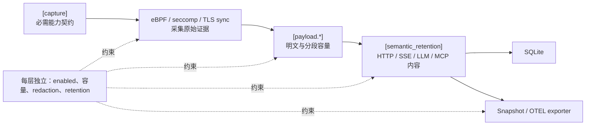

# 采集与内容保留配置参考

> 本文说明采集能力、payload、语义保留和主动治理配置之间的关系。

采集配置分为必需能力、证据采集、语义内容保留和数据输出。各层分别配置启用开关、容量和内容策略。

## `[capture]`

- **配置意图**：`profile_name` 标识配置意图。
- **必需能力**：`capabilities` 是每条 trace 必须满足的能力契约。当前 full-monitor 模板包含 process lifecycle/exec、file、mmap、network、stdio、TLS/socket plaintext、HTTP/HTTP2、resource metrics，以及 LSM 文件打开治理能力。
- **IPC 能力**：普通 IPC 的 `ipc-pipe-fifo`、`ipc-unix-socket` 默认不请求，P/C 等配置也不请求。MCP 专属通道关联独立于这两个能力。
- **治理后端**：访问控制各操作的后端默认使用 LSM，文件打开治理默认开启，目录操作、命令和网络治理须显式启用。
- **初始化模式**：`init` 的 complete 默认模式使用 eBPF 采集 TLS/socket 正文，seccomp-notify 关闭。profile 模式同时关闭主动治理。

### 后代采集深度

`agent_descendant_observation_depth` 控制 Agent 被识别后新建后代的详细采集深度。

- **不限深度**：默认 `-1` 表示不限制。
- **深度为零**：`0` 表示 Agent 保持详细采集、其未来后代仅保留生命周期。
- **指定深度**：正数表示继续详细采集对应层数的未来后代。
- **已有进程**：识别前已经存在的进程保持完整采集，生命周期和治理不受该选项影响。

能力保留在 `required`（必需）列表、但提供该能力的采集器被关闭时，配置或启动会失败。可选能力使用模板支持的 `opportunistic`（可用时启用）或 `disabled`（关闭）设置。

## `[ebpf]`

- **采集开关**：`enabled` 控制主机 eBPF collector。
- **资源容量**：map entry、ring buffer 和 path byte 上限约束内核与 daemon 资源。
- **文件路径**：`file_path_capture_enabled` 允许采集文件路径。实际上传和路径状态维护还要求采集计划请求文件能力。
- **MCP 端点关联**：`[ebpf.ipc_lineage]` 提供 MCP stdio 端点关联所需的采集许可与容量限制。

### 采集丢失诊断

- **汇总周期**：`diagnostics_summary_interval_ms` 控制采集丢失诊断的汇总周期，默认 `10000` 毫秒，必须大于零。
- **窗口计数**：窗口从首次发现新增失败开始计时，到期只保存和导出一条共享的 `event_transport_loss` 诊断（`trace_id = None`），包含各类新增计数。没有新增失败时不产生诊断。
- **汇总范围**：perf 丢失、内核传输与身份计数、stdio 组装丢失、文件 I/O 摘要失败使用同一窗口。
- **错误样例**：错误详情按固定类别保留窗口内首条样例，不逐事件缓存。
- **Trace 状态**：发现丢失后，活动 trace 立即标记为 `degraded`。已经降级的 trace 不重复写状态。
- **停机收尾**：正常停机在 exporter 关闭前补发最后一个非空窗口。

### 文件与 IPC 上下文

- **上传需求**：共享文件描述符（FD）上下文的上传由文件与 MCP stdio 的有效需求共同决定。
- **IPC 分类**：基础进程间通信（IPC）按自身采集能力使用内核 FD 分类，独立于 `ebpf.ipc_lineage.enabled`。
- **命名管道采集**：成功打开文件时，实际 inode 类型决定命名管道（FIFO）分类。`ipc-pipe-fifo` 包含所需的文件打开探针，因此文件能力关闭时仍可观测命名管道。FIFO 读写仅在存在 IPC 消费需求时上报。
- **端点展示**：FIFO 端点优先显示已采集的文件路径，否则显示进程编号和文件描述符（PID/FD）。这些信息用于展示，跨进程通道关联使用内核身份。
- **配置依赖**：要求 MCP stdio 投影而关闭 lineage 许可时启动失败，详见 [MCP stdio 配置依赖](../../architecture/components/mcp-stdio-observation.md#配置依赖)。
- **需求生效时间**：需求在共享运行时初始化时计算。空闲运行时的需求改变时重新加载。

### 共享运行时

- **能力预检**：主机 eBPF 预检实际加载并挂载程序，校验所需能力。
- **挂载生命周期**：预检成功的共享 runtime 保持挂载，事件 consumer 持续运行。trace 创建和结束维护进程跟踪状态，不触发预检挂钩的卸载或重新激活。
- **空闲开销**：没有观测目标时，业务事件由现有跟踪状态过滤。保持挂载仍有 hook 执行和 map 查询开销。

- **运行时复用**：新 trace 的能力请求与当前 runtime 兼容时直接复用。
- **计划不兼容**：无活动 trace 且计划不兼容时会释放并重新加载 runtime。已有活动 trace 且缺少必需能力时明确报错。
- **多计划预检**：预检多个不同计划时只保留最后一个 runtime。
- **资源释放**：共享 runtime 在替换或 daemon 关闭时释放程序、挂钩和 consumer。

- **计划范围**：共享计划决定程序挂载和上传范围。用户态根据绑定 trace 的实际采集能力，计算文件与 MCP 各自的上下文需求。
- **路径维护**：文件路径状态仅在 trace 有文件消费者时维护。
- **上下文过滤**：复用包含文件能力的 runtime 时，共享程序上传的文件上下文会在进入该 trace 时按需求过滤。

### 文件操作

- **fcntl 命令**：文件上下文中的 `fcntl` 只采集有消费者的命令：文件或 MCP stdio 需要 FD 复制结果，MCP stdio 还需要 `F_SETFD`。`F_GETFD`、`F_GETFL`、`F_SETFL` 不上传文件上下文。
- **ioctl 标志**：ioctl 的 FD 标志事实仅在有效 MCP 消费者存在时挂载和采集。
- **FD 身份**：内核为每个 FD 保存类别及区分编号复用的身份，并为网络连接维护共享对象引用计数。exec 后依据实际内核文件身份清理 FD 状态。

- **待完成操作**：`fcntl`、`close` 和共享可写 `mmap` 共用一个按线程索引的内核 pending map，容量使用 `ebpf.pending_operation_max_entries`。
- **结果上传**：参数与进程身份只保存一次，系统调用返回后上传 128 字节完成记录，用户态直接应用。
- **状态清理**：线程退出或上传失败均清理对应 pending 项。
- **close 结果**：`close` 保留失败结果。
- **mmap 范围**：文件 `mmap` 仅采集成功且带有 `PROT_WRITE`、`MAP_SHARED` 的映射，包含匿名共享映射。
- **TLS 映射**：TLS 可执行映射使用独立的 VMA 采集路径。

- **路径基址**：文件路径状态保存词法归一化后的绝对 cwd 和 FD 路径，相对路径解析复用这些基址。
- **调用记录**：待完成调用用一条记录保存系统调用与进程身份。
- **openat2 格式**：`openat2` 入口使用 384 字节单路径格式，出口上传 128 字节结果头。

- **映射归属**：仅请求 `fs-mmap` 且开启文件路径采集时，也会加载并校验 open、目录/FD 上下文及必要 FD 生命周期程序，以维持映射的文件归属。
- **路径解析失败**：基于显式目录 FD 的相对路径操作返回 `EBADF` 时，输出原始相对路径并标记 `unresolved_relative`。绝对路径按自身解析。
- **双目录操作**：两目录 FD 操作无法从 `EBADF` 判断哪一端无效，两侧依赖显式目录 FD 的相对路径均保持未解析。

## `[payload.tls]`

- **默认后端**：当前默认启用 `bpf-copy`，source/resolver/library 为 `auto`，不安装 TLS sync runtime。
- **TLS sync 路径**：显式选择 `tls-sync` 时，runtime library path 默认 `auto`，event socket 默认 `/run/actrail/tls-sync.sock`。

### TLS sync 事件发送

- **超时配置**：TLS-sync 事件发送端通过环境变量 `TLS_PAYLOAD_SYNC_EVENT_TIMEOUT_MS` 配置等待预算，默认 `100` 毫秒，必须为正整数且可表示为运行时期限。无效值在 native runtime 初始化时拒绝。该环境变量应在启动被观测命令前设置。
- **发送期限**：连接在发送线程内完成。每个发送批次共享一个绝对期限，部分写入或中断重试不重置期限。
- **退出处理**：退出排空使用独立的总体期限，到期后停止等待发送线程。
- **队列满载**：队列满时丢弃新事件。
- **通道故障**：连接或发送失败时停用当前进程的事件通道。
- **诊断输出**：发生传输失败或队列丢失时，发送线程尝试输出一条本地汇总诊断。
- **诊断计数**：`unconfirmed_events` 统计发送端未确认送达的事件，包含丢弃项及未完成发送批次。
- **诊断可达性**：通道故障可能导致 daemon 缺少该诊断。

### TLS sync 探针查询

- **超时配置**：TLS-sync 任务进程内的动态探针计划查询通过环境变量 `TLS_PAYLOAD_SYNC_PLAN_TIMEOUT_MS` 配置单次查询预算，默认 `100` 毫秒，必须为正整数且可表示为运行时期限。在启动被观测命令前设置，无效值在 native runtime 初始化时拒绝。
- **查询期限**：连接、请求发送及完整响应读取共用一个绝对期限，部分读写及中断重试不重置期限。
- **查询失败**：查询超时、连接或响应读取/解码失败时，按该二进制无探针点处理，并写入现有进程内计划缓存。同一缓存项不重复查询，业务继续运行。
- **采集影响**：查询失败时，相关 TLS 采集会缺失，不逐查询输出告警。
- **适用后端**：`bpf-copy` 不注入该 runtime，也不执行此查询。其启动探针发现和 daemon 侧动态发现由各自配置控制。

### 采集字段

- `max_segment_bytes`：单个 inline segment 上限。
- `max_operation_bytes`：一次 operation 可读取上限。
- `sync_max_frame_bytes`：TLS sync IPC 单帧上限，默认 `33554432`（32 MiB，包含 8 字节帧头）。必须容纳 operation 内容及事件元数据，也约束运行时 plan 响应。接收端在读取帧头后检查长度，异常帧只关闭对应连接。
- `ring_buffer_bytes`、`pending_operation_max_entries`：运行中容量。后者同时限制 Rustls 握手连接编号表的条目数，该表采用 LRU 淘汰，淘汰后的连接停止关联明文，直到该连接重新完成握手。
- `dynamic_discovery_capacity`：`bpf-copy` 探针解析器中待分析对象和已完成结果的单表总容量，同时限制探针分析任务队列，默认 `128`，必须大于 `0`。相同文件版本的待分析请求合并，容量耗尽影响本次发现。
- `direct_startup_discovery_enabled`：默认 `true`，仅作用于 `bpf-copy`。控制 `actrailctl launch` 放行前对启动命令和已配置 agent 命令的探针发现与挂载。关闭后允许启动时没有探针，运行中发现仍由下一项独立控制。
- `direct_dynamic_discovery_enabled`：默认 `true`，仅作用于 `bpf-copy`。控制运行中 exec 和可执行文件映射触发的对象发现与补挂。关闭时跳过动态探针发现。已安装探针仍可采集，文件映射事件继续处理。TLS 采集总开关为 `payload.tls.enabled`。
- `retention_max_bytes_per_trace`：每 trace 持久化上限。
- `redaction_policy`：写入前的内容 redaction，当前默认 `disabled`。
- `java_agent_enabled`：仅 Java JSSE workload 需要，默认 `false`。

### TLS sync 启动

- **运行库安装**：TLS sync 通过 `actrailctl launch` 安装运行库。
- **探针计划**：探针解析器根据目标二进制生成探针计划，明文采集范围取决于成功识别并安装的探针。

### Rustls 连接编号

- **编号分配**：在 aarch64 平台上，Rustls 的 eBPF 直接采集会验证明文入口、握手完成入口及证书链内存布局，然后按每次客户端握手分配连接编号。
- **编号关联**：证书链的独占堆分配作为采集侧查找键，编号在 `CommonState` 对象移动后保持不变。新握手覆盖同地址的旧记录。
- **适用后端**：连接编号同时用于 `bpf-copy` 和 seccomp 完整正文读取路径。
- **布局验证**：探针计划携带经机器码验证的布局。当前已验证 Codex 0.151.0 所用 Rustls 0.23.36 二进制的机器指令与证书链内存布局。

- **内核要求**：该连接编号路径要求内核支持 uprobe attach cookie（挂载探针时附带的标识值）。
- **读取失败**：证书链为空、字段读取失败或连接编号缺失时，跳过对应明文。
- **流量范围**：该路径覆盖握手完成后的客户端流量。覆盖范围以外包括握手前缓冲明文、0-RTT（握手完成前发送的数据）和无客户端证书的服务端连接。

### eBPF 直接采集

- **采集方式**：`capture_backend = "bpf-copy"` 使用用户态函数入口和返回探针（uprobe/uretprobe）直接采集，运行依赖为主机 eBPF。
- **启动发现**：通过 `actrailctl launch` 在放行程序前解析并挂载已知目标及可解析依赖，支持 OpenSSL、Rustls 和 BoringSSL 探针。
- **动态发现**：运行中可根据 exec 和文件映射事件发现新的可执行文件与共享库。
- **覆盖条件**：启动发现和动态发现开关相互独立，关闭任一项都可能减少覆盖。短进程可能在动态挂载前退出。
- **后代采集**：同 trace 后代命中已挂文件探针时仍可采集。

- **构建与主机要求**：该后端要求 ring-buffer 制品及主机 eBPF 可用。
- **能力就绪**：TLS 能力就绪表示实际 ring map、必要 BPF 程序与配置 map 已准备好。具体文件覆盖由成功挂载决定。
- **无初始探针**：无法生成适用 plan 的对象允许无初始探针启动，原因使用控制协议枚举码，由 ctl 展示。

- **分块长度**：TLS 的 `bpf-copy` 后端通过 eBPF 直接采集明文，按实际长度分块，每块最多 65,535 字节。
- **操作上限**：单次操作上限为 `max_operation_bytes` 与构建配置 `ACTRAIL_TLS_DIRECT_COPY_MAX_CHUNKS × 65535` 中的较小值。块数在 `.cargo/config.toml` 中默认配置为 100。
- **事件容量**：传输事件的缓冲空间随分块长度调整。
- **分块配置**：`max_segment_bytes` 参与配置校验，但该采集路径使用上述分块上限。
- **完整性**：达到采集预算会标记限采，事件缓冲区耗尽、读取失败及未安装探针会影响完整性。
- **seccomp 后端要求**：`seccomp-user-read` 和 `bpf-copy-seccomp-fallback` 要求显式开启 seccomp notify。

### TLS sync 传输格式

- **帧格式**：TLS sync IPC 使用二进制长度帧：`AT` 魔数、版本 `1`、消息类型各占固定字段，随后为小端 `u32` 正文长度。
- **正文编码**：事件正文直接传输原始字节。
- **消息分派**：payload、decision、summary 与 plan 查询/响应由消息类型分派。
- **接收缓冲**：daemon 增量接收半帧和连续多帧，共用读取缓冲区。

## `[payload.socket]`、`[payload.stdio]` 与 `[payload.mcp]`

本节帮助部署者选择 socket 明文采集后端，并理解两种模式的完整性保证。Socket 出站监听 `write`、`writev`、`sendto`、`sendmsg`，由 `payload.socket.capture_backend` 选择采集路径：

### Socket 出站：`bpf-copy`（默认）

- **运行依赖**：仅依赖 eBPF，不要求 seccomp notify。
- **读取容量**：成功 syscall 返回后，按实际完成长度和 `max_operation_bytes` 预算读取正文，每片最多 `min(max_segment_bytes, 4095)` 字节。
- **片段关联**：`writev`/`sendmsg` 按原顺序遍历 iovec，空片段跳过，所有片段共享 operation ID、连续 offset 和递增 chunk index。
- **达到预算**：达到操作预算时标记 `PolicyLimited`。
- **读取与传输失败**：读取失败或事件缓冲区耗尽时停止当前操作，保留已有丢失诊断与完整性事实。

### Socket 出站：`bpf-copy-seccomp-fallback`

- **启用条件**：完整采集需显式设置 `[seccomp_notify] enabled = true`。工作负载须通过能安装 seccomp listener 的路径启动，例如 `actrailctl launch` 或容器 seccomp profile。未启用 seccomp notify 时配置校验失败。
- **完成元数据**：该模式下 BPF 产生操作完成元数据，包括完成状态和序号。
- **正文读取**：需要正文的操作由 daemon 在 seccomp notify 上读取并切分，采集上限为 `max_operation_bytes`，适合需要完整 HTTP/LLM 消息的观测。
- **异常标记**：读取失败、缺口或操作未完整采集时，payload 标记为 `Truncated`，语义结果标记为 `partial`，并记录诊断。

### 后端配置

- **默认后端**：`actrailctl init --mode complete`（默认模式）和 `--mode profile` 均使用 TLS/socket `bpf-copy`，关闭 seccomp notify。
- **内容与容量**：内容保留与操作预算由各模式配置决定。
- **启用 notify**：选择 seccomp 后端时须同时开启 notify。
- **关闭 notify**：关闭 notify 时须将依赖它的后端改为 `bpf-copy`。

### Socket 入站

- **采集路径**：Socket 入站 `read`、`recvfrom` 在 syscall 返回时由 BPF 分段读取，两种后端均使用此路径。
- **分段容量**：每片最多 `min(max_segment_bytes, 4095)` 字节，每次 operation 最多 `max_operation_bytes` 字节。
- **片段关联**：各片共享 operation ID，携带连续 offset、chunk index 和各自的 stream sequence。
- **达到预算**：达到操作预算时标记 `PolicyLimited`。
- **读取与传输失败**：读取失败或事件缓冲区耗尽时停止当前操作，缺失的 sequence 由后续片段暴露，连接关闭时未完成消息保持不完整。
- **操作完成**：只有最后一片到达计划捕获总长时才报告 operation 捕获结束。
- **循环上限**：分段数必须不超过 Linux `bpf_loop` 的 8388608 次调用上限，超出配置在启动时拒绝。
- **默认事件量**：默认 4 MiB 操作预算与 4095 字节分段最多产生 1025 个事件。
- **传输容量**：ring buffer 容量与消费速度仍限制实际可送达的证据。

三类 payload 分别配置环形缓冲区、待完成操作容量、每条 trace 的内容保留额度和脱敏策略。

### 正文保留额度

- **执行后端**：`retention_max_bytes_per_trace` 由持久化后端执行。
- **额度统计**：SQLite 按 TLS、socket、stdio 分别统计每个 trace 实际保存的正文 bytes。组装后的 payload 继承原始 source，计入同一额度。
- **超额处理**：超过额度的 segment 保存元数据和空正文，`storage_omission` 整数编码为 `1`（retention limit）。`0` 表示未由此额度省略。
- **在线处理**：采集长度、完成状态与采集截断标记保持原始事实，在线协议分析与动作关联继续处理。
- **记录替换**：重复 segment 替换按旧、新实际字节差额计算。

- **计数来源**：SQLite 的计数 cache 从持久化行派生，只在该后端连接及其共享句柄内维护。
- **缓存容量**：启动时使用 `control.active_trace_max` 作为 cache 的 trace 容量。此值仅影响命中率，不限制可持久化的 trace 数，也不改变正文额度。
- **缓存失效**：cache 淘汰后从数据库重新统计。回滚或提交结果不确定时清空，trace 清理时失效对应项。
- **NoOp 存储**：NoOp 后端不保存正文，也不维护额度计数。

### Stdio 与 MCP

`payload.stdio.enabled=true` 允许 daemon 按下游需求启用 stdio，`false` 强制关闭。实际采集还要求已请求 `stdio-chunk`，并且满足以下至少一个消费者条件：

- MCP：`semantic_retention.projection_enabled=true`、`payload.mcp.enabled=true` 且 `capture_stdin=true`。
- L4：`semantic_retention.l4_payload.enabled=true`，且至少一个启用采集的方向，其 storage mode 为 `full` 或 `metadata-only`。

`payload.mcp.enabled` 默认 `false`，L4 默认关闭，因此刷新默认配置后 stdio 实际不采集。需要 MCP 识别时显式设置 `payload.mcp.enabled=true`。stdio 的默认按需许可会随有效消费者启用采集。

没有有效消费者时，stdio 采集关闭，有效采集计划移除 `stdio-chunk`，后续组装和重排没有 stdio 输入。配置文件中的 `true` 保留按需启用的含义。有效值在 daemon 启动构造采集服务时计算。

- **Stdio 保留模式**：Stdio 的 stdin/stdout/stderr 分别有 capture 和 storage mode。当前模板分别使用 `full`、`drop`、`metadata-only`，实际原始留存还受 L4 总开关控制。
- **MCP 容量与开关**：MCP 配置限制 parse buffer 与候选状态容量。关闭 MCP 会停止专属端点关联、bundle 和生命周期诊断。

## `[semantic_retention]`

HTTP/1 LLM 正文在 transfer framing 解码后增量处理 `Content-Encoding: br`、`gzip` 和 `zstd`，再交给 JSON/SSE 解析。压缩的 `text/event-stream` 和 `application/json` 正文按其 Content-Type 保留。TLS 裁剪摘要作为截断标记传递，不参与原始流拼接。

`semantic_retention.l0_llm_call.assembly.max_buffer_bytes` 限制解码后的正文大小；HTTP/1 wire 缓冲由 `semantic_retention.l2_http.http1.max_buffer_bytes` 限制。内容编码损坏、无法解码或超出容量时，仅结束受影响消息的正文消费，HTTP framing 继续处理真实消息边界。

各压缩实现使用库原生窗口设置；历史窗口、上下文和临时输出缓冲区另有内存开销。`assembly.max_buffer_bytes` 约束累计解码正文。

`semantic_retention.l2_http.max_active_directions` 限制共享协议路由同时持有的连接方向数，默认 `4096`，必须大于零。一个双向连接最多占两个方向。关闭连接或 trace 后释放。达到上限时拒绝新方向并记录告警，已接纳方向继续处理。该容量对普通 HTTP 和 LLM 请求均生效。

`semantic_retention.l2_http.exchange.max_message_facts_per_trace` 限制每个 trace 同时等待协议与语义关联的 HTTP 消息记录，默认 `4096`，必须大于零。一次完整请求/响应通常占两条消息。已完成的请求响应配对在当前 payload 处理事务补充观测数据后释放。达到容量时结束受影响消息的关联处理，并记录不完整原因。

`semantic_retention.l0_llm_call.projection_state` 限制动作版本、待关联到执行轨迹的动作和工具条目数量。HTTP 请求响应配对容量位于 `l2_http.exchange`，WebSocket 响应关联状态与待响应请求容量位于 `l0_llm_call.websocket`。

### HTTP/1 协议容量

- **字节容量**：`semantic_retention.l2_http.http1.max_buffer_bytes` 限制 HTTP/1 wire 缓冲，默认 `8388608` 字节。
- **证据容量**：`max_evidence_ranges` 限制其采集证据范围数，默认 `8192`。
- **配置要求**：两者必须大于零。
- **正文处理失败**：内容解码失败或正文组装超限只终止该消息的正文消费，HTTP framing 继续根据真实消息边界完成。
- **协议容量耗尽**：协议缓冲或证据容量超限才中止协议消息。

### HTTP/2 协议容量

- **单帧容量**：`semantic_retention.l2_http.http2.max_frame_bytes` 限制 HTTP/2 单帧大小，默认 `65536` 字节。
- **连接缓冲**：`max_connection_buffer_bytes` 限制共享 HTTP/2 协议缓冲，默认 `4194304` 字节。
- **配置要求**：两者必须大于零，作用于唯一 frame decoder，独立于 LLM 正文组装预算。
- **内容预览**：frame 内容预览仍由 application HTTP/2 观测配置控制。
- **协议完整性**：捕获缺口或 framing 完整性丢失后，受影响连接停止解析至连接关闭，防止把帧中间的字节当作新消息。

`semantic_retention.l2_http.http2.max_active_streams_per_trace` 限制每个 trace 的活动 HTTP/2 stream 数，默认 `4096`，必须大于零。每个 stream 的两个方向共用一个名额，结束后释放。该上限限制协议生命周期状态，消息事实容量另由 `exchange.max_message_facts_per_trace` 控制。

`semantic_retention.l2_http.http2.max_evidence_ranges` 限制 HTTP/2 协议缓冲中的采集证据范围数，默认 `4096`，必须大于零。它与字节上限共同限制大量细小片段的元数据内存，独立于 LLM 正文证据预算。

### WebSocket 观测与容量

- **来源观测**：`semantic_retention.l2_websocket` 控制 WebSocket 消息来源观测和协议预算。`enabled` 与 `message_summary` 默认均为 `true`，保留 `websocket.message` 的身份、方向、opcode、时间、完整性及 evidence，不复制消息正文。
- **独立开关**：关闭来源留存不会停止已启用的 LLM 内容解析。关闭 LLM 不停止 WebSocket 协议观测。
- **容量要求**：所有容量值必须大于零。

| `l2_websocket` 字段 | 默认值 | 作用域 |
| --- | --- | --- |
| `max_active_connections` | `4096` | 运行时全局活动连接数 |
| `max_frame_buffer_bytes` | `8388608` | 每个连接方向的 frame 缓冲字节 |
| `max_message_bytes` | `16777216` | 单条消息组装字节 |
| `max_decoded_message_bytes` | `33554432` | 单条消息解压后字节 |
| `max_evidence_ranges` | `4096` | 协议状态保留的采集证据范围数 |
| `compact_threshold_bytes` | `65536` | 已消费 frame 缓冲触发压缩整理的字节阈值 |

`semantic_retention.l0_llm_call.websocket.max_lanes_per_connection` 和 `max_pending_requests_per_connection` 默认均为 `32`，必须大于零，分别限制每连接的 provider 响应关联状态与待处理请求。这些内容关联预算独立于协议连接、frame 和消息预算。内容容量耗尽仅结束受影响的 LLM 消费，不改变 WebSocket 来源消息的真实传输终态。

### 语义投影开关

使用 NoOp 存储时，观测数据仅用于在线处理，已配置的语义分析与在线导出继续运行。语义分析由下述 `projection_enabled` 开关控制。

- **默认开关**：`projection_enabled` 默认 `true`。
- **关闭语义投影**：设为 `false` 时，停止进程、命令、文件、HTTP、LLM、MCP、工具和治理事件的语义动作及关联投影，以及这些语义投影的正文处理和结束输出。
- **进程与原始记录**：进程身份注册、trace 生命周期及原始事件记录继续运行。
- **协议观测**：共享 HTTP 消息解析、协议诊断及原始结束观测仍按应用协议配置运行。
- **原始内容**：payload 采集和原始 payload 保留由各自配置控制。
- **生效时间**：该开关在 daemon 启动时生效。

关闭投影要求 `capture.agent_descendant_observation_depth = -1`。其他深度值依赖语义 agent 识别来设置采集范围，两者冲突时 daemon 启动失败。

### 内容归属

当前默认 `content_owner = "highest_consumed"`：内容被更高语义层处理后，低层只保留摘要、计数、传输元数据与采集证据引用。

- **归属依据**：内容归属依据共享协议与语义解析结果确定。
- **归属明确**：只有当前片段的归属可完整确定时才省略低层正文。
- **归属待定**：混合消息、尚未确认的内容或边界不完整的片段按原始保留配置处理。
- **判断时机**：每个片段采用处理时已知的归属结果。

| 层 | 当前默认重点 |
| --- | --- |
| `l0_llm_call` | 启用；request `canonical_blocks`；request body export `none`；response `assembled_provider` |
| `l0_mcp_call` | request/response `canonical_json` |
| `l1_sse` | 保留 stream summary，不保留 event content |
| `l2_http` | 保留 message summary、header metadata 和 body text |
| `l2_websocket` | 保留原生消息 summary 和 evidence，不重复正文 |
| `l3_http2_frame` | 保留 frame summary，不保留 DATA content |
| `l4_payload` | 当前关闭 body retention，只保留 stats |

### 工具结果导出

`semantic_retention.l0_llm_call.tool_results_enabled` 默认 `true`，控制 `llm.tool_result` 动作及其关联的投影。设置为 `false` 后，在收集工具结果之前退出该投影。请求内容、响应工具声明和进程/文件采集分别由各自开关控制。

- **默认导出**：工具结果内容导出由 `tool_result_content_export` 控制，默认 `none`，此时不为结果内容计算或输出 `content_bytes`。
- **规范化长度**：设置为 `canonical_json` 时，结果带精确规范化长度。
- **正文上限**：设置为 `canonical_json` 时，正文超过 `tool_result_content_export_max_bytes`（默认131072字节）会省略正文并标记 `too_large`。
- **配置依赖**：开启该导出要求 `tool_results_enabled=true`，冲突配置在启动时失败。

### LLM 请求与响应

- **解析条件**：当 LLM 请求内容为 `none`，且工具结果投影、请求体导出和 trajectory 均关闭时，请求解析只生成 provider 分类、模型和后台请求分类所需的事实。
- **解析与校验**：已有 codec 仍优先执行。JSON 的 Unicode、数字范围、递归深度及尾随数据校验继续生效。
- **请求识别**：HTTP1 的 POST、JSON Content-Type 和已知 LLM 路由也可提供请求识别证据。
- **消息消费**：选择字段解析仍消费完整消息。后台分类需要的文本可能暂存到消息最终角色确定，转义文本仍需解码。
- **传输证据**：报文完整性及时间戳沿用传输层证据。

响应的正文、工具声明和 usage 开关分别传入 provider 解析器，在相应内容构建前判断。响应识别、chunk 和完成证据独立于保留的字符串。

- **终止事件**：Responses、Anthropic和Chat的SSE显式完成、失败和不完整终态沿同一解析状态传递。
- **完成标记**：`llm.response.done=true` 表示已观察到协议终止，失败不会被后续普通完成标记覆盖。
- **失败与限采**：完整采集的 provider 失败记录为 `error/partial`。限采沿用 `capture_limited` 完整性规则。
- **传输截断**：没有 provider 终态的传输截断仍为 `done=false`。
- **错误事件识别**：通用 error 事件仅在真实协议事件已确认 provider 后处理，HTTP Content-Type 和请求关联本身不构成响应识别证据。

- **异常隔离**：容量耗尽、采集截断（`Truncated`）或操作未完整采集时，仅隔离受影响的传输方向或数据流，并记录诊断。
- **恢复条件**：重新观察到可信的消息边界后恢复请求关联。
- **预期限采**：达到配置采集上限（`PolicyLimited`）时也会隔离缺失字节，并在恢复时保持静默。

## 治理配置

- **作用范围**：`[enforcement]`、`[command_control]` 和 `[network_control]` 会改变工作负载行为，不只是采集。
- **默认设置**：当前生成配置保留 fanotify 文件控制，但 seccomp syscall 列表为空，命令控制和网络控制关闭。
- **启用条件**：需要同步治理时，部署必须显式启用 seccomp-notify 及对应控制能力，并审查规则文件、default/failure decision、gray timeout/fallback、审计和 capability 组合。
