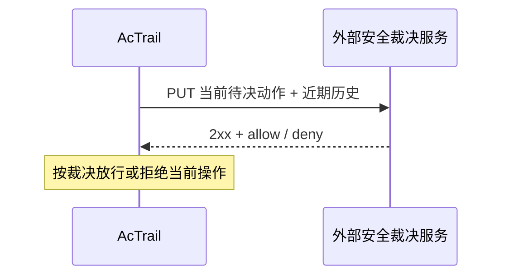

# Grey 外部安全裁决服务协议

适用于 `grey_forwarding` 插件与外部安全裁决服务的对接。



## HTTP 约定

| 项目 | 约定 |
| --- | --- |
| 地址 | `grey_proxy.endpoint` 的完整 URL，同样填入 `host.http.allowed_urls`。路径由服务定义 |
| 方法与正文 | `PUT`，UTF-8 JSON 对象，`Content-Type: application/json` |
| 响应状态码 | 接受 `2xx`，仍须通过正文校验 |
| 响应 Content-Type | 可省略，接受任意合法字段值，例如 `application/json`、`text/plain` |
| 响应正文 | 必须是 UTF-8 JSON 对象，包含有效 `verdict` |
| 超时 | 外部调用受 `host.http.timeout_ms` 限制，当前操作还受 grey 规则等待时限约束 |
| 正文大小 | 请求受 `host.http.request_max_bytes` 限制，响应受 `host.http.response_max_bytes` 限制 |

## 请求字段

| 字段 | 类型 | 含义 |
| --- | --- | --- |
| `decision_id` | string | 用于关联当前待决请求的字符串标识 |
| `operation` | string | 当前操作，例如 `read`、`write`、`open`、`exec`、`connect` |
| `target` | string | 目标路径或网络端点文本，保留来源格式 |
| `argv` | string[]，可选 | 当前待决命令的参数数组，保留参数边界 |
| `history.actions` | object[] | 同一 trace、同一逻辑进程的已有数据库记录。以查询时刻为终点，按 `window_ms` 和 `max_actions` 取最新记录，时间倒序 |
| `history.truncated` | boolean | true 表示历史因数量或字节上限被截断，false 表示本次未截断 |
| `history.error` | string，可选 | 身份缺失或查询失败的原因，此时 actions 为空。空数组需结合 error 和 truncated 判断 |

### 历史记录

| 字段 | 适用记录 | 类型 | 含义 |
| --- | --- | --- | --- |
| `time` | 全部 | integer | Unix epoch 毫秒时间戳 |
| `operation` | 访问裁决 | string 或 null | 历史访问操作 |
| `target` | 访问裁决 | string 或 null | 历史访问目标 |
| `decision` | 访问裁决 | string 或 null | allow 表示授权通过，deny 表示拒绝，null 表示源属性缺失。字段存在即表示裁决记录 |
| `protocol` | 网络裁决 | string，可选 | 网络协议 |
| `operation` | 进程执行 | string | 固定为 exec，该类记录省略 decision 字段 |
| `command` | 进程执行 | string，可选 | 采集参数用空格连接形成的命令文本 |
| `parameters_truncated` | 进程执行 | boolean，可选 | true 表示参数采集被截断 |
| `target` | 进程执行 | string，可选 | 参数不可用时提供的执行目标 |
| `parameters_unavailable` | 进程执行 | boolean，可选 | true 表示参数缺失，使用 target 描述执行目标，省略 command 字段 |
| `result` | 进程执行 | string，可选 | error（失败）、unknown（未知）、in_progress（进行中）。省略表示 exec 成功 |

## 请求示例

```json
{
  "decision_id": "lsm:42",
  "operation": "connect",
  "target": "203.0.113.10:443",
  "history": {
    "actions": [
      {
        "time": 1794367387153,
        "operation": "exec",
        "command": "python3 /work/send.py --upload"
      },
      {
        "time": 1794367387152,
        "operation": "read",
        "target": "/sensitive/credentials",
        "decision": "allow"
      }
    ],
    "truncated": false
  }
}
```

## 响应与故障

| 字段 | 类型 | 约定 |
| --- | --- | --- |
| `verdict` | string，必填 | 精确的小写 allow 或 deny，仅作用于本次操作 |
| `reason` | string，可选 | 裁决说明 |
| 其他字段 | — | 忽略。响应通过本次 HTTP 调用关联 |

| 服务返回或故障 | AcTrail 处理 |
| --- | --- |
| `2xx` + `{"verdict":"allow"}` | 放行 |
| `2xx` + `{"verdict":"deny","reason":"敏感文件读取后的外发不符合策略"}` | 正常拒绝 |
| 非 `2xx`，包括 `3xx`、`403` | 进入 grey 故障处理 |
| 连接失败、超时、正文超限、无效 JSON、缺少或无效 verdict、`204` 空正文 | 进入 grey 故障处理 |
| grey 故障处理 | 按配置放行或拒绝 |

## 相关入口

| 内容 | 链接 |
| --- | --- |
| 构建、配置与采集要求 | [插件 README](../../../crates/plugins/grey_forwarding/README.md) |
| 按敏感读取历史和命令参数拒绝外发的服务示例 | [真实 Xiaoo 端到端用例](../../../tests/v2/regression/grey_proxy_xiaoo/case.py) |
