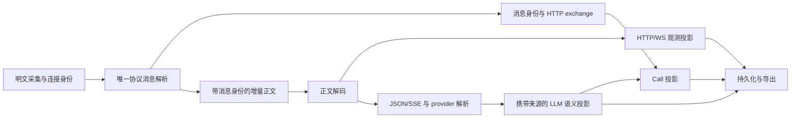

# 流式解析器

> 本文定义 HTTP、SSE、provider、evidence 和语义投影的职责边界。

Status: Accepted
Owner: HTTP 与 LLM 语义投影流水线
Scope: 增量 HTTP/SSE/provider 解析与 stream finalization

## 必需流水线

每条箭头都是一条所有权边界。SSE（Server-Sent Events）是 HTTP response body 中以空行分隔的事件。`SemanticAction` 是 AcTrail 对有意义的 agent 或进程动作进行存储和导出的表示。任何层都不得解析上游协议拥有的 framing；HTTP header、HTTP/1 chunk 语法和 HTTP/2 frame 禁止直接进入 SSE framer。消息投影直接携带已确认的来源身份；HTTP 场景的 Call 只沿权威 HTTP exchange 关系派生。

## 消息身份与关联

协议解析在可信消息边界确认时分配稳定消息身份，后续 Head、BodyChunk、End/Abort 沿用该身份。消息身份独立于完整正文、LLM 分类、观测留存和数据库 EventId 分配；连接作用域包含生命周期，防止 fd 复用串联。采集片段序号不是消息身份，同一片段可包含多条消息。

HTTP exchange 唯一拥有 HTTP 请求—响应关系。LLM request/response 是对应消息的内容投影，不另行按时间、路径或最老待配请求决定 HTTP 归属。HTTP 错误先作为该 exchange 的事实存在，待请求被识别为 LLM 后生成对应失败 response。信息到达顺序只影响投影何时齐全。

HTTP/1 必须处理临时响应、HEAD、CONNECT 和升级边界；捕获缺口后重新找到消息头不能证明配对已经重新对齐。HTTP/2 按连接作用域内 stream ID 关联，消息方向和生命周期仍分别记录。WebSocket 保留消息来源，应用协议内的 request/response 身份决定逻辑 Call；一次 Call 可以消费多条消息。

HTTP/2 frame 观测与 stream 正文语义必须消费同一 decoder 的输出。每个连接方向唯一维护 HPACK 上下文，完整 HEADERS/CONTINUATION 建立消息头与方向正文来源。method、path、status、Content-Encoding 取自解码后的真实字段；trailer 不重建消息身份或内容解码器。每个 stream 方向唯一持有增量内容解码器及有界解码正文，SSE/provider 只消费该正文，原始 DATA 坐标独立用于 evidence。END_STREAM 完成内容解码并证明该方向传输结束，不能单独证明 LLM 成功。关闭 LLM 投影不停止 HPACK、HTTP/2 frame 与消息观测。

WebSocket 在消息开始时分配原生 `websocket.message` 身份，Complete/Abort 沿用同一身份及真实采集时间。frame、continuation、masking 与消息解压由单一协议 owner 处理；完整消息直接交给 provider 内容解析。禁止将 WebSocket 消息包装成 HTTP 或 SSE 后重新解析。provider response ID 及其协议定义的请求顺序决定 Call 归属，响应可通过多个 `llm.response.websocket_message` 来源链接引用多条消息。

握手与后续 frame 必须具有可证明的同一连接身份。连接作用域包含 trace、process、source boundary 与生命周期；跨 stream key 只能使用 producer 提供的稳定连接身份或明确别名关系。单候选、时间邻近、可解码的首帧或进程相同均不能证明连接归属。未确定来源时保留原始事实和局部诊断，不猜配。

WebSocket 来源留存与 LLM 消费分别受 `l2_websocket` 和 `l0_llm_call.websocket` 控制。协议预算不能依赖 LLM 开关或 HTTP exchange 配置。来源工厂不维护第二套消息生命周期状态，不持有正文；来源关闭时不输出指向未留存消息的语义链接。

### 终态持久化

已写入的 LLM response 和 WebSocket message 在正常结束或异常收口时必须通过 `ActionSnapshot` 持久化权威标题及完整属性。属性采用整体替换语义，包含旧字段删除；空集合清除已有属性。更新必须核验 action ID、trace、kind 和 process，不能改变来源身份或开始时间。`Lifecycle` 独立持久化结束时间、状态和完整性。

进行中的轻量 action 不得使终态正文、usage、消息摘要或标题停留在初始值。在线 `updated_actions` 不能代替持久化 update。WebSocket delta 不触发聚合正文快照写入；HTTP/1、HTTP/2 与 WebSocket 共用终态投影契约。

## 增量所有权

- connection router 按 trace、process、connection 和 direction 隔离状态；HTTP/2 再加入 `stream_id`。
- HTTP/1 decoder 只保留未完整 header 或 chunk boundary，并在 transport boundary 已知后释放 wire message。
- HTTP/2 decoder 最多保留一个未完整 frame tail，按 stream ID 解复用完整 DATA frame，禁止把 partial frame 当成未知应用数据。
- SSE framer 只扫描新增后缀，只输出以空行终止的完整事件，最多保留未完整事件状态。
- provider 确认后，由单个 parser object 持有该 stream 的有界语义 aggregate，不保留全部 raw event。
- evidence tracking 使用单调、有界 span，不复制完整 payload。
- HTTP 观测与 LLM 语义消费同一份消息解析结果；正文留存配置不限制在线语义解析的数据来源。
- 本批优先借用字节，跨批只保留必要尾部或有界内容；多消费者共享不可变分块，避免累计正文反复复制。

每层处理输入字节的摊销复杂度必须为线性。connection、stream、header、frame tail、pending event、aggregate、tool call 和 evidence span 的上限必须可配置并在启动时校验。

## 分类

分类状态只有 `Undetermined` 与 `ConfirmedLlm`。ping、comment 或 metadata 不能证明它是普通 SSE。soft sniff budget 只限制初期识别工作；达到预算不得丢弃事件或永久定类，后续完整事件仍可确认 provider。确认后固定 parser，不得对每个事件重新运行 provider registry。

## 收口

provider 的明确终态决定 LLM 内容语义的终态；HTTP boundary 独立决定来源消息的传输完整性。provider 已完成时，HTTP stream 仍需保留至 END/Abort，不得提前释放后重新创建同一来源。HTTP 传输结束本身不能证明 LLM 成功。trace close、capture gap、truncation、硬 buffer limit、protocol mismatch 或 reset 都进入同一个 per-stream finalizer，收口尚未完成的语义与协议状态。

已确认的 LLM stream 若包含有效内容，异常结束时生成 partial/error response 及其 call 关系；否则只生成 compact diagnostic。诊断不得包含 payload body、header 或 token 正文。finalization 与下游写失败只影响当前 logical stream。

内容解析失败不能阻止 HTTP 事实投影。协议损坏按实际影响范围隔离消息、stream 或连接方向；缺失来源或配对时保留不完整事实。Trace 关闭不能生成虚假的完整响应。内部消息增量无需逐块持久化，处理路径不得等待完整响应或下游存储确认。
